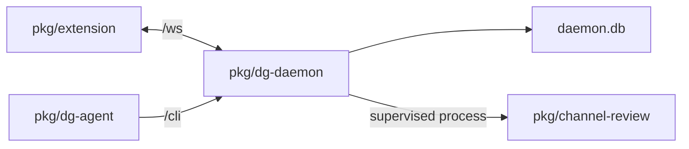

# 0002 — The daemon owns durable sessions and work

Status: Accepted
Date: 2026-10-16

## Context

- Browser service workers can suspend, and an agent CLI can exit between turns.
- Messages need claim and acknowledgment leases across those exits.
- Jobs and supervised services must outlive a single browser connection.

## Decision

The `pkg/dg-daemon` process owns sessions, message queues, assets, scheduled jobs, and service supervision.
The extension connects over `/ws`; `dg-agent` sends authenticated requests to `/cli`. The agent can start the
sibling daemon binary. Channel review remains a separate process that can run as a supervised service.

## Consequences

- Clients reconnect without owning the queue; see `pkg/dg-daemon/src/store/index.ts`.
- A daemon failure interrupts all attached sessions until it restarts.
- Service recovery and browser reconnection have separate lifecycles in `services/supervisor.ts` and `server/connection.ts`.

## Alternatives considered

- An extension-owned queue would depend on service-worker lifetime.
- Direct agent-to-extension messages would require each short-lived client to recover work.
- Running channel review in the hub would couple its runner failures to chat sessions.

## Diagrams

## References

- [pkg/dg-daemon/src/server/http.ts](../../pkg/dg-daemon/src/server/http.ts)
- [pkg/dg-daemon/src/store/index.ts](../../pkg/dg-daemon/src/store/index.ts)
- [pkg/dg-daemon/src/services/supervisor.ts](../../pkg/dg-daemon/src/services/supervisor.ts)
- [pkg/common/src/node/cli-client.ts](../../pkg/common/src/node/cli-client.ts)
