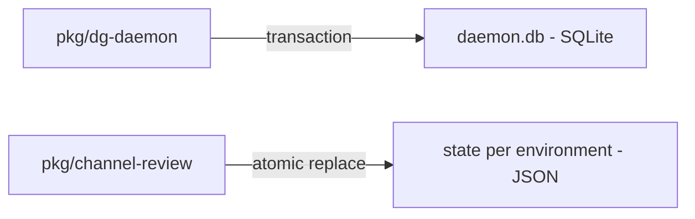

# 0003 — SQLite for daemon state; JSON for channel review

Status: Accepted
Date: 2026-10-16

## Context

- The hub must update claims and delivery state as one transaction.
- Channel review has one state owner and a small restart checkpoint.
- Older state files must remain readable as fields are added.

## Decision

The hub uses `bun:sqlite`, STRICT tables, ordered schema migrations, and immediate write transactions. Channel
review uses an atomically replaced `state.<env>.json` file with shape validation on load. Only event-cursor
updates are coalesced for one second; other state changes save immediately.

## Consequences

- SQLite serializes daemon writes and protects message leases in `store/index.ts`.
- Channel-review checkpoints avoid database setup, but rewrite the state file.
- An abrupt exit can replay the last second of event cursors; handled-message state provides a separate duplicate check.

## Alternatives considered

- JSON cannot provide the hub’s multi-statement claim transactions.
- A second SQLite schema would add migration work for the single-owner channel checkpoint.

## Diagrams

## References

- [pkg/dg-daemon/src/store/schema.ts](../../pkg/dg-daemon/src/store/schema.ts)
- [pkg/dg-daemon/src/store/index.ts](../../pkg/dg-daemon/src/store/index.ts)
- [pkg/common/src/node/sqlite.ts](../../pkg/common/src/node/sqlite.ts)
- [pkg/channel-review/src/state.ts](../../pkg/channel-review/src/state.ts)
