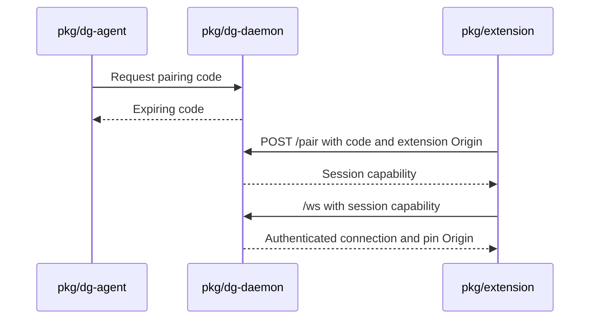

# 0004 — Require origin and capability checks on loopback

Status: Accepted
Date: 2026-10-16

## Context

- An ordinary web page can try to contact a loopback service.
- The extension must acquire a session without exposing a long-lived shared secret.
- Clients must not read assets or messages from another session.

## Decision

The daemon binds `127.0.0.1` and checks the Host authority. Extension WebSockets require an extension-scheme
Origin; the authenticated origin is pinned. Pairing consumes a six-digit code with a five-minute lifetime and
a five-attempt limit. Normal `/cli` requests and asset reads require a session ID and token, compared in
constant time. Credential service grants use the narrower exception in [0006](0006-credential-store.md).

## Consequences

- A valid local connection alone grants no session access; see `server/http.ts`.
- Moving an unpacked extension can require `dg-daemon origin clear`.
- Pairing codes are short-lived bootstrap credentials, while session tokens authorize subsequent requests.

## Alternatives considered

- Binding a LAN address with TLS would add remote access and certificate management.
- A single static token would combine all sessions into one authority.
- Local access without authentication would expose the service to local browser requests.

## Diagrams

## References

- [pkg/dg-daemon/src/server/http.ts](../../pkg/dg-daemon/src/server/http.ts)
- [pkg/dg-daemon/src/server/host-guard.ts](../../pkg/dg-daemon/src/server/host-guard.ts)
- [pkg/dg-daemon/src/server/origin.ts](../../pkg/dg-daemon/src/server/origin.ts)
- [pkg/dg-daemon/src/pairing.ts](../../pkg/dg-daemon/src/pairing.ts)
- [pkg/common/src/node/session-tokens.ts](../../pkg/common/src/node/session-tokens.ts)
