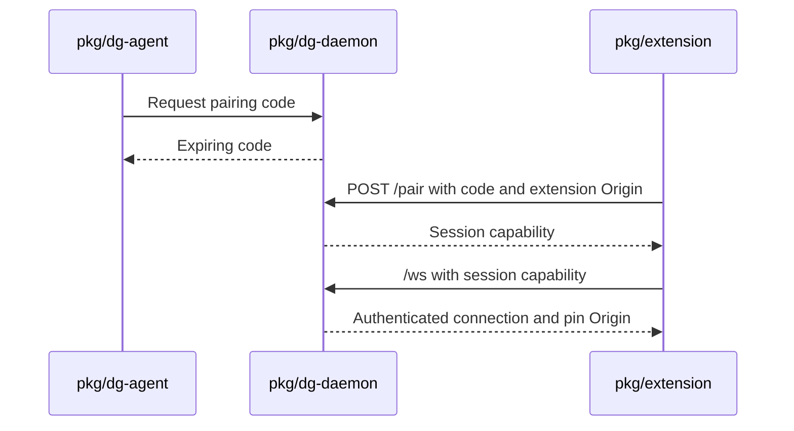
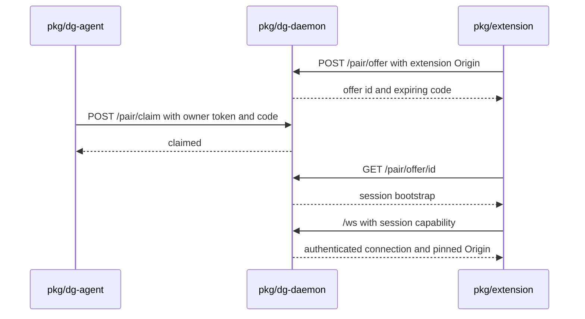

# 0004 — Require origin and capability checks on loopback

Status: Accepted
Date: 2026-10-16

## Context

- An ordinary web page can try to contact a loopback service.
- The extension must acquire a session without exposing a long-lived shared secret.
- Clients must not read assets or messages from another session.

## Decision

The daemon binds `127.0.0.1` and checks the Host authority. Extension WebSockets require an extension-scheme
Origin; the authenticated origin is pinned. Pairing consumes a six-digit code with a five-minute lifetime and
a five-attempt limit. Normal `/cli` requests and asset reads require a session ID and token, compared in
constant time. Credential service grants use the narrower exception in [0006](0006-credential-store.md).

## Consequences

- A valid local connection alone grants no session access; see `server/http.ts`.
- Moving an unpacked extension can require `dg-daemon origin clear`.
- Pairing codes are short-lived bootstrap credentials, while session tokens authorize subsequent requests.

## Alternatives considered

- Binding a LAN address with TLS would add remote access and certificate management.
- A single static token would combine all sessions into one authority.
- Local access without authentication would expose the service to local browser requests.

## Diagrams

## References

- [pkg/dg-daemon/src/server/http.ts](../../pkg/dg-daemon/src/server/http.ts)
- [pkg/dg-daemon/src/server/host-guard.ts](../../pkg/dg-daemon/src/server/host-guard.ts)
- [pkg/dg-daemon/src/server/origin.ts](../../pkg/dg-daemon/src/server/origin.ts)
- [pkg/dg-daemon/src/pairing.ts](../../pkg/dg-daemon/src/pairing.ts)
- [pkg/common/src/node/session-tokens.ts](../../pkg/common/src/node/session-tokens.ts)

## Amended 2026-11-07: offer and claim replace POST /pair

[ADR 0038](0038-extension-pairing-only.md) changed how a session reaches the extension. The origin pin, the owner token, the six-digit code, its five-minute life and the five-attempt limit still hold. The text above stays as the record of the first decision. Where it describes `POST /pair` or says the extension must acquire a session, this amendment replaces it. The origin pin stays the trust anchor. Offer and claim bootstrap only the first pairing.

- The extension no longer creates a session. It asks for an offer with `POST /pair/offer` and shows the code in the pairing popup.
- The agent claims the offer with `dg-agent pair <code>`. The claim is `POST /pair/claim` with the owner token. It refuses any `Origin` header.
- The extension polls `GET /pair/offer/<id>` and receives the session bootstrap once. It then opens `/ws` with the session capability.
- The fifth wrong claim inside one five-minute window expires every pending offer for good, and the popup must ask for a new one. The daemon holds at most 8 pending offers. It trims expired tombstones to 8 when it creates the next offer, and otherwise they expire with their TTL. A lockout can expire 8 pending offers at once, so the map can briefly hold more. It also holds any claimed offer the extension has not polled yet.
- `POST /pair` and `handlePair` no longer exist.

