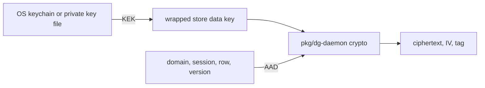

# 0005 — Encrypt secret fields with a wrapped data key

Status: Accepted
Date: 2026-10-16

## Context

- The Bun SQLite binding does not provide whole-database SQLCipher encryption.
- Encrypted rows must not remain valid when copied into another field or session.
- Agent memory uses full-text search and has a separate confidentiality tradeoff.

## Decision

Secret daemon fields use AES-256-GCM envelopes with a fresh IV and additional authenticated data that binds
the domain, session, row, and format version. A key-encryption key from the OS keychain wraps the random store
data key. Supported backends use Linux Secret Service, macOS Keychain, or a Windows DPAPI file; a private key
file is the fallback. A recorded key mismatch refuses to open the store. Agent `memory.db` remains plain text
so full-text search works.

## Consequences

- Copying an envelope to another bound location fails authentication in `crypto/envelope.ts`.
- The key-file fallback relies on filesystem permissions rather than a keychain unlock.
- Memory entries need the same care as other unencrypted local notes; see `pkg/dg-agent/src/memory/store.ts`.

## Alternatives considered

- Whole-file encryption is unavailable through this SQLite binding.
- A keychain entry per field would make normal queue reads depend on many keychain operations.
- Plain-text chat and asset fields would expose stored session content.

## Diagrams

## References

- [pkg/dg-daemon/src/crypto/envelope.ts](../../pkg/dg-daemon/src/crypto/envelope.ts)
- [pkg/dg-daemon/src/crypto/keychain-backends.ts](../../pkg/dg-daemon/src/crypto/keychain-backends.ts)
- [pkg/dg-daemon/src/crypto/key-resolution.ts](../../pkg/dg-daemon/src/crypto/key-resolution.ts)
- [pkg/dg-agent/src/memory/store.ts](../../pkg/dg-agent/src/memory/store.ts)
