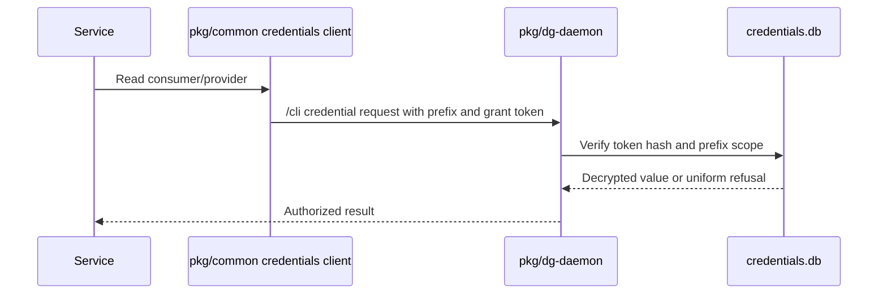

# 0006 — Separate credential storage and prefix-scoped service grants

Status: Accepted
Date: 2026-10-16

## Context

- Services need credential reads without a user chat session.
- Copying the chat database must not also copy credential records or their wrapped data key.
- A service should read only its own credential namespace.

## Decision

Credentials live in `credentials.db` with a separate data key wrapped by the daemon’s KEK. Authenticated data
binds each credential to its table, column, and name. Names follow `<consumer>/<provider>[/<qualifier>]`.
Session-authenticated clients manage entries; services use read-only grants for one consumer prefix. The
private grant token file is mode 0600; the store checks its SHA-256 hash. This implementation is merged in
commit `d764653`.

## Consequences

- Copying only `daemon.db` does not include credentials; possession of all store files and the KEK is a different boundary.
- Grant reads cannot write credentials, and denied names do not reveal whether the name exists.
- CLI management commands never print credential values; internal authorized reads necessarily return values to the consumer.

## Alternatives considered

- A credentials table in the chat database would share its backup and data-key boundary.
- Environment variables alone do not provide encrypted persistence or scoped read grants.
- One keychain item per service credential would bypass the shared store and grant policy.

## Diagrams

## References

- [pkg/dg-daemon/src/store/credentials-store.ts](../../pkg/dg-daemon/src/store/credentials-store.ts)
- [pkg/dg-daemon/src/server/credentials.ts](../../pkg/dg-daemon/src/server/credentials.ts)
- [pkg/common/src/credentials-format.ts](../../pkg/common/src/credentials-format.ts)
- [pkg/common/src/node/credential-grants.ts](../../pkg/common/src/node/credential-grants.ts)
- [pkg/common/src/node/credentials-client.ts](../../pkg/common/src/node/credentials-client.ts)
