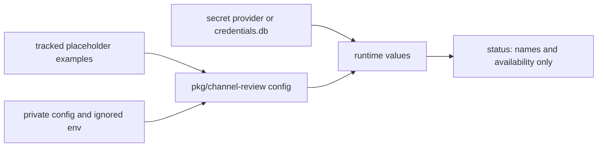

# Keep deployment values out of the public repository

Status: Accepted
Date: 2026-10-16
Topic: Security

## Context

- The source repository is public.
- Relay endpoints, chat IDs, and owner IDs belong to one deployment.
- Health checks must explain missing settings. They must not print secrets.

## Decision

Tracked examples use placeholders. Private configuration, ignored `.env` files, and the encrypted credential
store hold deployment values. Relay secret resolution keeps fetched values in process memory. Automation
status shows the names of set variables and whether they are available. It never shows secret values.

## Consequences

- Examples still work without a deployment’s IDs; see `config.example.json`.
- Operators must set private values apart from the package install.
- Redaction lowers the risk of a leak. It does not allow logging private data.

## Diagram

## Other options

- A committed deployment config would publish IDs. It would also tie releases to one install.
- A built-in private default would point a fresh install at another deployment’s service.

## References

- [plugins/dg/skills/channel-review/references/config.example.json](../../plugins/dg/skills/channel-review/references/config.example.json)
- [.env.example](../../.env.example)
- [.gitignore](../../.gitignore)
- [pkg/channel-review/src/credentials.ts](../../pkg/channel-review/src/credentials.ts)
- [pkg/channel-review/src/automation/start.ts](../../pkg/channel-review/src/automation/start.ts)
