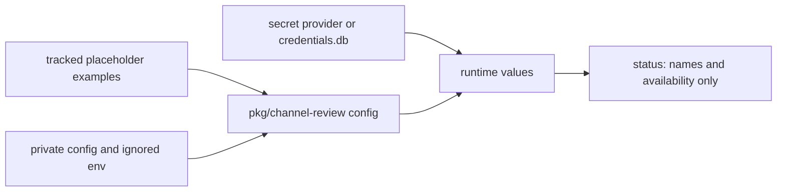

# 0007 — Keep deployment values out of the public repository

Status: Accepted
Date: 2026-10-16

## Context

- The source repository is public.
- Relay endpoints, chat identifiers, and owner identifiers belong to a deployment.
- Health checks need to explain missing configuration without printing secrets.

## Decision

Tracked examples use placeholders. Private configuration, ignored `.env` files, and the encrypted credential
store hold deployment values. Relay secret resolution keeps fetched values in process memory. Automation
status reports configured variable names and availability instead of secret values.

## Consequences

- Examples remain usable without carrying a deployment’s identifiers; see `config.example.json`.
- Operators must provision private values separately from installing the package.
- Redaction reduces accidental disclosure but is not permission to log arbitrary private data.

## Alternatives considered

- A committed deployment config would publish identifiers and couple releases to one installation.
- A built-in private default environment would make a fresh install point at another deployment’s service.

## Diagrams

## References

- [plugins/dg/skills/channel-review/references/config.example.json](../../plugins/dg/skills/channel-review/references/config.example.json)
- [.env.example](../../.env.example)
- [.gitignore](../../.gitignore)
- [pkg/channel-review/src/providers/teams-relay/secret.ts](../../pkg/channel-review/src/providers/teams-relay/secret.ts)
- [pkg/channel-review/src/automation/start.ts](../../pkg/channel-review/src/automation/start.ts)
