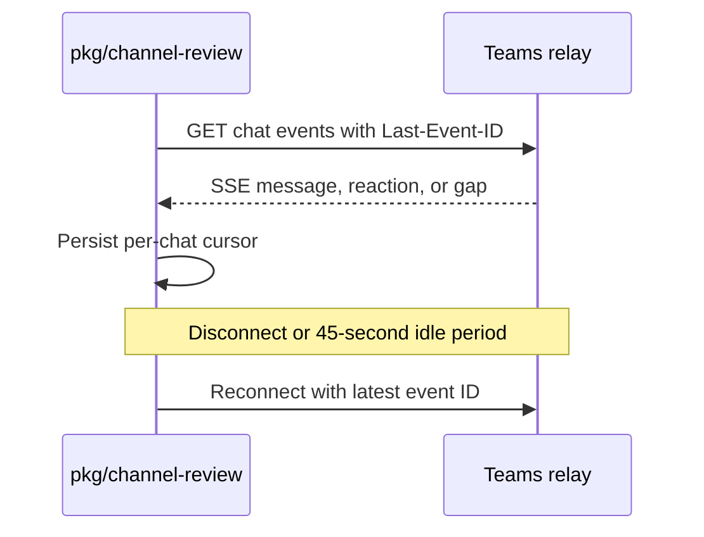

# 0008 — Consume one resumable relay stream per chat

Status: Accepted
Date: 2026-10-16

## Context

- A workstation should not require an inbound webhook endpoint.
- Chat transport and runner execution have different contracts.
- A disconnected stream needs a cursor without blocking other chats.

## Decision

The `ChatProvider` interface supplies chat resolution, subscriptions, reactions, replies, direct messages, and
reaction listing. The Teams adapter consumes one SSE stream per chat and resumes with `Last-Event-ID`. It
reconnects after 45 seconds without data or pings and uses capped backoff with jitter. Direct messages use the
relay’s direct mode. Each chat has an independent stream pump.

## Consequences

- The engine stays independent of the relay HTTP shapes in `providers/types.ts`.
- A failing chat does not stop other stream pumps in `daemon/serve.ts`.
- A cursor cannot recover events a relay no longer retains; gap events remain possible.

## Alternatives considered

- Direct Graph polling would couple the consumer to Graph credentials and polling behavior.
- Inbound webhooks would require a reachable workstation endpoint.
- One shared stream would couple reconnect and cursor state across chats.

## Diagrams

## References

- [pkg/channel-review/src/providers/types.ts](../../pkg/channel-review/src/providers/types.ts)
- [pkg/channel-review/src/providers/teams-relay/subscribe.ts](../../pkg/channel-review/src/providers/teams-relay/subscribe.ts)
- [pkg/channel-review/src/providers/teams-relay/reply.ts](../../pkg/channel-review/src/providers/teams-relay/reply.ts)
- [pkg/channel-review/src/daemon/serve.ts](../../pkg/channel-review/src/daemon/serve.ts)
- [pkg/channel-review/README.md](../../pkg/channel-review/README.md)
