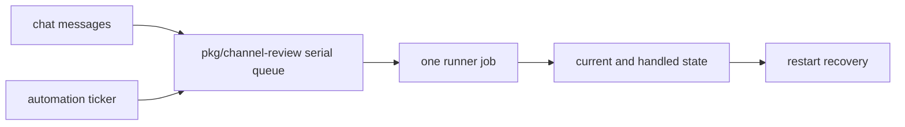

# 0009 — Serialize runner jobs across chats and task kinds

Status: Accepted
Date: 2026-10-16

## Context

- All chats share the same workstation and runner login.
- Review, address, fix, and dependency work can touch shared clone roots.
- Restart recovery must distinguish an old child from a reused process ID.

## Decision

Channel review routes review, address, error-fix, and dependency jobs through one serial queue. In-flight keys
prevent duplicate PR or automation work. Recovery inspects persisted child identity, including process start
time, before terminating a leftover runner and cleaning abandoned work.

## Consequences

- One job executes at a time in `engine.ts`, reducing clone and login contention.
- A long review delays work from every chat.
- Recovery and cleanup need persisted job state; the queue itself is not a durable broker.

## Alternatives considered

- A queue per chat would still allow conflicting runners on one machine.
- A worker pool would require stronger isolation of runner accounts and clone operations.

## Diagrams

## References

- [pkg/channel-review/src/engine.ts](../../pkg/channel-review/src/engine.ts)
- [pkg/common/src/serial-queue.ts](../../pkg/common/src/serial-queue.ts)
- [pkg/channel-review/src/state.ts](../../pkg/channel-review/src/state.ts)
- [pkg/channel-review/src/automation/start.ts](../../pkg/channel-review/src/automation/start.ts)
