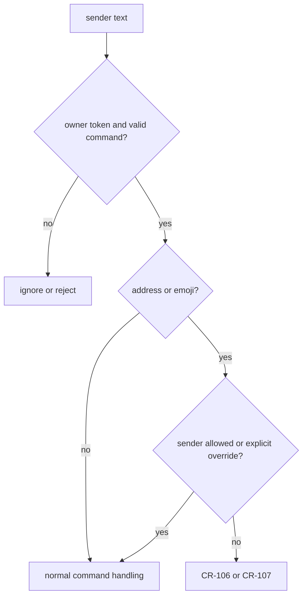

# 0010 — Use an owner token and sender IDs for write-capable chat commands

Status: Accepted
Date: 2026-10-16

## Context

- Chat membership alone does not authorize repository writes or reaction configuration.
- Display names are not stable sender identities.
- Review requests and write-capable commands need different sender policies.

## Decision

Command parsing requires the configured `owner.token` in the sender’s text. Both `$address` and `$emoji` also
require `from.id` in `owner.senderIds`, unless `address.allowAnySender` explicitly permits all senders.
Missing or rejected identities produce CR-106 for address and CR-107 for emoji. The token is an explicit
command gate, not a substitute for sender identity.

## Consequences

- Write-capable commands fail closed when a relay omits the sender ID and the override is off.
- Operators must maintain the private sender allowlist.
- The shared `address.allowAnySender` option also widens emoji access; see `engine.ts`.

## Alternatives considered

- Trusting display names would allow ambiguous identities.
- Fetching chat roles through Graph would introduce a second authorization service.
- An owner token alone would let every reader of that token change configuration or address reviews.

## Diagrams

## References

- [pkg/channel-review/src/trigger.ts](../../pkg/channel-review/src/trigger.ts)
- [pkg/channel-review/src/engine.ts](../../pkg/channel-review/src/engine.ts)
- [pkg/channel-review/src/config.ts](../../pkg/channel-review/src/config.ts)
