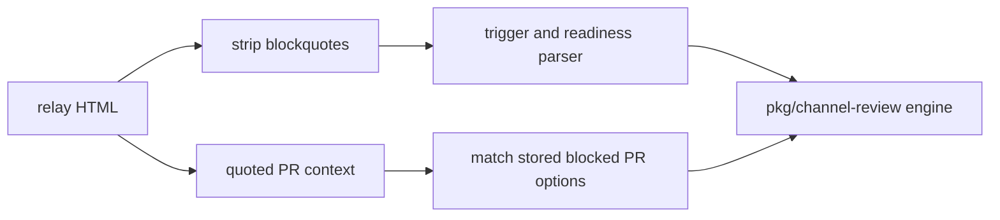

# 0011 — Parse commands only from the sender’s own text

Status: Accepted
Date: 2026-10-16

## Context

- Chat replies can quote an earlier command.
- Replaying a quoted command could run work that the sender did not request.
- A readiness reply may still need the quoted PR to identify blocked work.

## Decision

Trigger and readiness parsing remove HTML blockquotes before recognizing commands. Quoted content can identify
the blocked PR and recover its stored options, but it cannot introduce a new command. The engine resolves that
context separately from command parsing.

## Consequences

- Replying to an old request does not replay its command in `trigger.ts`.
- Quotation handling depends on the relay’s HTML representation.
- Readiness context remains available through the engine’s quoted-option handling.

## Alternatives considered

- Parsing all reply HTML would treat quoted requests as new instructions.
- Discarding quotes everywhere would remove useful blocked-PR context.

## Diagrams

## References

- [pkg/channel-review/src/trigger.ts](../../pkg/channel-review/src/trigger.ts)
- [pkg/channel-review/src/engine.ts](../../pkg/channel-review/src/engine.ts)
