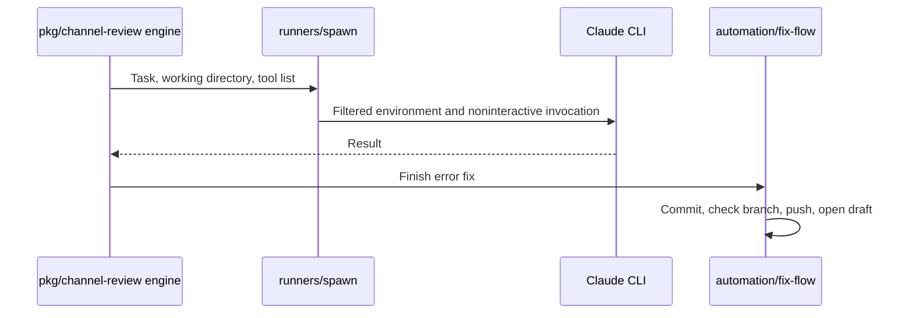

# 0012 — Invoke runner CLIs with task-specific tool lists

Status: Accepted
Date: 2026-10-16

## Context

- Runner credentials and CLI behavior already exist outside channel review.
- Review, address, fix, and dependency tasks need different tools.
- An allowed shell or test command can itself invoke other programs.

## Decision

The Claude runner uses `claude -p`, noninteractive permission settings, and a task-specific `--allowedTools`
list. Child environment filtering removes the configured Claude nesting and control variables; the Claude task
can retain its OAuth token. For error fixes, the prompt asks the runner not to commit or push; channel review
then commits, checks the branch against the expected and default branches, pushes, and opens a draft PR. Codex,
Copilot, and Grok review runners use broader bypass settings and remain experimental.

## Consequences

- Task configuration limits direct tool selection in `runners/index.ts` and `config.ts`.
- Tool allowlists are not an OS sandbox: an allowed test command can run `git push`.
- The fix-flow branch guard protects its own push path; address and dependency skills retain their own workflows.

## Alternatives considered

- An embedded runner SDK would duplicate authentication and skill setup from the installed CLI.
- One shared tool list would grant every task the broadest task’s tools.
- Treating an allowlist as a push sandbox would claim a boundary it does not enforce.

## Diagrams

## References

- [pkg/channel-review/src/runners/index.ts](../../pkg/channel-review/src/runners/index.ts)
- [pkg/channel-review/src/runners/spawn.ts](../../pkg/channel-review/src/runners/spawn.ts)
- [pkg/channel-review/src/config.ts](../../pkg/channel-review/src/config.ts)
- [pkg/channel-review/src/automation/fix-flow.ts](../../pkg/channel-review/src/automation/fix-flow.ts)
