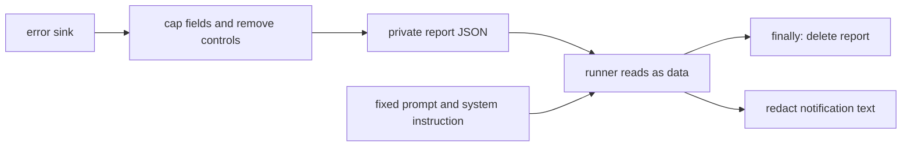

# 0013 — Pass error reports as data files

Status: Accepted
Date: 2026-10-16

## Context

- Error messages and stack traces can contain text controlled by an external user.
- Including that text in the task prompt would blur data and instructions.
- Automation must bound report size and remove temporary report files.

## Decision

Error-fix automation caps report fields, removes control characters, and writes a mode-0600 JSON report beside
the clone. The fixed runner prompt names the file instead of embedding the error text. A separate system
instruction tells the runner to treat the report as untrusted data. Cleanup deletes the report in `finally`.
Notification text passes through bounded redaction.

## Consequences

- The task instruction stays separate from report content in `runners/index.ts`.
- The runner must read a temporary file outside the clone.
- This separation reduces prompt-injection exposure; it cannot prove that a model will ignore every embedded
  instruction. Notification links are appended separately from redacted text.

## Alternatives considered

- Including error text in the prompt would place attacker-controlled content in the prompt.
- Environment variables would still mix large untrusted text into process inputs and could leak through diagnostics.

## Diagrams

## References

- [pkg/channel-review/src/automation/fix-flow.ts](../../pkg/channel-review/src/automation/fix-flow.ts)
- [pkg/channel-review/src/runners/index.ts](../../pkg/channel-review/src/runners/index.ts)
- [pkg/channel-review/src/automation/notify.ts](../../pkg/channel-review/src/automation/notify.ts)
