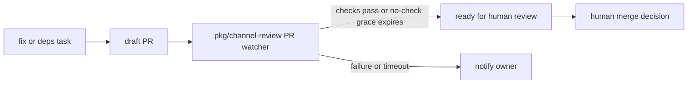

# 0014 — Automation opens drafts and never merges them

Status: Accepted
Date: 2026-10-16

## Context

- An automated fix still needs human review.
- CI completion and merge approval are different decisions.
- Dependency and error-fix flows need a visible handoff.

## Decision

The error-fix flow creates PRs with `--draft`, and dependency automation hands draft PRs to the watcher. The
watcher can mark a draft ready after checks settle successfully, but it never merges. With no checks, the
implementation waits five minutes before marking ready. A person remains responsible for review and merge.

## Consequences

- Generated work is visible before merge in `automation/fix-flow.ts` and `pr-watch.ts`.
- A ready PR does not mean a person approved it, and the no-checks grace period does not supply test evidence.
- Failed or timed-out CI causes notification and ends that watch; it does not authorize a merge.

## Alternatives considered

- Auto-merge on green would replace human review with CI status.
- Opening error fixes as ready immediately would skip the draft handoff.

## Diagrams

## References

- [pkg/channel-review/src/automation/fix-flow.ts](../../pkg/channel-review/src/automation/fix-flow.ts)
- [pkg/channel-review/src/automation/deps-flow.ts](../../pkg/channel-review/src/automation/deps-flow.ts)
- [pkg/channel-review/src/automation/pr-watch.ts](../../pkg/channel-review/src/automation/pr-watch.ts)
- [pkg/channel-review/src/automation/repos.ts](../../pkg/channel-review/src/automation/repos.ts)
