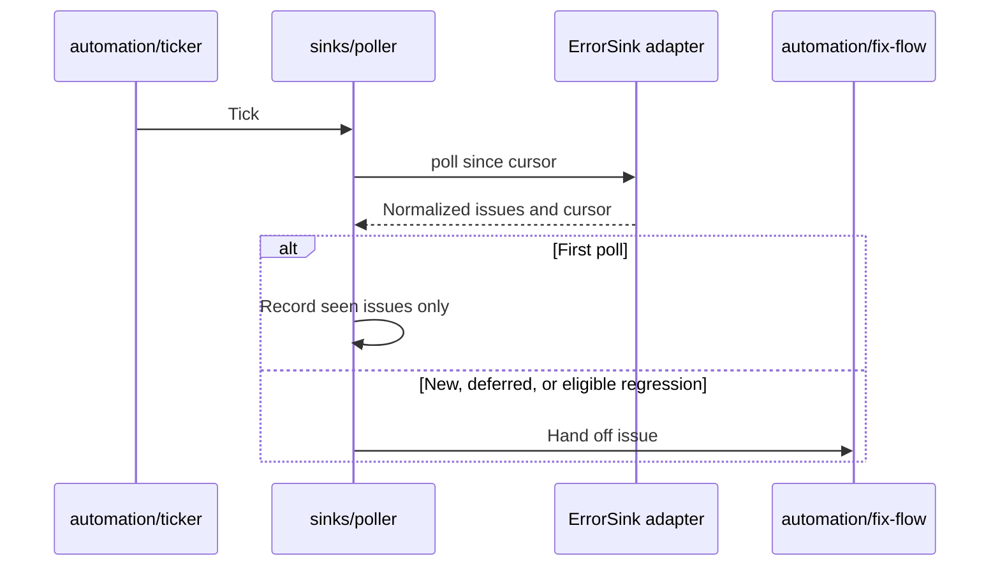

# 0015 — Normalize error providers behind a polling interface

Status: Accepted
Date: 2026-10-16

## Context

- Error providers expose different issue and regression fields.
- Enabling a watcher must not immediately repair every historical issue.
- Provider retries and deferred work need persistent cursors.

## Decision

An `ErrorSink` exposes `name`, `poll({since, signal})`, and `detail(issue)`. The first poll records issues as
seen without starting fixes. Later polls hand off new issues, deferred issues, or regressions newer than the
stored transition, excluding work already fixing. Adapters normalize provider-specific regression fields
before the poller decides.

## Consequences

- Sentry and Datadog share the same fix flow through `sinks/types.ts`.
- Polling adds latency and requires cursor and rate-limit handling.
- A provider’s regression signal affects whether an old issue triggers again; the adapter must preserve its meaning.

## Alternatives considered

- Inbound tracker webhooks would need another reachable endpoint.
- One hard-coded provider would mix provider response shapes into automation policy.

## Diagrams

## References

- [pkg/channel-review/src/sinks/types.ts](../../pkg/channel-review/src/sinks/types.ts)
- [pkg/channel-review/src/sinks/poller.ts](../../pkg/channel-review/src/sinks/poller.ts)
- [Datadog adapter](../../pkg/channel-review/src/sinks/datadog.ts)
- [Sentry adapter](../../pkg/channel-review/src/sinks/sentry.ts)
