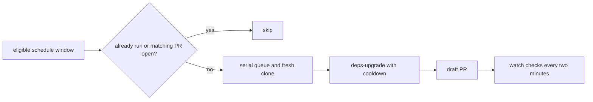

# 0016 — Run dependency work in bounded windows with a cooldown

Status: Accepted
Date: 2026-10-16

## Context

- Dependency upgrades need a per-repository schedule.
- A restart should not replay every missed window.
- An existing dependency PR should prevent a duplicate run.

## Decision

Dependency automation runs once per repository window, without catch-up, and skips repositories with an open
PR matching the configured branch prefix. A fresh clone runs `/deps-upgrade --cooldown-days N` through the
serial queue. The draft PR watcher runs on a two-minute cadence and marks ready only under the policy in
[0014](0014-draft-prs.md). Failures and CI timeouts notify the configured target.

## Consequences

- The package cooldown avoids adopting every newly published version immediately.
- Missed windows wait until a later eligible window rather than creating a backlog.
- The separately installed dependency skill must honor the requested cooldown and draft workflow.

## Alternatives considered

- Upgrading every package to the newest release would remove the package-age delay.
- Automatic dependency merges would skip the human merge decision.

## Diagrams

## References

- [pkg/channel-review/src/automation/deps-flow.ts](../../pkg/channel-review/src/automation/deps-flow.ts)
- [pkg/channel-review/src/automation/schedule.ts](../../pkg/channel-review/src/automation/schedule.ts)
- [pkg/channel-review/src/automation/ticker.ts](../../pkg/channel-review/src/automation/ticker.ts)
- [pkg/channel-review/src/automation/pr-watch.ts](../../pkg/channel-review/src/automation/pr-watch.ts)
