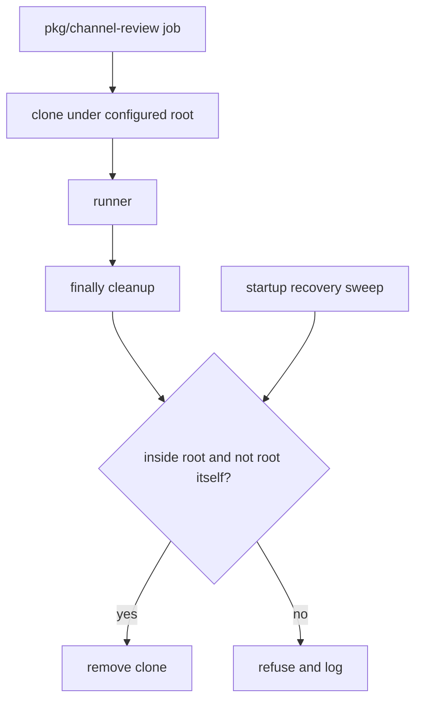

# 0017 — Isolate automation clones and guard recursive deletion

Status: Accepted
Date: 2026-10-16

## Context

- Unattended tasks must not reuse the user’s working checkout.
- Interrupted jobs can leave clones behind.
- A cleanup path error could recursively delete unrelated files.

## Decision

Automation uses an absolute configured clone root outside `~/code`, where worktree tooling can otherwise
relocate work. `removeCloneDir` resolves paths and refuses both the root itself and any path outside it.
Recovery removes interrupted address clones and sweeps abandoned automation clones; dependency completion also
sweeps. Normal job cleanup runs after the job.

## Consequences

- Fresh clones isolate runner changes from a user’s checkout in `automation/repo-job.ts`.
- Cloning costs time and disk space, and interrupted work depends on recovery cleanup.
- The deletion check is a resolved-path containment guard, not a general filesystem sandbox.

## Alternatives considered

- Worktrees under a user checkout would couple automation cleanup to active development.
- System temporary directories without ownership records would make ownership and restart sweeping harder to define.

## Diagrams

## References

- [pkg/channel-review/src/config.ts](../../pkg/channel-review/src/config.ts)
- [pkg/channel-review/src/address.ts](../../pkg/channel-review/src/address.ts)
- [pkg/channel-review/src/automation/repo-job.ts](../../pkg/channel-review/src/automation/repo-job.ts)
- [pkg/channel-review/src/engine.ts](../../pkg/channel-review/src/engine.ts)
