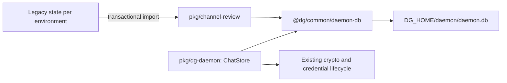

# 0018 — Store channel-review state in the shared daemon database

Status: Proposed
Date: 2026-10-16
Updates: [0003](0003-storage-by-writer.md) (the accepted JSON-state decision).

## Context

Channel-review is a separate process inside `dg-skills`, with a serial in-memory
runner queue. It previously saved one `DG_HOME/channel-review/state.<env>.json`
file per environment. The loopback daemon already owns SQLite at
`DG_HOME/daemon/daemon.db`. A second service-specific database would fragment
operational state and introduce another schema lifecycle.

The old implementation's state includes more than review statuses: per-chat
replay cursors, current process identity, blocked PR options, issue and sink
state, fix rate-limit timestamps, deps run windows, and PR watches. These must
survive the move together. A storage migration does not make the in-memory
queue resumable.

## Decision

Use the existing `daemon.db`. `@dg/common/daemon-db` owns the shared schema-only
opener and the single ordered migration list in
`pkg/common/src/node/daemon-schema.ts`. The old daemon `store/schema.ts` path
re-exports that authority. Both `ChatStore.open` and channel-review call the
same opener; neither imports the other's workspace package. The Bun-specific
entry point is separate from the general Node and browser-safe common barrels.

Central migration 12 adds:

| Object | Purpose |
| --- | --- |
| `channel_review_state` | One complete validated `state_json` snapshot per `env` (`dev` or `prod`), with revision, update time, legacy source, and import time. |
| `channel_review_requests` | SQL view of environment, message ID, status, timestamp, and chat ID from `handled`. |
| `channel_review_current` | SQL view of environment, current message/chat, PR URL/number, start time, PID, and PID start identity. |

Each mutation updates the snapshot atomically. Views derive from that same row,
so no second projection can drift. The revision predicate rejects a stale
writer rather than overwriting another connection's newer snapshot. Dev and
prod share the file but have separate primary-key rows. Existing request IDs
and retention rules remain unchanged.

Only the shared migration runner updates `PRAGMA user_version`; there is no
service-local version counter. Connections use WAL, foreign keys, and the
existing five-second busy timeout. Initial WAL lock upgrades retry bounded
`SQLITE_BUSY` failures, which can bypass SQLite's busy handler. Schema steps use
`BEGIN IMMEDIATE` and recheck the version under the write lock. Existing stores
get the normal pre-migration SQLite snapshot. Both main-daemon-first and
review-service-first startup are supported, including overlapping connections.

The opener does not initialize `crypto_meta`, resolve keys, open credentials.db,
or authenticate to a browser. `ChatStore` retains sole responsibility for its
existing encryption/key lifecycle. Channel-review retains its existing
plaintext operational-state boundary inside the private daemon directory;
placing its previously plaintext state here does not decrypt or change any
chat, inbox, credential, or key records. Relay secrets remain in memory and
config retains references rather than secret values. Encrypting this operational
payload in a future decision would require deliberate shared key/API design.

## Legacy import guarantees

On the first writable open of an environment, an immediate transaction checks
for its row, reads and validates only that environment's JSON source, and
inserts the entire snapshot plus import metadata. The inserted row is also the
initialization marker, including when there was no legacy file. Import and
marker commit together. An existing row always wins; retained or subsequently
modified JSON is never imported over newer database state.

The legacy file stays untouched, even after success, as the recovery source.
Malformed JSON or malformed known fields fail visibly without creating an
initialized row. An interrupted/failed import leaves the source intact and
can retry after repair; SQLite rolls back partial transactions. A scalar legacy
`lastEventId` requires a resolved chat before import; per-chat IDs take
precedence. Status reads are read-only, do not create or migrate a database,
and do not consume an import. State read failures produce a named status error
and exit 1 rather than masquerading as empty state.

## Restart semantics and tradeoffs

The move preserves current behavior: recovery prunes handled entries older than
24 hours, marks surviving pending/running requests failed, reports CR-205, and
clears current. It only kills a recorded runner whose PID, PID start identity,
command line, and age meet the existing checks. Interrupted fix/deps work is
failed under the existing recovery logic. Requests are not reconstructed or
automatically rerun. Per-chat replay and sink cursors, blocked options, scheduling
history, and watches remain durable. Replay cursor writes still coalesce for
up to one second; job writes and orderly close flush held cursors.

A complete JSON snapshot keeps the existing state API small and preserves all
fields in one transaction. It rewrites a bounded operational snapshot and
request-view queries scan JSON rather than an indexed request table. The
existing 24-hour handled retention bounds normal review history. Independent
writers for the same environment are refused; this is not a multi-worker queue
or a scheduler redesign. Sensitive operational identifiers still require
protecting the database, snapshots, and retained legacy JSON.

## Validation and deployment

Regression tests exercise version-11 daemon.db with encrypted messages and
unchanged key metadata, both startup orders, concurrent schema initialization,
transaction failure/retry, source retention/idempotency, separate environment
rows, query views, replay cursors, existing CLI status/start/stop behavior, and
interrupted work across two real service lifecycles using isolated test seams.
No development test migrates a live database.

Deploy `dg-daemon` and `dg-skills` builds that both support central schema 12.
Older binaries deliberately refuse the newer database on their next open;
installing only a new skills binary can therefore prevent an old daemon from
restarting. Stop both old processes before the first import, back up operational
files and the database using the established maintenance procedure, install the
compatible pair, and start normally. No downgrade or export-back-to-JSON is
implemented. Keep legacy sources until migration has been verified; do not run
an old JSON writer alongside the new service.

## Merge and ADR integration

This record is Proposed while the implementation is off master and appears in
the ADR index. When the implementation merges, mark it Accepted and add a
linked partial supersession to [0003](0003-storage-by-writer.md) for its
channel-review JSON decision. Preserve that record’s historical Decision and
its unrelated daemon storage decision.

## Source evidence

- [Shared opener](../../pkg/common/src/node/daemon-db.ts)
- [Central schema and migration 12](../../pkg/common/src/node/daemon-schema.ts)
- [Migration runner](../../pkg/common/src/node/sqlite.ts)
- [Review state/import API](../../pkg/channel-review/src/state.ts)
- [Existing restart recovery](../../pkg/channel-review/src/engine.ts)
- [Encrypted database compatibility tests](../../pkg/dg-daemon/__tests__/store/channel-review-state.spec.ts)
