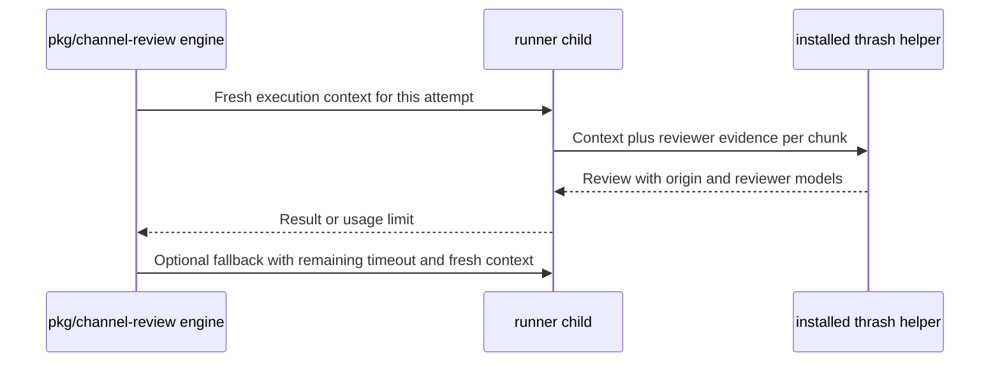

# 0019 — Pass review origin and model evidence across runner attempts

Status: Proposed
Date: 2026-10-16

## Context

- The daemon invokes an independently installed thrash skill and helper.
- An automatic review and a direct CLI review must identify their origin.
- A reviewer can use a different model from the parent runner.
- Claude quota exhaustion can require another backend for the same request.

## Decision

Each review attempt passes fresh JSON in `THRASH_EXECUTION_CONTEXT`: origin,
backend, optional model, and modelSource (requested, configured, or default).
The child environment drops inherited `THRASH_*` values. Daemon reviews use
origin daemon, while direct runner calls default to manual. Current-job state
and local logs retain the orchestration evidence. This extends the invocation
boundary in [0012](0012-runner-boundaries.md).

The separately deployed thrash helper records actual reviewer evidence per
chunk and labels public reviews Automatic (daemon) or Manual (CLI), with the
reviewer models. Parent context alone cannot prove a reviewer model; unresolved
models stay explicit. Deploy compatible helper and skill instructions with the
runner changes; old helpers do not consume the context.

A Claude review that returns CR-207 may retry once with the configured fallback,
Codex by default, after its readiness probe succeeds. The fallback gets a fresh
context, its own model default and log, and the remaining original timeout.
The daemon replies to the triggering chat request that Claude is out of tokens
and names the fallback. It does not send an owner DM for a review fallback.
Authentication errors, cancellation, and write tasks do not trigger this retry.

## Consequences

- Fallback never retains a requested Claude model or inherited reviewer evidence.
- Configured Grok models remain visible without claiming a resolved runtime ID.
- Public attribution requires a coordinated user-owned helper and skill deployment.
- Grok readiness checks use models and inspect --json without generating a review.

## Alternatives considered

- Inferring origin from the presence of a daemon would mislabel manual reviews.
- Reporting the parent model as every reviewer would hide mixed-model work.
- Retrying every runner error could repeat write tasks or hide authentication failures.

## Diagrams

## References

- [Attempt execution and fallback](../../pkg/channel-review/src/engine.ts)
- [Runner context](../../pkg/channel-review/src/runners/index.ts)
- [Environment filtering](../../pkg/channel-review/src/runners/spawn.ts)
- [Grok readiness](../../pkg/channel-review/src/runners/grok.ts)
- [Quota and fallback regressions](../../pkg/channel-review/__tests__/core-engine-fallback.spec.ts)
- [Deployment contract](../DEVELOPER.md#review-attribution)
