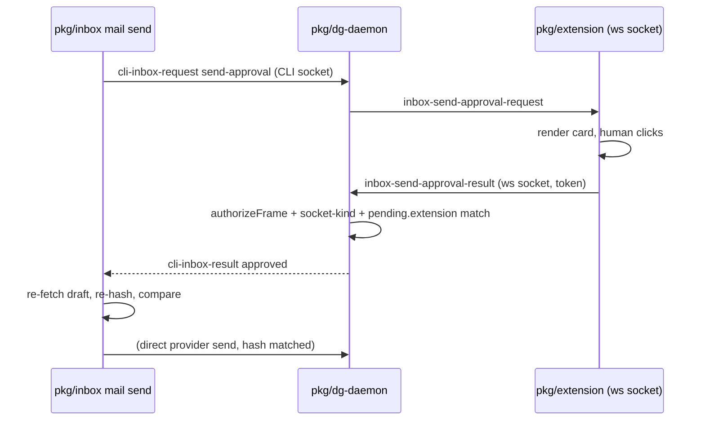

# 0020 — Require a human browser click for outgoing mail

Status: Proposed
Date: 2026-10-23

## Context

- `mail send` lets an agent hand a drafted message to a human for a final decision, not send it unattended.
- The CLI session and the extension session share one daemon process, so a naive gate based on session identity alone does not separate "the agent" from "the human".
- The CLI socket already holds the session token (it needs it to send other authenticated frames), so a token check alone cannot be the only gate on an approval result.
- A draft can be edited by another command between the human's click and the actual send.
- The daemon must never print or forward the session token to a surface an agent can read.

## Decision

`mail send` (`pkg/inbox/src/mail/send.ts`) resolves the draft, hashes its
`to`/`cc`/`subject`/`text`, and asks the daemon to broker approval through the
one extension peer on the session (`pkg/dg-daemon/src/server/inbox.ts`,
`handleInboxCli` with `operation: "send-approval"`). The daemon forwards
`inbox-send-approval-request` to that peer and gates the extension version at
1.22.0 or newer, since only that version renders the approval card.

Only a frame from a socket with `data.kind === "ws"` can settle the pending
request. `dispatchFrame` (`pkg/dg-daemon/src/server/frame-handlers.ts`) rejects
`inbox-send-approval-result` from any other socket with
`sendError(..., "inbox-send-approval-result is accepted only on the extension
socket")`, before the frame reaches `handleInboxSendApprovalResult`. That
handler re-checks the frame's token against the session's token in constant
time through `authorizeFrame`, and settles only the pending request whose
stored `extension` socket reference matches the caller — a CLI socket that
also holds the session token is still refused by the socket-kind check alone.
The extension (`pkg/extension/lib/features/inbox-send-approval.ts`) renders
the exact unredacted draft as text and sends `inbox-send-approval-result`
only on a click.

After the daemon reports `approved: true`, `mail/send.ts` re-fetches the
draft, recomputes its hash, and aborts with `mail-send-aborted` /
`draft-changed` when it no longer matches the hash shown to the human,
instead of sending a message the human never actually reviewed.

## Consequences

- **Good:** an agent on the CLI socket cannot forge approval even with the session token (`pkg/dg-daemon/__tests__/server/inbox-send-approval.spec.ts`).
- **Good:** a draft edited after the click cannot be sent silently (`pkg/inbox/test/mail-send.test.ts`).
- **Bad:** sending mail now requires a human with the extension open and connected; there is no unattended path, by design.
- **Neutral:** the extension's self-expiry timer for the card (`INBOX_SEND_APPROVAL_MAX_TIMEOUT_MS`) is independent of the CLI's `--wait`; a click after the daemon's own timeout is simply ignored, so the card can stay open longer than the CLI waited.

## Alternatives considered

- **TTY-only prompt.** Simple and needs no extension, but `script -q` defeats an `isTTY` check, and it pulls the human out of the chat they are already in.
- **No CLI send in this release.** Smallest change, but it does not give the requested `send` command; the agent would have to ask the human to send a server-side draft from their own mail client.
- **Relay the approval code through the agent.** The agent would see or pass along the thing that authorizes the send, defeating the point of a human-only channel.

## Diagrams

## References

- `pkg/dg-daemon/src/server/inbox.ts`
- `pkg/dg-daemon/src/server/frame-handlers.ts`
- `pkg/extension/lib/features/inbox-send-approval.ts`
- `pkg/inbox/src/mail/send.ts`
- `pkg/dg-daemon/__tests__/server/inbox-send-approval.spec.ts`
- `pkg/inbox/test/mail-send.test.ts`
- [Origin and capability checks on loopback](0004-loopback-pairing.md)
