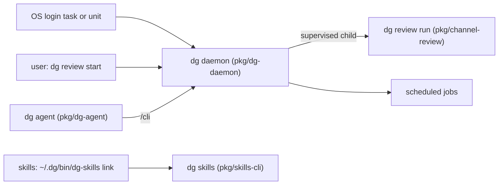

# 0020 — One `dg` command and binary that supervises channel review

Status: Proposed
Date: 2026-10-22

## Context

- dg ships three compiled Bun binaries: `dg-skills`, `dg-daemon`, and `dg-agent`. Each is about 80 to 90 MB,
  and each has its own release tag prefix.
- Channel review runs from `dg-skills channel-review start`. It keeps its own pid file and runs detached.
  Nothing starts it again after WSL or the machine restarts.
- `dg-daemon` can already supervise services with restart backoff, log rotation, and an env file
  (`pkg/dg-daemon/src/services/supervisor.ts`). No install step registers channel review as a service.
- Nothing starts `dg-daemon` at login. `dg-agent` starts it only when a session needs it
  (`pkg/dg-agent/src/start.ts`).
- [ADR 0002](0002-daemon-hub.md) keeps channel review out of the daemon process, so a runner crash does not
  drop chat sessions.
- About 112 files call `~/.dg/bin/dg-skills` by its literal path.

## Decision

dg ships one compiled binary, `dg`. The names `dg-skills`, `dg-daemon`, and `dg-agent` stay as links to it.
The binary reads the name it was started with and runs the matching command tree. On Windows, the old names
are hard links or small `.cmd` shims. The command tree is grouped by purpose: `dg daemon`, `dg review`, `dg
service`, `dg job`, `dg agent`, `dg skills`, `dg install`, `dg upgrade`, `dg doctor`, and `dg autostart`.

Channel review runs as a supervised child service of `dg-daemon`, not inside the daemon process. `dg review
start --env <env>` starts the daemon if it is not running, registers the `review-<env>` service if it is
missing, and starts it. `dg review stop` waits up to two minutes for a running review, then stops the service.
The channel-review pid file goes away. `dg review run` stays for foreground debugging.

`dg autostart install` starts `dg-daemon` at login. It writes a systemd user unit and turns on linger on Linux
and WSL, a launchd LaunchAgent on macOS, and a scheduled task on Windows. In WSL, it also adds a Windows login
task that runs `wsl.exe -d <distro> --exec true`, so WSL boots and its systemd unit starts. `dg autostart
remove` undoes all of it.

## Consequences

- **Good:** one command to learn, one binary of about 90 MB in place of about 250 MB, and one version to keep
  in sync.
- **Good:** a crashed or hung review restarts with the supervisor's backoff, and the daemon and its reviews
  start again after a reboot.
- **Good:** one owner for the review process, so `dg review` and `/dg:jobs` cannot disagree about its state.
- **Bad:** a `dg-daemon` restart also restarts channel review. A review that is running ends with CR-205.
- **Bad:** the release flow changes from four tags to one, and the release guards in
  `pkg/skills-test/__tests__/release-triggers.spec.ts` must change with it.
- **Neutral:** skills keep calling `~/.dg/bin/dg-skills`. The link sends the call to `dg skills`.

## Alternatives considered

- **A thin `dg` dispatcher over the three binaries.** It keeps three binaries, three versions, and about 250
  MB.
- **One binary with the old names removed.** It breaks the 112 literal paths and the skills that older
  releases installed.
- **Channel review inside the daemon process.** A runner crash or memory leak would drop every chat session,
  which ADR 0002 rejects.
- **Keep the pid file and let the supervisor watch it.** Two owners for one process can disagree about its
  state.
- **Start the daemon from the shell profile.** It starts only when a shell opens, and it does not work on
  Windows.

## Open questions

- **Service env.** How the `review-<env>` service gets the Bedrock profile and region (an `envFile` from
  `runner.claude.bedrock`, or the service reads the config itself), and how an expired AWS SSO session is
  shown while the service runs unattended.
- **Compatibility and migration.** How the four release tags become one, how an install with three binaries
  upgrades, and how a user rolls back.

## Diagrams

## References

- [ADR 0002 — The daemon owns durable sessions and work](0002-daemon-hub.md)
- `pkg/dg-daemon/src/services/supervisor.ts`
- `pkg/dg-daemon/src/services/config.ts`
- `pkg/dg-agent/src/start.ts`
- `pkg/channel-review/src/paths.ts`
- `pkg/skills-test/__tests__/release-triggers.spec.ts`
