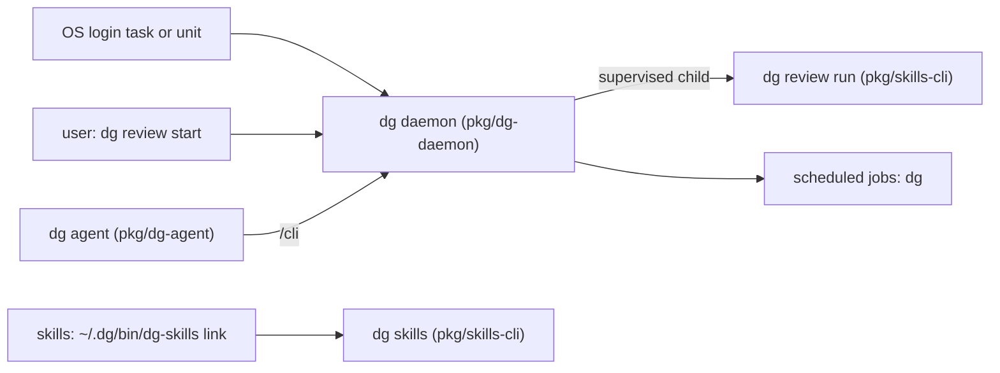

# 0020 — One `dg` command and binary that supervises channel review

Status: Proposed
Date: 2026-10-22
Note: every decision below is settled. Status stays Proposed until the owner accepts the build.

## Context

- dg ships three compiled Bun binaries: `dg-skills`, `dg-daemon`, and `dg-agent`. Each is about 80 to 90 MB,
  and each has its own release tag prefix.
- Channel review runs from `dg-skills channel-review start`. It keeps its own pid file and runs detached.
  Nothing starts it again after WSL or the machine restarts.
- `dg-daemon` can already supervise services with restart backoff, log rotation, and an env file
  (`pkg/dg-daemon/src/services/supervisor.ts`). No install step registers channel review as a service.
- Nothing starts `dg-daemon` at login. `dg-agent` starts it only when a session needs it
  (`pkg/dg-agent/src/start.ts`).
- [ADR 0002](0002-daemon-hub.md) keeps channel review out of the daemon process, so a runner crash does not
  drop chat sessions.
- About 112 files call `~/.dg/bin/dg-skills` by its literal path.

## Decision

dg ships one compiled binary, `dg`. The names `dg-skills`, `dg-daemon`, and `dg-agent` stay as links to it.
The binary reads the name it was started with and runs the matching command tree. On Windows, the old names
are hard links or small `.cmd` shims. The command tree is grouped by purpose: `dg daemon`, `dg review`, `dg
service`, `dg job`, `dg agent`, `dg skills`, `dg install`, `dg upgrade`, `dg doctor`, and `dg autostart`.

Channel review runs as a supervised child service of `dg-daemon`, not inside the daemon process. `dg review
start --env <env>` starts the daemon if it is not running, registers the `review-<env>` service if it is
missing, and starts it. `dg review stop` waits up to two minutes for a running review, then stops the service.
The channel-review pid file goes away. `dg review run` stays for foreground debugging.

`dg-daemon` is the long-running service and nothing else: the session hub, the store, the job scheduler,
the service supervisor, and the socket API. It has no command tree of its own; `dg daemon run` starts it.
Every command lives in `pkg/skills-cli`, which builds the `dg` binary. That includes the channel-review
engine (`dg review run --env <env>` is the service entry), the client side of `dg-agent` (attach,
overwatch, phone-friend), `inbox`, and a thin `dg daemon` client for the socket. A daemon service or job is
a stored `dg <command>` argument list. The supervisor starts, watches, and restarts those processes, so any
`dg` command can become a job or a service without new daemon code, and each review still runs in its own
process. One copy of each shared pattern lives in `pkg/common`: paths, config, credentials, the error
catalog, process spawn, JSON output with redaction, wire formats, and the doctor check type. That leaves
five packages: `common`, `skills-cli`, `dg-daemon`, `skills-test`, and `extension`.

The `review-<env>` service declaration carries no `envFile`. Channel review reads `runner.claude.bedrock`
(profile and region) from its own config at every start, so a supervisor restart always picks up the current
config instead of a snapshot that can drift out of step with it. When the AWS SSO session for that profile
expires while the service runs unattended, the runner that hits the expiry already starts
`aws sso login --profile <profile>` itself, once per expiry (`pkg/channel-review/src/runners/index.ts`), and
the owner approves it in the browser. The review that hit the expiry fails with CR-208. The service does not exit, so
the supervisor's restart loop in `pkg/dg-daemon/src/services/supervisor.ts` never engages; it restarts a
service only when its process exits, and CR-208 is a review result, not a process exit.

`dg autostart install` starts `dg-daemon` at login. It writes a systemd user unit and turns on linger on Linux
and WSL, a launchd LaunchAgent on macOS, and a scheduled task on Windows. In WSL, it also adds a Windows login
task that runs `wsl.exe -d <distro> --exec true`, so WSL boots and its systemd unit starts. `dg autostart
remove` undoes all of it.

The release flow moves to one tag, `dg-v<x>`, cut from the commit that builds the single `dg` binary. For two
minor releases after the switch, every release also tags that same commit with the old prefixed tags
(`skills-v`, `daemon-v`, `agent-v`) and the extension's `ext-v` tag, so installs, bootstrap URLs, and
self-update that still look for the old tags keep working. An upgrade replaces the three old binaries with
`dg` plus the `dg-skills`, `dg-daemon`, and `dg-agent` links. A rollback runs the bootstrap of an older tag,
which installs the three separate binaries again. After the bridge, the release publishes only `dg-v`. It
keeps publishing `ext-v` too: the extension is a separate artifact for the Chrome store channel, not one of
the three binaries this ADR merges, and that channel still needs its own tag.

## Consequences

- **Good:** one command to learn, one binary of about 90 MB in place of about 250 MB, and one version to keep
  in sync.
- **Good:** a crashed or hung review restarts with the supervisor's backoff, and the daemon and its reviews
  start again after a reboot.
- **Good:** one owner for the review process, so `dg review` and `/dg:jobs` cannot disagree about its state.
- **Good:** `review-<env>` reads `runner.claude.bedrock` from the channel-review config at every start, so
  there is no generated `envFile` to fall out of sync with it.
- **Bad:** a `dg-daemon` restart also restarts channel review. A review that is running ends with CR-205.
- **Bad:** the release flow changes from four tags to two, with a two-minor-release bridge that publishes all
  five tags on one commit. The release guards in `pkg/skills-test/__tests__/release-triggers.spec.ts` change
  twice: once to add the bridge, and again when the old three prefixed tags stop.
- **Neutral:** skills keep calling `~/.dg/bin/dg-skills`. The link sends the call to `dg skills`.
- **Neutral:** an expired AWS SSO session fails only the review that hit it, with CR-208. The owner approves
  the sign-in the runner already started; `review-<env>` and the supervisor are not involved, so no restart
  loop follows.

## Alternatives considered

- **A thin `dg` dispatcher over the three binaries.** It keeps three binaries, three versions, and about 250
  MB.
- **One binary with the old names removed.** It breaks the 112 literal paths and the skills that older
  releases installed.
- **Channel review inside the daemon process.** A runner crash or memory leak would drop every chat session,
  which ADR 0002 rejects.
- **Keep the pid file and let the supervisor watch it.** Two owners for one process can disagree about its
  state.
- **Start the daemon from the shell profile.** It starts only when a shell opens, and it does not work on
  Windows.
- **A generated `envFile` for `review-<env>`.** It would drift once `runner.claude.bedrock` changes in the
  channel-review config, so the service and the config could disagree about the profile or region.
- **Only flag the expired SSO session, without starting sign-in.** The owner chose to have the runner start
  `aws sso login` itself instead of just reporting the expiry.
- **A hard cut straight to `dg-v`.** Old installs, bootstrap URLs, and self-update that still look for the
  prefixed tags would break the day the switch ships, so every one of them would need to re-bootstrap by hand.
- **Keep four tags forever.** It never lets the project collect on the one-version gain this ADR is for.

## Diagrams

## References

- [ADR 0002 — The daemon owns durable sessions and work](0002-daemon-hub.md)
- `pkg/dg-daemon/src/services/supervisor.ts`
- `pkg/dg-daemon/src/services/config.ts`
- `pkg/dg-agent/src/start.ts`
- `pkg/channel-review/src/paths.ts`
- `pkg/channel-review/src/runners/index.ts`
- `pkg/skills-test/__tests__/release-triggers.spec.ts`
