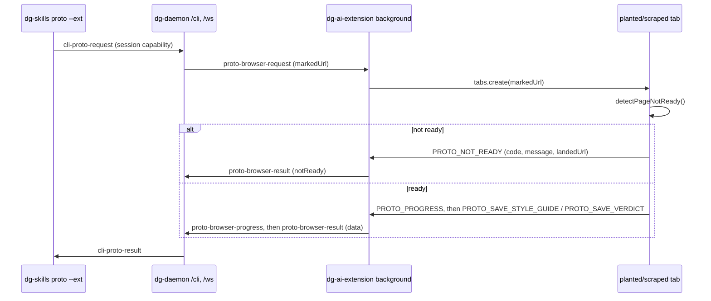

# 0021 — Relay `--ext` scrape and plant through the daemon instead of Downloads

Status: Proposed
Date: 2026-10-24

## Context

- `dg-skills proto --ext scrape|plant` opened a marked URL with the system browser
  opener, then polled a fixed `~/Downloads/dg-proto/<slug>/` path for a file the
  extension wrote with `chrome.downloads.download(...)`.
- A page that never loads the target content — a login wall, a redirect, an HTTP
  error page — never runs the content script's scrape/plant code, so the
  extension never issues a download. The CLI then polls an empty folder for the
  full timeout (120s) with no signal about what actually happened in the browser.
- `pkg/dg-daemon` and `pkg/extension` already carry an authenticated CLI↔daemon↔extension
  relay for `dg-skills inbox` (`pkg/dg-daemon/src/server/inbox.ts`,
  `pkg/extension/lib/background/inbox.ts`): the CLI opens a WebSocket to the
  daemon's `/cli` endpoint with a session capability, the daemon forwards the
  request to the one paired extension over `/ws`, and relays its reply back.
- Downloads also surprise the user with files they did not ask to save, and
  "ask where to save each file" or a relocated Downloads folder silently breaks
  the whole flow with no good error.

## Decision

`--ext scrape` and `--ext plant` relay through the same daemon session pattern
`inbox` uses, instead of the filesystem. `pkg/common` adds `cli-proto-request`/
`cli-proto-result` to `CliFrame` and `proto-browser-request`/`proto-browser-result`/
`proto-browser-progress` to `ChatFrame`. `pkg/dg-daemon/src/server/proto.ts` mirrors
`inbox.ts`: it holds one pending record per `(sessionId, requestId)`, forwards the
CLI's request to the session's paired extension, and resolves the CLI's request
when the extension answers, times out, or the session closes — tracking the
extension's last progress report so a timeout names what it last saw. The CLI
(`pkg/skills-cli/src/commands/proto.ts`) connects with `CliClient`/`resolveCliSession`
exactly as `inbox` does, and never touches Downloads or any browser-process
filesystem path. The extension's background script
(`pkg/extension/lib/background/proto.ts`) opens the marked URL in a new tab,
correlates the content script's eventual report by that tab's id (never by
slug, so concurrent requests cannot cross), and relays scrape/plant results,
not-ready errors, and progress back to the daemon. The content script
(`pkg/extension/entrypoints/demo-tour.content.ts`) runs a new `detectPageNotReady`
check (`http-error`, `login-page`, `redirected`) before scraping or planting and
reports a typed `ProtoNotReadyError` — code, message, and the URL it actually
landed on — instead of silently doing nothing.

## Consequences

- **Good:** a login wall, redirect, or HTTP error page now fails fast with a
  typed code and the landed URL (`ProtoNotReadyFailure` in
  `pkg/skills-cli/src/commands/proto.ts`), instead of a silent 120-second
  Downloads-folder timeout.
- **Good:** no browser download, no "ask where to save each file" prompt, and
  no Downloads-folder/relocation failure mode; `dg-skills proto --ext` requires
  only the same daemon session pairing `inbox` already requires.
- **Good:** a generic timeout now names the extension's last reported status
  (`pkg/dg-daemon/src/server/proto.ts`'s `lastStatus`), not a bare "timed out."
- **Bad:** `--ext` now has a hard runtime dependency on a live `dg-daemon` with a
  registered session and a paired extension — a precondition `--ext` did not
  have before (Downloads-polling worked with no daemon running at all). A user
  who has not run `dg-agent start --open` and opened the session's `/start#_chat=`
  URL in the extension's browser now gets a connection error instead of a slow
  Downloads timeout.
- **Bad:** an extension build older than this change silently ignores the new
  `proto-browser-request` frame type until the CLI's relay timeout fires,
  because the extension's own version was not bumped in lockstep (see
  "Alternatives considered").
- **Neutral:** `~/Downloads/dg-proto/<slug>/` folders from an older `dg-skills`
  are simply unused now; nothing reads or writes them, and deleting them is
  always safe.

## Alternatives considered

- **Keep polling Downloads, add a page-readiness heartbeat file.** Still
  requires a filesystem round trip through the browser process and still
  surprises the user with a download; does not fix the "ask where to save"
  failure mode.
- **Bump the extension's version with this change.** The project's matched-set
  version rule ties the extension, `dg-skills`, `dg-daemon`, and `dg-agent` to
  one release version; this change does not touch that release process, so the
  version was left unbumped and the mismatch window above is accepted rather
  than forced into an out-of-band release.

## Diagrams

## References

- `pkg/common/src/proto-format.ts`
- `pkg/common/src/chat-format.ts`
- `pkg/common/src/cli-wire.ts`
- `pkg/dg-daemon/src/server/proto.ts`
- `pkg/dg-daemon/src/server/inbox.ts`
- `pkg/extension/lib/background/proto.ts`
- `pkg/extension/lib/features/prototype.ts`
- `pkg/extension/entrypoints/demo-tour.content.ts`
- `pkg/skills-cli/src/commands/proto.ts`
