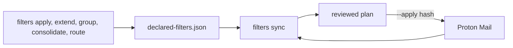

# 0022 — Keep Proton filters in one declared file

Status: Proposed
Date: 2026-10-24

## Context

- Proton filter writes were spread across five inbox commands. Each one called the provider client on its own.
- A redacted `filters.json` snapshot can cut a Sieve script mid-rule. That file cannot be the source of a rewrite.
- Filter order is meaningful. Proton evaluates filters from the top down, so a few filters must stay first.
- A filter or folder delete, and a route into Spam or Trash, can drop mail that the owner still needs.
- The public repository must not hold a real mailbox: no live filter names, folder names, or addresses.

## Decision

One declared filters file is the source of truth for every Proton filter and folder. It lives under the dg home,
at `inbox/workspaces/protonmail/<workspace>/declared-filters.json`. The repository ships the schema, the loader,
a synthetic example, and this record. `filters import` copies the live mailbox into that file. `filters sync` is
the only command that writes filters or folders back to Proton.

`filters sync` prints a plan and does not write unless the operator confirms it. `--apply` must carry the plan
hash from that dry run. A delete is never implied by `--apply`. Each deleted filter or folder needs its own
`--approve-delete` entry. Filters or folders changed in the Proton UI show up as drift. The operator pulls that
drift into the file or reverts Proton. A name that breaks the naming rules becomes a rename proposal in the
plan. Sync does not rename it on its own.

Safety checks block the apply. The declared file sets the protected plus-alias pattern and any extra
verification senders. GitHub, GitLab, Spam, and Trash always stay on that list. No planned write may send
protected plus-alias mail, or mail from those senders, to Spam or Trash. Every live Proton call, including
import and the sync read, waits on one shared pacer. The gap is irregular, calls stay serial, and a rate
limit backs off a few times and then stops. A stopped apply records the steps that landed before it throws.
A folder rename sends the parent id, or an explicit move to the root for a top-level path. A create or
rename whose parent cannot be resolved stops the apply before any write.
The other filter commands edit only the declared file.

## Consequences

- **Good:** one reviewed plan is the Proton write path, in `pkg/inbox/src/features/filter-policy/sync-command.ts`.
- **Good:** a truncated inventory snippet cannot become a stored filter. `fullSieveOrThrow` refuses it.
- **Good:** a partial apply writes the declared file before it throws, so the next dry run does not duplicate a filter Proton already created.
- **Bad:** the first sync needs an import, and a later edit in the Proton UI stays drift until someone chooses pull or revert.
- **Bad:** applying a new plan requires a new hash. Adding `--approve-delete` or `--pull` changes the hash.
- **Neutral:** `filters.json` remains a redacted inventory. It is no longer an input to a Proton write.

## Alternatives considered

- **Keep writing from each command.** A confirm on extend, group, or apply could still skip the shared safety checks and the order diff.
- **Treat `filters.json` as the source of truth.** The snapshot is redacted and truncated, so a rewrite could drop conditions.
- **Apply rename proposals automatically.** A wrong suggestion would rename a live filter before anyone reviewed it.

## Diagrams

## References

- `pkg/inbox/src/features/filter-policy/`
- `docs/inbox-filter-policy.md`
- [0007](0007-private-configuration.md)
