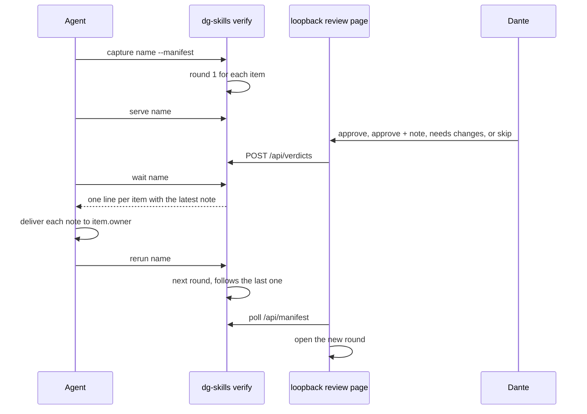

# 0023 — Review finished work round by round on a local board

Status: Proposed
Date: 2026-10-28

## Context

- `/dg:proto` asks Dante to pick among variants of a design that is not built yet. A finished branch has no variants, so that picker does not apply.
- Agents already finish work in branches and worktrees. Dante still needs a before-and-after visual, per role, at desktop and mobile, in light and dark.
- That visual includes scrolled pages and open menus.
- The prototype flow already has a local page, a same-origin decision POST, sentinel files, and a reload token so one tab can show the next round.
- Verify needs the same shape for a different question.
- Screenshots of a running app can contain real user data. A review that fetches a public URL, or that commits the images, would take that data off the machine.
- The app under review often has a strict Content-Security-Policy. An inline script on the review page, or a CDN script, would not run.

## Decision

`dg-skills verify` reviews finished items on one loopback board.
The manifest lists before and after URLs, seed roles, and the owning agent's name.
An optional target URL is the prototype column.
`pkg/skills-cli/src/verify/` captures with `playwright-core` when a local Chromium is present, at 1440, 768, and 390.
The HTTP engine is an explicit fallback that stores HTML and says so in each label.

Each capture of an item is a round. A round is a section in `board.json` with an id, a round number, a short summary, and `follows` set to the round before.
Pending entries in the same file show agent work that is not captured yet.
Verdicts live in `verdicts.json`, keyed by section id: approved, changes, or skip, with a note.
Approve with a note is approved and starts a follow-up round. Changes needs a note. Skip leaves the item open.
An item is done when its latest round is a plain approve. `ALL APPROVED` needs every item done and nothing pending.

The CLI shape follows `prototype`: `serve`, `status`, `wait`, `stop`, plus `add`, `pending`, `watch`, `capture`, and `rerun`.
`serve` runs the server in the background and records its pid in the session.
`wait` returns when every round has a verdict. It does not claim or consume anything, because a new round makes it block again.
`rerun` captures the next round only for items sent back or approved with a note.
The board polls `/api/manifest` and opens a new round by itself.

The board is three static files in the skill's `assets/` folder. The server sends a Content-Security-Policy of `'self'` only.
`POST /api/verdicts` accepts only same-origin JSON.
The icon set is one file, `proto/assets/dg-icons.js`. The verify board loads it as `/board/icons.js`, and `prototype serve` inlines it into every served page, so both toolbars match.

## Consequences

- **Good:** Dante can approve or send a change back without a prototype that has no variants.
  The toolbar, the icons, and the follow-up round match the prototype flow he already uses.
- **Good:** Capture refuses non-loopback URLs and credential-shaped headers, and the session directory `.agents/verify/` is gitignored.
- **Good:** The review page does not inject a script into the app, so the app's CSP does not have to allow the review.
- **Bad:** This slice does not boot the before and after stacks. The agent starts them and passes URLs. A wrong URL fails the capture.
- **Bad:** The accessibility summary is a local check of seven axe rule ids. It is not full axe-core, and it does not compute color contrast.
- **Neutral:** Chrome stable can take screenshots here.
  `demo --verify` still refuses it, because that flow loads an extension and Chrome stable disables `--load-extension`.

## Alternatives considered

- **Reuse `/dg:proto` with a single variant.** Proto's question is which variant to build.
  A finished change has no variants, and the before/after pair would be forced into that model.
- **Inject the picker into the app under review.** That fights the app's CSP and mixes review controls with the product. A separate local page keeps them apart.
- **Add axe-core and load it in the page.** That is a new dependency and a script the CSP would have to allow.
  The local check covers the rules we can see from HTML.
  Full axe-core can be a later slice if the summary is not enough.

## Diagrams

## References

- `pkg/skills-cli/src/verify/`
- `pkg/skills-cli/src/prototype/sentinels.ts`
- `plugins/dg/skills/proto/assets/dg-icons.js`
- `pkg/skills-cli/src/prototype/serve.ts`
- `plugins/dg/skills/verify/SKILL.md`
- `docs/adr/0021-proto-daemon-relay.md`
