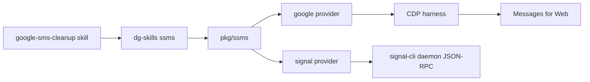

# 0024 — Host SMS provider commands on dg-skills

Status: Proposed
Date: 2026-10-31

## Context

- `google-sms-cleanup` is a browser instruction with no CLI. The agent clicks
  Messages for Web by hand, and nothing in the tree can run the same steps twice.
- [ADR 0020](0020-one-dg-command.md) puts every user command on the `dg` binary
  built from `pkg/skills-cli`. `dg-skills` and `dg-agent` are names for that
  binary. The daemon supervises stored `dg <command>` processes and does not
  grow its own command tree.
- `dg-agent` is the chat client: attach, overwatch, and phone-friend. It talks
  to the daemon. It is not where inbox or other account tools live.
- SMS needs a provider boundary. Google Messages for Web and Signal do not share
  a login, and Signal must not open Signal Desktop or its database key.
- A send that can run from a hook, or a log line that contains a phone number,
  a linking URI, or a message body, would leak the account or send mail the
  user did not approve.

## Decision

`ssms <provider> <verb>` is a `dg-skills` command. The provider code lives in
`pkg/ssms`. `pkg/skills-cli` registers the command, the doctor checks, and the
CDP launcher. `dg-agent` does not grow an SMS command. The daemon does not embed
`signal-cli` or Chrome.

`google` drives Messages for Web through the CDP harness in
`pkg/skills-cli/src/utils/cdp-harness.ts`, the same browser launch demo uses.
`signal` spawns `signal-cli` in daemon JSON-RPC mode. Each provider implements
one interface and a capability map. A false capability throws
`UnsupportedCapability` instead of a silent no-op.

Sends go through `draft`, then `send --draft <id>`. The approval token is
shown only on the terminal device. The draft stores a hash of that token, not
the token. `decideSend` in `pkg/ssms/src/safety/send-gate.ts` allows the send
only for an interactive yes on a real terminal, or for `--approve` with the
token that hashes to the stored value. `--yes` alone does not send. The gate
blocks accidental and non-interactive sends. Same-user code that evades it,
for example by allocating its own pty, is out of scope. `allow_send` is read
only from `~/.dg/ssms/config.yaml` under the OS user home, not from `$DG_HOME`.
`--config` cannot set it. `allow_send: false` never sends. Cleanup never
deletes and never sends. Logs go through `sanitizeLogLine` and carry an id
and a reason only.

## Consequences

- **Good:** skills call `~/.dg/bin/dg-skills ssms`, which already has doctor
  checks and an allow rule, the same path inbox uses.
- **Good:** a new provider is another module behind the same interface. The
  contract test in `pkg/ssms/__tests__/contract.spec.ts` runs it.
- **Bad:** `dg-skills` now launches Chrome for `ssms google` and can spawn
  `signal-cli` for `ssms signal`. Those processes are children of the CLI, not
  of the daemon, so a crash does not drop chat sessions.
- **Neutral:** `signal link` still needs a person to scan the QR. The CLI does
  not install `signal-cli`.

## Alternatives considered

- **Put `ssms` on `dg-agent`.** The chat client would own an account tool, and
  the skill would call a different binary than inbox. ADR 0020 already rejected
  a second command tree.
- **Run Signal inside the daemon process.** A signal-cli crash or a Chrome
  hang would share a fate with chat sessions. ADR 0002 keeps that work out of
  the daemon process.
- **Keep the skill as browser instructions.** The rules stay in prose and no
  test can fail when a send or a delete slips through.
- **Drive Signal Desktop's database.** That reads the desktop key and the GUI
  state. Dante rejected it.

## Diagrams

## References

- [ADR 0020 — One dg command](0020-one-dg-command.md)
- [ADR 0002 — The daemon owns durable sessions and work](0002-daemon-hub.md)
- `pkg/ssms/src/provider.ts`
- `pkg/ssms/src/safety/send-gate.ts`
- `pkg/skills-cli/src/commands/ssms.ts`
- `pkg/skills-cli/src/utils/cdp-harness.ts`
