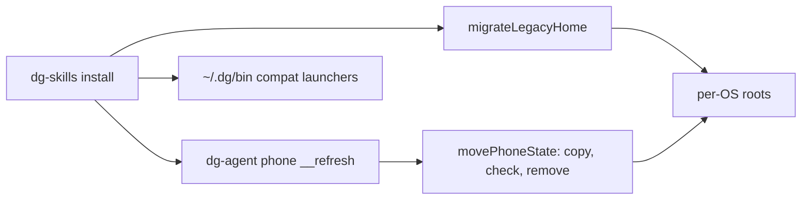

# 0025 — Keep dg files in the per-OS layout

Status: Proposed
Date: 2026-11-03

## Context

- Every dg path hung off `~/.dg`, and several modules built it by hand:
  `paths.ts`, `install-skills.ts`, `lib.ts` and `cli-only.ts`.
- Each OS separates config, data, state and cache (XDG on Linux, `Library`
  on macOS, `APPDATA` and `LOCALAPPDATA` on Windows). Backup tools and
  cleaners treat these roots differently. One flat folder defeats that.
- Tests leaked `DG_HOME`, and an empty `DG_HOME` resolved to a relative
  path.
- Skills called `~/.dg/bin/dg-skills`, so every skill and every allow rule
  named a path that only dg uses.

## Decision

One helper, `resolveDgPaths` in `pkg/common/src/node/dg-paths.ts`, owns
every root and every dg file. It returns the launcher folder and the config,
data, state, cache and log roots for the current OS. A set `DG_HOME` maps each
role to `<DG_HOME>/<role>`; an empty one counts as unset. Install writes the
launchers to the per-OS bin folder (`~/.local/bin` on Linux and macOS,
`%LOCALAPPDATA%\dg\bin` on Windows). Install moves the old `~/.dg` into the
new roots: copy, check, then remove. `phone __refresh` moves the phone state
and checks the copied database and keys before it removes the old folder.
Skills call `dg-skills` by name, with one generated first-run block that falls
back to `${DG_HOME:-$HOME/.local}/bin/dg-skills`. `~/.dg/bin/*` keep notice-printing
launchers for two minor releases. The daemon keychain account moves to one scoped by the state root. On first
use the daemon copies the old entry to the new account, reads it back, compares
it, and only then deletes the old entry; a failed step keeps the old entry and
reads from it.

## Consequences

- **Good:** dg uses the standard locations on each OS. A path change happens
  in one file. Skill text is shorter, and allow rules name `dg-skills`.
- **Bad:** the first install after the change moves user data. The phone move
  needs a check step and a rollback command
  (`dg-agent phone __rollback-home`). Users must update old
  `Bash(~/.dg/bin/dg-skills …)` allow rules; doctor names the new rule.
- **Neutral:** the AI scratch and state roots in `scratch-paths.ts` do not
  change. The staged extension folder and `ssms` move too; the browser must
  load the extension once from its new folder.

## Alternatives considered

- **Keep `~/.dg`.** Simple, but not standard, and it mixes cache with keys.
- **XDG only on Linux.** Three code paths for one idea, with macOS and
  Windows still in a flat folder.
- **One symlink from `~/.dg`.** The old folder splits into four roots, so no
  single link can stand in for it.

## Diagrams

## References

- `pkg/common/src/node/dg-paths.ts`
- `pkg/skills-cli/src/install/migrate-home.ts`
- `pkg/skills-cli/src/install/compat-launchers.ts`
- `pkg/dg-agent/src/phone/migrate-home.ts`
- `scripts/skill-bootstrap-block.ts`
- [Install guide](../install.md#where-dg-keeps-its-files)
