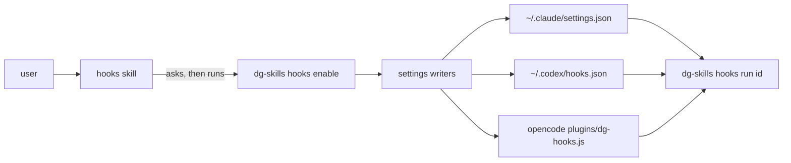

# 0026 — Opt-in hooks that write tool settings

Status: Accepted
Date: 2026-11-01

## Context

- dg hooks used to be shell scripts that only one machine carried. A new
  install had none of them.
- Claude, Codex, and opencode each keep hook entries in their own file. Other
  tools and people edit the same files.
- A hook that runs on every tool call changes behavior the user never asked
  for. A silent install breaks trust.
- A write that clobbers a settings file loses the user's own hooks and
  permissions.
- Each hook starts a process, so the delay grows with every hook enabled.

## Decision

Hooks are off by default. The user turns one on with
`dg-skills hooks enable <id>`, after the `hooks` skill asks. The command lives
in `pkg/skills-cli/src/hooks` and the manifest in `manifest.ts` lists each hook.

Each runtime has a `SettingsWriter` in `hooks/settings`. Claude and Codex write
JSON hook groups. opencode gets a generated `dg-hooks.js` in its `plugins`
folder, because opencode loads plugin files and not bare package names.

dg owns an entry only when it matches the anchored marker in
`hooks/settings/marker.ts`: a `dg-skills` path, `hooks run`, and one id. Writers
touch owned entries only. `updateJsonFile` rereads the file before the atomic
write and retries up to three times.

## Consequences

- **Good:** nothing changes on a machine until the user opts in.
- **Good:** user entries and unrelated keys survive `enable` and `disable`.
- **Good:** `dg-skills doctor hooks` finds unreadable settings and stale entries.
- **Bad:** each hook costs a process start. The 40 ms latency budget arrives
  with a later change, so hooks stay slower than shell hooks until then.
- **Bad:** the writers depend on three settings formats that the tools own.
- **Neutral:** a change applies in new sessions only.

## Alternatives considered

- **Enable hooks at plugin install.** The plugin would change settings the user
  did not review.
- **Ship shell scripts.** They need a shell on every platform and cannot share
  the manifest.
- **List `dg-hooks` in `opencode.json`.** opencode does not resolve a bare
  package name from that list.

## Diagrams

## References

- `pkg/skills-cli/src/hooks/manifest.ts`
- `pkg/skills-cli/src/hooks/settings/marker.ts`
- `pkg/skills-cli/src/hooks/settings/json-file.ts`
- `pkg/skills-cli/src/hooks/doctor.ts`
- [Hooks](../hooks.md)
