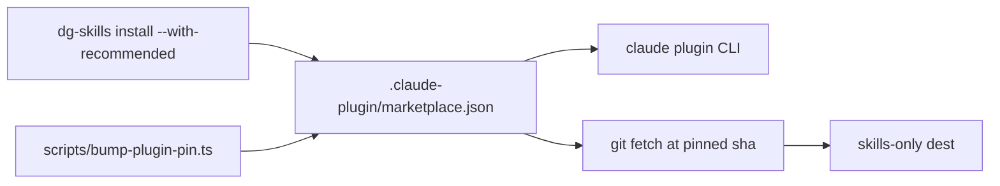

# 0027 — Offer pinned third-party plugins as an opt-in install

Status: Proposed
Date: 2026-11-03

## Context

- dg kept private copies of upstream skills such as `teach` and `wait-what`.
  The copies drifted from upstream and dg maintained them for no gain.
- `unslop` and `mattpocock-skills` already exist as upstream plugins.
- A dg skill that needs an imported plugin breaks for every user who skipped it.
- A floating branch ref lets upstream change code on a user's machine unseen.
- Installing dozens of extra skill descriptions raises the system prompt of
  every Claude Code session.
- Codex and OpenCode have no plugin CLI, and a flat skills folder can hold two
  skills with one name.

## Decision

Imported plugins are optional extras that dg pins and does not maintain. The
marketplace is the single list: every entry in `.claude-plugin/marketplace.json`
except `dg` is a recommended plugin, pinned to a full commit sha.
`dg-skills install --with-recommended` installs them. The flag is off by
default.

For Claude Code, `install/recommended-plugins.ts` runs the `claude` plugin CLI
and checks the installed sha. For `--skills-only --dest`,
`install/recommended-skills-only.ts` fetches the pinned commit and copies the
declared skills. A skill that collides with a dg skill (`grill-me`,
`wayfinder`) is skipped and named. A failed fetch prints one warning and the
install continues.

`scripts/bump-plugin-pin.ts` moves a pin. No dg skill may require an imported
plugin. `/dg:polish` skips `/unslop:unslop` when it is absent. dg retires its
`teach` and `wait-what` copies, and a skills install removes a retired folder
only when its `SKILL.md` hash matches a dg copy.

## Consequences

- **Good:** dg stops maintaining copies of upstream skills.
  `plugin-pins.spec.ts` guards every pin.
- **Good:** `imported-plugins-optional.spec.ts` fails when a dg skill requires
  an imported plugin.
- **Bad:** a pin bump is a manual step through `scripts/bump-plugin-pin.ts`.
- **Bad:** a user who wants `/teach` must run the flag once.
- **Neutral:** the dg copies of `grill-me` and `wayfinder` stay, so two skills
  share a name outside Claude Code namespaces.

## Alternatives considered

- **Float on the upstream branch.** Upstream could change code with no review.
- **Vendor the upstream skills.** dg would maintain them again.
- **Install by default.** It adds prompt tokens for every user.
- **Keep a second list in code.** It would drift from the marketplace.

## Diagrams

## References

- `.claude-plugin/marketplace.json`
- `pkg/skills-cli/src/install/recommended-plugins.ts`
- `pkg/skills-cli/src/install/recommended-skills-only.ts`
- `scripts/bump-plugin-pin.ts`
- `docs/install.md`
