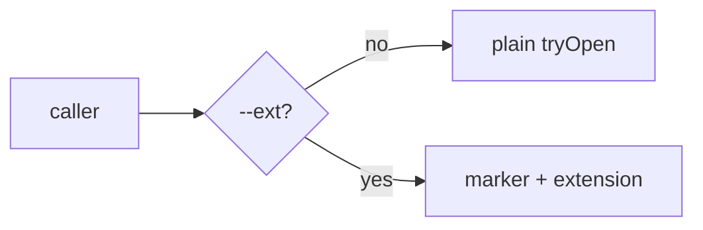

# 0028 — Run every skill locally and make the extension opt-in with `--ext`

Status: Accepted
Date: 2026-11-01

Superseded in part by [ADR 0031](0031-loopback-pages.md): the PENDING_LOCAL_MODE allowlist is gone.

## Context

- Four skills declared `requires: [extension]`: `browser`, `chat`, `demo`, and
  `overwatch`.
- Every PR-opening flow (`pushup`, `deps-upgrade`, `sdlc`, `spec`) calls
  `dg-skills batch-open`. The CLI-only guard refused that command, so agents on a
  CLI-only install hit a wall on every PR they opened.
- `/dg:proto` already ran locally by default and took `--ext` for the
  extension. The other skills had no matching switch.
- A browser tab group is a convenience. A PR URL in a plain tab serves the same
  reader.

## Decision

Every dg skill runs locally unless the caller passes `--ext`. `--ext` is the only
switch. The flag helper in [ext-flag.ts](../../pkg/skills-cli/src/utils/ext-flag.ts)
adds it to a command. The CLI guard and `dg-skills doctor` follow the flag: a
command needs the extension only when `--ext` is present or the command is
`--ext`-only, such as `launch`. A repo test,
[ext-opt-in.spec.ts](../../pkg/skills-test/__tests__/ext-opt-in.spec.ts),
enforces three rules:

- No `SKILL.md` outside `PENDING_LOCAL_MODE` declares `requires: [extension]`.
- Every line outside `PENDING_LOCAL_MODE` that runs `dg-skills require-extension`
  also carries `--ext`.
- `browser`, `proto`, and every skill whose references pass `batch-open --ext`
  (`pushup`, `deps-upgrade`) list `--ext` in their Flags table with the default
  `off (local is the default)`. `demo`, `chat`, and `overwatch` join the rule
  when they leave the allowlist.

## Consequences

- **Good:** `batch-open` opens plain tabs on a CLI-only install. Callers keep
  their print-the-URL fallback and no longer need it for a missing extension.
- **Good:** a new skill cannot reintroduce a hard extension requirement without
  failing the test.
- **Bad:** tab grouping, side-loaded launch, and the extension's tours are opt-in.
  A caller that grouped without `--ext` now gets plain tabs and one stderr line.
- **Neutral:** `chat`, `demo`, and `overwatch` keep a named allowlist,
  `PENDING_LOCAL_MODE`, until bundles 015 and 016 add their local modes. Each
  bundle removes its names from the list.
- **Neutral:** the extension never writes a marker without `--ext`.

## Alternatives considered

- **Fail `batch-open` without the extension.** The PR already exists, so a hard
  failure only prints a URL that the caller prints anyway.
- **Scan `process.argv` for `--ext`.** It also matches text such as
  `dg-skills jot "--ext"`. The guard reads parsed options instead.

## Diagrams

## References

- `pkg/skills-cli/src/utils/ext-flag.ts`
- `pkg/skills-test/__tests__/ext-opt-in.spec.ts`
- `plugins/dg/skills/browser/SKILL.md`
- `plugins/dg/skills/proto/SKILL.md`
