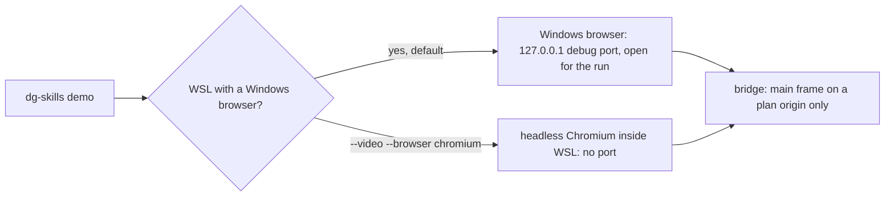

# 0029 — Accept the WSL remote-debugging port for the local demo player

Status: Accepted
Date: 2026-11-02

## Context

- The local `demo` player drives a real browser through the Chrome DevTools
  Protocol (CDP). It needs a remote-debugging port.
- On WSL with a Windows browser installed, the default `demo` and `--video` alone
  drive that Windows browser. The browser opens a remote-debugging port on
  127.0.0.1.
- The port has no authentication. Any local process that reaches 127.0.0.1 can
  attach and control the browser.
- The player is the
  [demo bridge](../../pkg/skills-cli/src/demo/bridge.ts) plus the
  [player process](../../pkg/skills-cli/src/demo/player-process.ts).

## Decision

Accept the risk. On WSL with a Windows browser, a default local `demo` and
`--video` alone expose an unauthenticated 127.0.0.1 remote-debugging port while
the run is live. The window lasts at most `--timeout`, 30 minutes by default. Any
local process can attach during that window.

Four mitigations bound the risk:

- The port binds to loopback only.
- The port closes when the run ends.
- `--video --browser chromium` keeps the run headless inside WSL and opens no
  Windows port.
- The bridge accepts calls only from the main frame of a page on a plan origin.
  `trustedSource` rejects every other frame and origin.

The mitigations limit what the page can ask of the bridge. They do not stop a
local process from attaching to the port.

## Consequences

- **Good:** the default `demo` works on WSL with the browser the user already
  runs.
- **Good:** a user who objects to the port has one flag combination that avoids
  it.
- **Bad:** for up to `--timeout`, a hostile local process can control the Windows
  browser the run uses.
- **Neutral:** [the demo skill](../../plugins/dg/skills/demo/SKILL.md) and
  [the install guide](../install.md) state the port and the opt-out.

## Alternatives considered

- **Default to headless Chromium inside WSL.** It opens no Windows port, but the
  demo no longer shows the browser the user works in.
- **Authenticate the port.** Chrome offers no authentication for the
  remote-debugging port.

## Diagrams

## References

- `pkg/skills-cli/src/demo/bridge.ts`
- `pkg/skills-cli/src/demo/player-process.ts`
- `plugins/dg/skills/demo/SKILL.md`
- `docs/install.md`
