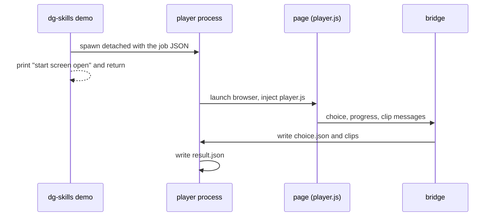

# 0030 — Share the tour UI and play demos in a local player

Status: Accepted
Date: 2026-11-02

## Context

- The tour overlay, start screen, and editor lived only in the extension content
  script. A demo needed the extension.
- [ADR 0028](0028-local-default-extension-opt-in.md) makes local the default and
  `--ext` the opt-in. The local default needs the same UI outside the extension.
- Playwright records a silent video. A voiced demo needs narration from somewhere
  else.
- The WSL debug-port risk of a local player has its own record:
  [ADR 0029](0029-local-demo-player-wsl-debug-port.md).

## Decision

Move the DOM-only tour UI into `pkg/tour-ui` behind the `TourHost` interface.
The extension and a Playwright-injected player are two hosts of one
implementation.

- The player is an injected IIFE text asset. It ships inside the demo chunk, not
  the stash chunk.
- `dg-skills demo` spawns a detached player process. The process reports through
  a bridge and a `result.json` file. `demo status <slug>` reads that file.
- Narration runs in the page. Kokoro loads from on-demand assets that the CLI
  downloads on the first voiced run and checks against `SHA256SUMS`. The CLI
  writes a sidecar WAV aligned to each step start. It merges the WAV into the
  video when `ffmpeg` exists.
- `--ext` stays the path for tab-capture video in the user's own browser.

## Consequences

- **Good:** one UI to test. The extension content script shrinks.
- **Good:** `demo` runs with no extension, as ADR 0028 requires.
- **Bad:** the first voiced run downloads about 23 MB of assets and an 86 MB
  model.
- **Bad:** a site Content Security Policy can block the in-page voice. The run
  then records without voice and says why.
- **Neutral:** without `ffmpeg`, the sidecar WAV stays beside the video.

## Alternatives considered

- **Duplicate the overlay in the CLI.** Two UIs drift apart.
- **Inject the extension content script.** It needs extension APIs that a plain
  Playwright page lacks.
- **Run Kokoro in Bun through `onnxruntime-node`.** It adds a 208 MB native
  download.

## Diagrams

## References

- `pkg/tour-ui/src/host.ts`
- `pkg/skills-cli/src/demo/player-process.ts`
- `pkg/skills-cli/src/demo/bridge.ts`
- `plugins/dg/skills/demo/SKILL.md`
