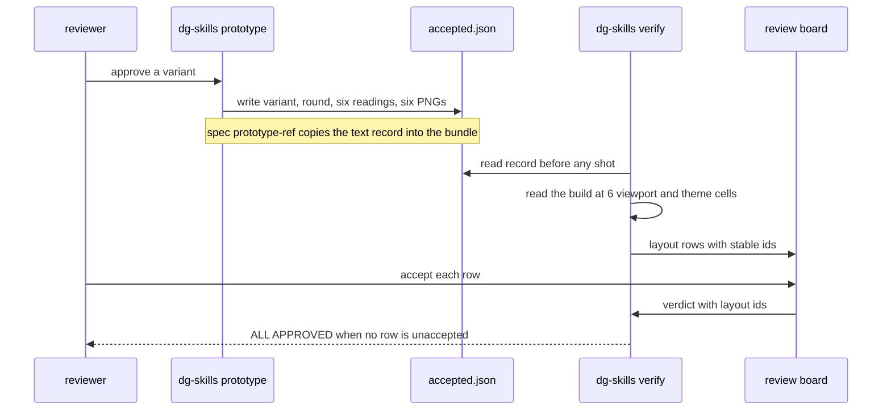

# 0031 — Gate verify on the layout of the accepted prototype

Status: Proposed
Date: 2026-11-03

## Context

- A local approval of a prototype variant left no durable record. The claim
  deleted the sentinels, and `lineage.md` depended on the agent.
- The build did not match the approved variant. A button sat at the top where the
  prototype had it at the bottom. Header buttons stayed that the prototype hid.
  Fixed bars covered the panel.
- `dg-skills verify` passed that build. It checked behavior and pixels, not
  layout.
- The DOM of the build differs from the DOM of the prototype. A recorded CSS
  selector for a control cannot match both.
- Pixel differences are noise across seed data. They must not fail a review.

## Decision

The CLI writes the record when it claims an approve. `dg-skills verify` reads the
record and fails on any layout difference that the reviewer did not accept on the
board.

- `sentinels.wait()` calls `recordAcceptance()` on an approve claim. It writes
  `.agents/prototype/<name>/accepted.json` and six reference PNGs. This covers
  `prototype wait` and `ui` sessions. Stdout does not change.
- The feature carries the marker `data-verify-root="<prototype name>"`, on every
  variant and on the built feature. Exactly one visible root is required.
- A reading lists each control under the root in DOM order, at 1440, 768, and 390
  wide, in light and dark. Each control has its role, name, test id, box,
  vertical and horizontal band, visibility, and an occlusion check with
  `elementFromPoint`.
- Controls match by test id, else by role and normalized name. Positions compare
  as fractions of each root. A band change counts as `moved` only when the center
  shifts by 0.1 of the root or more.
- `spec prototype-ref` copies the text-only record into the committed spec bundle.
  The manifest item names it with `record`.
- `layout/diff.ts` returns rows of kind `root-missing`, `missing`, `extra`,
  `reordered`, `moved`, `visibility`, `occluded`, `theme`, or `not-checked`. Each
  row has an id that does not change between rounds.
- The board shows a Layout pill and a table with an Accept box per row.
  `Verdict.layout` holds the accepted ids. `mergeVerdicts` refuses an unknown id.
  It refuses a plain approve while a row is unaccepted. `verify status` prints
  `| layout: N unaccepted`, and `ALL APPROVED` waits until N is 0.
- The http engine, `--ext` records, and `--no-fingerprint` records give one
  `not-checked` row per role. The reviewer accepts it on the board.
- Pixel differences never fail. The reference PNGs fill the prototype column when
  no prototype server runs.

## Consequences

- **Good:** a layout drift from an approved variant blocks `ALL APPROVED` until
  the reviewer accepts it (`pkg/skills-cli/src/verify/board.ts`).
- **Good:** the check needs no generated test and no pixel baseline.
- **Bad:** each feature needs the `data-verify-root` marker. A missing marker
  shows at accept time and as a `root-missing` row at verify time.
- **Bad:** the accessible name is an approximation. A renamed control with no test
  id shows as `missing` plus `extra`.
- **Bad:** a claim can take 5 to 15 seconds longer while the browser takes
  readings.
- **Neutral:** the record in the sandbox is gitignored. Only the text copy in the
  spec bundle is committed.

## Alternatives considered

- **Compare pixels.** Seed data makes pixel diffs fail on every run.
- **Record a CSS selector per control.** The build DOM differs from the prototype
  DOM.
- **Generate a Playwright test.** It adds a second browser path and a file to
  maintain. The CLI diff already runs in `verify capture`.
- **Put the fingerprint in `ACCEPTED.md`.** The CLI would have to parse prose. A
  sibling JSON file keeps the page for people.

## Diagrams

## References

- `pkg/skills-cli/src/layout/fingerprint.ts`
- `pkg/skills-cli/src/layout/record.ts`
- `pkg/skills-cli/src/layout/diff.ts`
- `pkg/skills-cli/src/prototype/accepted.ts`
- `pkg/skills-cli/src/verify/capture.ts`
- `pkg/skills-cli/src/verify/board.ts`
- `plugins/dg/skills/verify/SKILL.md`
