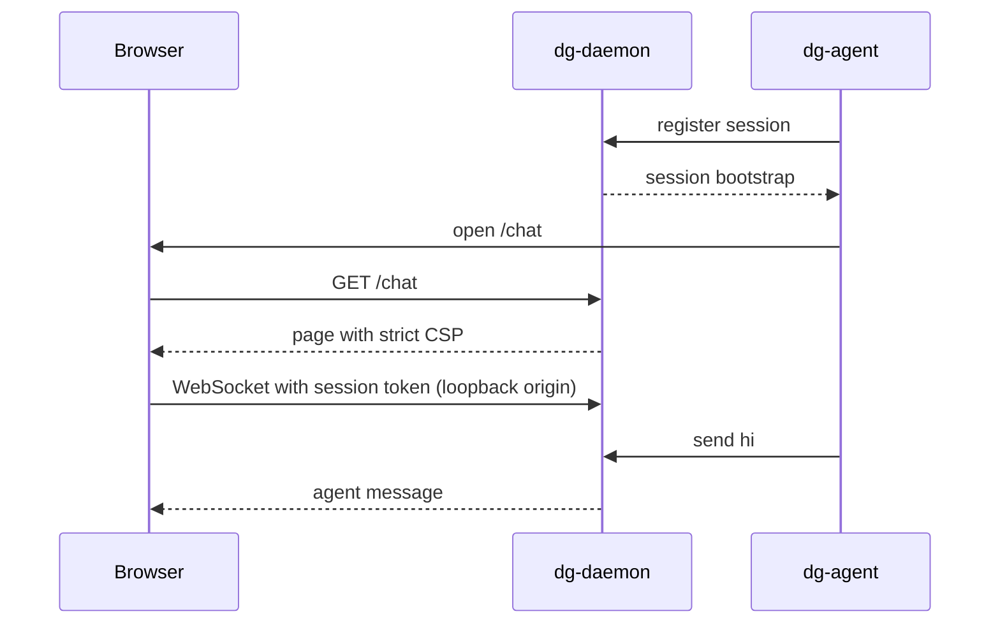

# 0031 — Serve the chat and board pages from the daemon on loopback

Status: Accepted
Date: 2026-11-02

## Context

- `chat` and `overwatch` needed a UI that lived in the extension origin, so both
  skills declared `requires: [extension]`.
- [ADR 0028](0028-local-default-extension-opt-in.md) makes every skill local by
  default. These two skills sat on an allowlist that exempted them.
- `dg-daemon` already owns the sessions, messages and board state that the pages
  show.
- A local page needs a gate. Without one, any web page could ask the daemon for
  a session.

## Decision

`dg-daemon` serves the chat page at `/chat` and the board page at `/board` on
127.0.0.1. The pages come from the shared `pkg/pages` package, which the
extension also uses. `dg-agent start` and `dg-agent overwatch open` print and
open `http://127.0.0.1:<port>/chat#_chat=<base64url>` and
`/board#_chat=<base64url>`. Both pages read one fragment format.

The page shells are public, because the token sits in the fragment and never
reaches the server. The daemon accepts API and WebSocket requests only from a
loopback origin or from a request with no `Origin`, and only with the token of a
live session. A dead token gets 403 and a foreign origin gets 400. The query
token works only on the WebSocket upgrade. The page strips the fragment from the
address bar and keeps the bootstrap in `sessionStorage`.

The extension stays as the `--ext` path: `dg-agent start --ext` prints the
`/start` URL and `dg-agent overwatch open --ext` sends `cli-overwatch-open`.

## Consequences

- **Good:** `chat` and `overwatch` work with no extension, and the allowlist in
  `ext-opt-in.spec.ts` is empty.
- **Good:** one page build serves both hosts.
- **Bad:** the daemon now serves HTML, so the strict CSP and the origin gate in
  [origin.ts](../../pkg/dg-daemon/src/server/origin.ts) are a new trust boundary.
- **Neutral:** the token sits in a URL fragment that the shell prints, as the
  `/start` URL already did.

## Alternatives considered

- **Chat in the terminal.** The human and the agent share the terminal, so the
  human cannot type while the agent works.
- **Keep `--ext` only.** It breaks the local-default rule of ADR 0028.

## Diagrams

With `--ext`, `dg-agent` opens `/start#_chat=bootstrap` instead, and the
extension side panel replaces the page.

## References

- [`origin.ts`](../../pkg/dg-daemon/src/server/origin.ts)
- [`build.ts`](../../pkg/pages/build.ts)
- [ADR 0028](0028-local-default-extension-opt-in.md)
