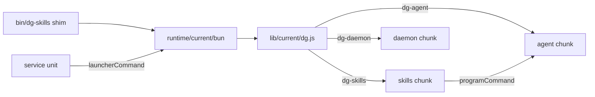
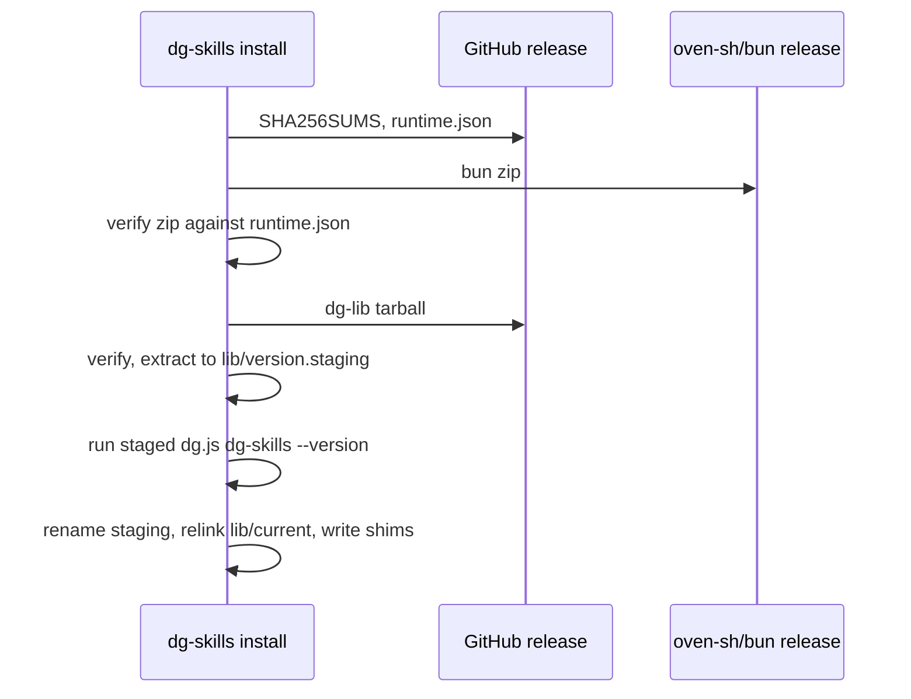

# 0032 — Ship one pinned Bun runtime and one minified bundle

Status: Accepted
Date: 2026-11-03

## Context

- `dg-skills`, `dg-agent` and `dg-daemon` were three `bun build --compile`
  binaries. Each one embedded the 79.5 MB Bun runtime, so an install took about
  250 MB.
- A release had 18 platform binaries as assets.
- `dg-skills --version` took 260 to 390 ms, because every command module loaded
  at startup. The time went to module evaluation, not to binary size.
- The release builds did not minify.
- A running program had no stable path for a sibling program or a service unit
  once the code no longer lived in one file per program.

## Decision

dg installs one pinned Bun runtime under `<root>/runtime/bun-v<version>/` and
one minified, code-split bundle per release under `<root>/lib/<version>/`.
`<root>` is `${DG_HOME:-~/.dg}`. `runtime/current` and `lib/current` are
symlinks (directory junctions on Windows), replaced by create-then-rename.
`bin/dg-skills`, `bin/dg-agent` and `bin/dg-daemon` are shims (`.cmd` on
Windows) that run `runtime/current/bun lib/current/dg.js <program>`.

`pkg/launcher/src/dg.ts` reads the program name and imports only that program.
Each command imports its own code inside its action, so `--version` and
`--help` load almost nothing. A running program starts a sibling with
`programCommand()`, which uses the same runtime and bundle. Service units and
detached listeners use `launcherCommand()`, which names the stable `current`
links. No in-tree code spawns a `.cmd` shim.

`pkg/launcher/runtime.json` pins the Bun version and the sha256 of each
platform zip. A release ships `dg-lib-<v>.tar.gz` and `runtime.json`, and both
are listed in `SHA256SUMS`. `bootstrap.sh`, `bootstrap.ps1` and
`dg-skills install` verify `runtime.json` against `SHA256SUMS`, verify the Bun
zip against `runtime.json`, and run the staged bundle's `--version` before they
change a link.

## Consequences

- **Good:** an install takes about 90 MB, and the release has one
  platform-independent bundle in place of 18 binaries.
- **Good:** `--version` adds under 20 ms to a Bun process that writes one line.
  `pkg/launcher/__tests__/startup-budget.spec.ts` checks it.
- **Good:** `install --version <previous release>` points `lib/current` back at
  that version with no download while its directory still exists.
- **Bad:** a first install and each runtime bump download the Bun zip, a
  second download.
- **Bad:** Windows launchers are `.cmd` files, which a program cannot spawn
  without a shell. A test fails on any `spawn(cliDest(` outside the tests.
- **Neutral:** a user's own `bun` on PATH is never used.
- **Neutral:** a compiled-binary install cannot find the new assets. Its owner
  runs `bootstrap.sh` once.

## Alternatives considered

- **Keep `--compile` and add minify.** It saves about 7 MB per binary and keeps
  three runtimes.
- **One compiled binary under three names.** It saves two runtimes, but startup
  stays slow without lazy commands, and every release still needs a binary per
  platform.
- **Use the user's Bun.** The version drifts, and many machines have no Bun.
- **Pointer text files in place of the `current` links.** A service unit could
  not name a stable `dg.js` path.

## Diagrams

## References

- [dg.ts](../../pkg/launcher/src/dg.ts)
- [build.ts](../../pkg/launcher/build.ts)
- [runtime.json](../../pkg/launcher/runtime.json)
- [program.ts](../../pkg/common/src/node/program.ts)
- [runtime.ts](../../pkg/skills-cli/src/install/runtime.ts)
- [bundle.ts](../../pkg/skills-cli/src/install/bundle.ts)
- [shims.ts](../../pkg/skills-cli/src/install/shims.ts)
- [bootstrap.sh](../../pkg/skills-cli/bootstrap.sh)
- [release.yml](../../.github/workflows/release.yml)
- [bump-runtime.ts](../../scripts/bump-runtime.ts)
