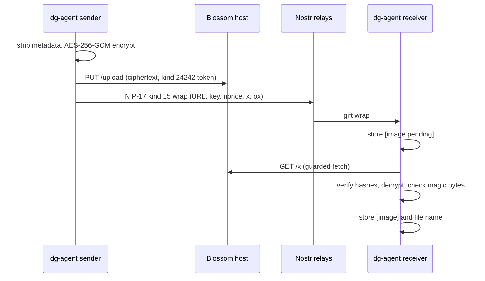

# 0034 — Send images over the phone as encrypted Blossom files

Status: Proposed
Date: 2026-11-04

## Context

- `dg-agent phone` sends text only. `openDetailed` in `pkg/dg-agent/src/phone/chat.ts` drops
  every rumor that is not kind 14, so a kind 15 file message from another client is dropped today.
- A user wants one agent to send a screenshot to a contact, end to end encrypted.
- A host that stores encrypted ePHI is a business associate under HHS cloud guidance, even without the
  key. Public Blossom hosts sign no business associate agreement. Relays that hold PHI text have the same problem.
- `references/safety.md` had no PHI rule. That gap exists for text today.
- A peer controls the file URL and the image bytes. A receiver that fetches and opens them takes on
  server-side request forgery, parser, and prompt-injection risk.

## Decision

Slice 1 adds the PHI and received-file rules to `plugins/dg/skills/phone/references/safety.md`. They apply
under every option. The later slices build image messages on these decisions.

- **Transport shape:** an image is a NIP-17 kind 15 rumor. The sender encrypts the image with AES-256-GCM,
  with a fresh key and nonce per file, and uploads the ciphertext to a Blossom host (BUD-02, auth token
  kind 24242 from BUD-11). The rumor carries `file-type`, `encryption-algorithm: aes-gcm`,
  `decryption-key`, `decryption-nonce`, `x`, `ox`, and `size`. Its `content` is the host URL.
- **Scope:** images only: PNG, JPEG, and WebP, chosen by magic bytes. The plaintext cap is 5 MiB.
  One image per `say`, with no caption. Threads work too: one rumor, wrapped to each member.
- **PHI:** PHI never crosses the phone, as text or image. A default-off `files` setting and a
  per-send `--no-phi` flag guard the send path. Agents may run `phone files on` with no TTY confirm, so the
  rule in `safety.md` and `--no-phi` carry the guard.
- **Host:** self-hosted Blossom. The client reads hosts from the `files` server list, so the code does not
  depend on the deploy. Deploying the host is separate infrastructure work with its own reuse plan and approval.
- **Retention:** the sender deletes the blob after 7 days. The receiver stores the decrypted image under
  the phone folder with mode 0600 and prunes it with the 7-day message TTL.
- **Receive:** the receiver stores `[image pending]` at once, fetches in a queue with concurrency 1, then
  updates the row to `[image]` or to a fixed placeholder reason, and notifies the hook.
- **Transport still open:** the choice between a central host and Tailscale sender-serves waits until
  before first real use. The code builds against the `files` server list, and tests use fake servers only.

### Security findings

1. Business associate: a host that stores ciphertext still counts. R3 answers it: no PHI.
2. Ciphertext persists: Blossom DELETE is best effort, and mirrors or backups can keep copies.
3. The peer controls the URL: the receiver takes only the origin, matches it exactly to a `files` entry,
   builds the fetch URL locally, follows no redirect, and caps size and time.
4. The type comes from the magic bytes of the decrypted image, never from `file-type`. SVG is rejected.
   The file name is a computed hash.
5. Upload auth: a token signed with the chat key links the npub to each upload. This is fine on a self-hosted host.
6. Prompt injection: text in an image is peer text. A received image stays closed unless the human asks.
7. Exfiltration: a peer can ask an agent for a screenshot. Sending an image needs human approval.
8. Data at rest: decrypted images are plaintext on disk, like `phone.db` rows.
9. Harvest now, decrypt later: secp256k1 wraps are exposed to a future quantum attacker. Text has the same exposure.

The Step 0 security review also requires these changes before the build:

- Set the text of a kind 15 row to `[image]` on the thread and held paths, never the URL.
- Validate tags first: `x` and `ox` are 64 lowercase hex characters, the key is 32 bytes, the nonce is 12 bytes.
- Fetch with `Accept-Encoding: identity`, `redirect: "error"`, a Content-Length check, a byte cap, and one 20 second timeout.
- Check order: hash of the ciphertext, then one-call GCM decrypt, then hash of the plaintext, then magic bytes.
- Strip metadata before encryption (EXIF, XMP, and the like).
- Cap the `files/` folder size and the per-contact daily count.
- Let only kind 14 carry `dg-call` or create a contact. Drop kind 15 from non-contacts.
- Use a fixed reason list. Never write raw error text, host body, URL, or key to a row or `listener.log`.

NIP-17 does not name the encoding of `decryption-key` and `decryption-nonce`. Slice 2 reads it from the
source of one real client and records it in this record with a source link before it codes the tags.

## Consequences

- **Good:** the PHI and received-file rules apply to text today, with no code change beyond docs
  (`plugins/dg/skills/phone/references/safety.md`).
- **Good:** kind 15 is the standard NIP-17 shape, so other clients can interoperate once the tag
  encoding is confirmed.
- **Bad:** the receiver runs a fetch, a decrypt, and an image check on peer data. A slow host holds
  text behind it for up to 20 seconds.
- **Bad:** deletion cannot be proven. The sweep limits exposure and cannot erase mirrors or backups.
- **Bad:** only policy stops an agent that adds `--no-phi` by habit.
- **Neutral:** `pkg/dg-agent/src/phone/db.ts` moves to schema version 5 when slice 2 lands.

## Alternatives considered

- **Blossom with kind 15 (chosen).** Standard shape and the smallest trust surface that works.
  NIP-96 is not an option: it is marked unrecommended and deprecated in favor of Blossom.
- **Inline in events.** Rejected. nos.lol caps a message at 131,072 bytes, and relay.damus.io and
  relay.primal.net at 1,000,000. After base64 and two NIP-44 layers, one event carries about 40 KB of image
  on nos.lol and about 300 KB on the others. Many screenshots exceed that. The format is not standard.
  Relays are third-party stores, and a gift wrap is signed by a throwaway key, so NIP-09 deletion is impossible.
- **Out of band.** Share the file through an approved channel and send a text note. Zero code. It stays the
  fallback, and the work stops after slice 1 if the human chooses it.
- **Tailscale sender-serves.** The sender serves the ciphertext on the tailnet. It needs no third-party
  store, but it needs the sender online and both sides on one tailnet. Still open as the transport.
- **Magic Wormhole.** A direct, one-time transfer with no stored copy. It needs a second tool and a code
  exchange for each file, and it does not fit the NIP-17 message flow.

## Diagrams

## References

- [safety.md](../../plugins/dg/skills/phone/references/safety.md)
- [phone.md](../phone.md)
- [chat.ts](../../pkg/dg-agent/src/phone/chat.ts)
- [db.ts](../../pkg/dg-agent/src/phone/db.ts)
- [NIP-17](https://github.com/nostr-protocol/nips/blob/master/17.md)
- [Blossom BUD-02](https://github.com/hzrd149/blossom/blob/master/buds/02.md)
- [Blossom BUD-11](https://github.com/hzrd149/blossom/blob/master/buds/11.md)
