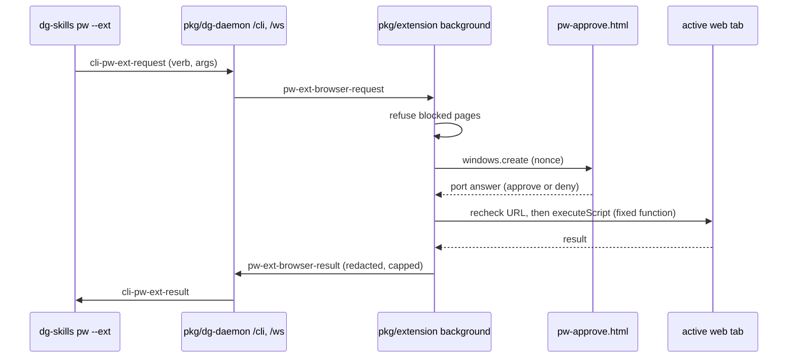

# 0035 — Drive the real browser with `pw --ext` behind a per-call approval

Status: Proposed
Date: 2026-11-05

## Amended 2026-11-05: no per-call approval

The human decided: "we just always give access to the CLI to control the
browser if given explicitly. We don't need to approve every single browser
action that's taking place in the extension anymore."

Passing `--ext` on the CLI is now the explicit grant. The extension no longer
opens `pw-approve.html`. The approval page, its port, and the approver
(`pw-ext-approval.ts`) are deleted, and there is no setting to bring them back.
The accepted text below stays as the record of the first decision. Where it
describes the popup, the pre-prompt reads of the target element and tool list,
the approved size, or the element handle, this amendment replaces it.

Guards that remain:

- Blocked pages: browser settings pages, extension pages, `file:` and `about:`
  pages, the web stores, private windows, and the signed-in Proton Mail tab
  (`PW_EXT_BLOCKED_ERROR`, `PW_EXT_MAILBOX_ERROR`).
- Text and URL redaction in the extension and again in the CLI, and the output
  size caps.
- Daemon session ownership, CLI auth, the pending request caps, and the
  `PW_EXT_MIN_EXTENSION_VERSION` gate.
- The page function checks the document URL against the tab URL before it acts.
  A screenshot is discarded if the window shows another tab after capture.
- Upload goes only to `https:` pages. The staged file is deleted right after the
  fetch, a size that differs from the declared size is refused, and the 25 MiB
  cap holds.
- Timeouts, the relay deadline, and cancel on a closed session or a stopped CLI.
  `cli-pw-ext-cancel` and `pw-ext-browser-cancel` still stop a request in flight.

Removed because it had no job without the popup: the element fingerprint and
handle. It bound the element the human saw in the prompt to the element the
write used. Now one page call resolves the target and acts, so no gap is left to
guard. The second tab recheck after approval is gone for the same reason.

The wire format did not change. It carried no approval field, so an older
daemon or extension still interoperates. An older extension still shows its
popup; a newer one does not. `PW_EXT_MIN_EXTENSION_VERSION` stays at 1.42.0
because the CLI works with both.

## Context

- Plain `dg-skills pw` drives its own Playwright browser. An agent cannot see
  the page the user has open, and it cannot act on a page where the user is
  signed in.
- Slice 25 of the dg-skills consolidation plan asks for `pw --ext`: a small set
  of read and write verbs on the user's real browser through the
  dg-ai-extension, with no code execution.
- The agent cannot approve for the user. A consent field on the wire, or a
  setting the CLI can change, would let an agent approve its own requests.
- The extension already has `<all_urls>`, `tabs`, `scripting` and `activeTab` on
  Chromium for tours and prototypes.
- [ADR 0021](0021-proto-daemon-relay.md) gives an authenticated CLI to
  dg-daemon to extension relay. [ADR 0028](0028-local-default-extension-opt-in.md)
  makes the extension opt-in with `--ext`.

## Decision

`dg-skills pw --ext <verb>` sends one `cli-pw-ext-request` to dg-daemon on the
same `/cli` socket that `inbox` and `proto --ext` use. The daemon forwards it as
`pw-ext-browser-request` to the one paired extension on the session, and only
when that extension is at least `PW_EXT_MIN_EXTENSION_VERSION`, the one
constant that names the release that ships this feature. The verbs are fixed:
`current`, `snapshot`, `screenshot`, `selection`, `console` and `tools` read;
`open`, `click`, `fill`, `upload` and `call` write. The validators in `pkg/common/src/pw-ext-format.ts` accept an exact
set of fields per verb, so the wire carries no code and no approval.

The extension (`pkg/extension/lib/background/pw-ext.ts`) acts on the active tab
of the last focused normal window. Before it asks, it refuses browser settings
pages, extension pages, `file:` and `about:` pages, the web stores, and the
signed-in Proton Mail tab, for every verb except `current`, which hides those
tabs' URLs and titles, and `open`, which opens a new tab. It then opens an extension popup window,
`pw-approve.html`, that names the verb and the tab. Write verbs say that they
change the page. Every call asks; nothing is remembered. Only that popup page,
loaded with a random per-request nonce, can answer
(`pkg/extension/lib/background/pw-ext-approval.ts`). Closing it, a timeout, or a
second request while one is open counts as deny. After approval the extension
checks that the tab did not navigate, then runs a fixed function from
`pkg/extension/lib/features/pw-ext-page.ts` in the isolated world through
`scripting.executeScript`. Session teardown cancels a pending request, and
the handler checks for cancellation again just before it acts. That function checks the document URL against the
approved URL before it acts, and a screenshot is discarded if the window shows
another tab after capture. The output passes `redactText` in the extension and
again in the CLI, and stays under 100,000 characters of text or the proto
preview limit for an image.

Before the prompt, `click`, `fill` and `upload` read only their target element
(tag, role, accessible name, short text) and refuse a target that does not
resolve. `call` reads the page's WebMCP tool list first, refuses an unknown
tool, and the prompt shows the tool name, description, hints and exact args.

`upload` stages the file in the existing dg-daemon asset store
(`postAsset` in `pkg/common/src/node/assets.ts`, the same store `dg-agent stage`
uses), because one relay frame is capped at 1 MiB. The request carries only the
asset id, file name, size, MIME type and a display path. After approval the
extension fetches the asset with the session capability, refuses a size that
differs from the approved one, and sets the file on an enabled file input with a
`DataTransfer` in the isolated world. Uploads go only to `https:` pages. The CLI
takes regular files from the working directory, the dg scratch directory or the
dg demos directory (never the home folder or `/` as a root), refuses hidden
paths and a file that is a symbolic link, pins the checked file's identity when
it opens it, and reads at most the asset store limit of 25 MiB.

A CLI that stops sends `cli-pw-ext-cancel`, and a closed CLI socket has the
same effect. The daemon then sends `pw-ext-browser-cancel` to the extension,
which closes the approval window and runs nothing.

`console` keeps the isolated-world capture of uncaught errors and unhandled
rejections, and on its first call also runs `pwExtConsoleHook`
(`pkg/extension/lib/features/pw-ext-main.ts`) in the page's MAIN world. The hook
wraps `console.warn` and `console.error` once per document and keeps the last
50 entries.

`tools` and `call` run `pwExtWebMcp` in the MAIN world. It uses the WebMCP API
from the W3C Web Machine Learning Community Group draft of 2 November 2026
([spec](https://webmachinelearning.github.io/webmcp/),
[repository](https://github.com/webmachinelearning/webmcp)):
`document.modelContext` (secure contexts only) with
`getTools(options)` resolving to `RegisteredTool` records (`name`, `title`,
`description`, `inputSchema`, `outputSchema`, `window`, `origin`,
`annotations`), and `executeTool(registeredTool, inputObject, { signal })`
resolving to a string. Chrome's early preview shipped a testing surface,
`navigator.modelContextTesting` with `listTools()` or `getTools()` and
`executeTool(name, jsonString)`, behind a flag; sources disagree on its current
state, so it is a best-effort fallback only. With neither API, `tools` returns an
empty list. `pwExtWebMcp` drops `window`, caps each description, schema and
output, redacts tokens before its result leaves the page, rechecks the
approved URL after each await, and bounds discovery and the call with
timeouts.

A write keeps the element it described under a random per-request handle in
the isolated world and acts only if the target still resolves to that element.
The relay deadline, a closed session, or a stopped CLI cancels the request in
the extension; upload checks for cancellation again after it fetches the
staged file.

## Consequences

- **Good:** the manifest permissions do not change. The approval window uses
  `windows.create`, which needs no permission.
- **Good:** the CLI cannot approve. The only answer path is a port from the
  extension's own page at the exact nonce URL.
- **Good:** snapshot refs live in the isolated world of the tab, so a snapshot
  does not write attributes into the page.
- **Bad:** every call needs a human in front of the browser. An unattended agent
  times out after 120 seconds.
- **Bad:** `click` and `fill` dispatch synthetic events. A page that checks
  `isTrusted` ignores them.
- **Bad:** `console` sees only messages after the first `console` call on that
  tab.
- **Bad:** a reload at the same URL during approval is not detected; refs from
  the old document fail, but a CSS selector can match in the new one.
- **Bad:** a screenshot shows what is on screen. Redaction cannot remove a token
  that the page shows as text in the image.
- **Neutral:** the extension refuses on Firefox. Only Chromium-family browsers
  are supported.
- **Neutral:** an extension older than `PW_EXT_MIN_EXTENSION_VERSION` gets no
  request; the daemon tells the CLI to update it.
- **Bad:** the `console` hook and WebMCP calls run in the page's MAIN world. The
  page can see or replace the console wrapper and can shape what its own tools
  report. Output is still redacted and capped in the worker.
- **Bad:** `call` runs the site's own code. The prompt shows what the site says
  the tool does; it cannot prove it.
- **Bad:** upload bytes reach the local daemon before the human approves. They
  stay on loopback in the session's asset store. The extension deletes them
  through `DELETE /assets/<id>` right after it fetches them, and the daemon
  deletes them when the request ends in any other way.
- **Bad:** a pre-approval read touches the page before consent, but only for the
  one target element or the tool list.

## Alternatives considered

- **`debugger` permission (CDP).** It gives trusted input and console history,
  but it is broad, it shows a banner on every page, and it allows code
  execution.
- **An always-on content script that wraps `console`.** It gives warnings and
  history, but it runs extension code in every page the user opens, all the
  time.
- **Approval in the side panel or a notification.** A notification needs a new
  permission. The side panel can be closed and is easy to miss. A popup window
  is visible and needs nothing new.
- **Approve once per session.** Less friction, but the plan asks for one approval
  per call.

## Diagrams

## References

- `pkg/common/src/pw-ext-format.ts`
- `pkg/dg-daemon/src/server/pw-ext.ts`
- `pkg/extension/lib/background/pw-ext.ts`
- `pkg/extension/lib/features/pw-ext-page.ts`
- `pkg/skills-cli/src/pw/ext.ts`
