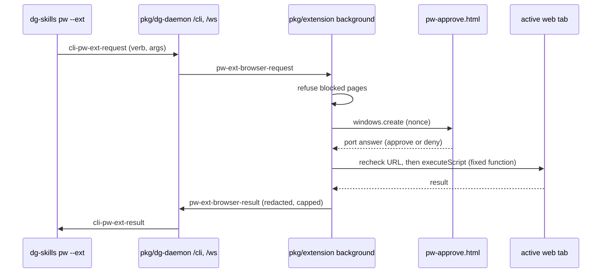

# 0035 — Drive the real browser with `pw --ext` behind a per-call approval

Status: Proposed
Date: 2026-11-05

## Context

- Plain `dg-skills pw` drives its own Playwright browser. An agent cannot see
  the page the user has open, and it cannot act on a page where the user is
  signed in.
- Slice 25 of the dg-skills consolidation plan asks for `pw --ext`: a small set
  of read and write verbs on the user's real browser through the
  dg-ai-extension, with no code execution.
- The agent cannot approve for the user. A consent field on the wire, or a
  setting the CLI can change, would let an agent approve its own requests.
- The extension already has `<all_urls>`, `tabs`, `scripting` and `activeTab` on
  Chromium for tours and prototypes.
- [ADR 0021](0021-proto-daemon-relay.md) gives an authenticated CLI to
  dg-daemon to extension relay. [ADR 0028](0028-local-default-extension-opt-in.md)
  makes the extension opt-in with `--ext`.

## Decision

`dg-skills pw --ext <verb>` sends one `cli-pw-ext-request` to dg-daemon on the
same `/cli` socket that `inbox` and `proto --ext` use. The daemon forwards it as
`pw-ext-browser-request` to the one paired extension on the session, and only
when that extension is 1.41.0 or newer. The verbs are fixed: `current`,
`snapshot`, `screenshot`, `selection` and `console` read; `open`, `click` and
`fill` write. The validators in `pkg/common/src/pw-ext-format.ts` accept an exact
set of fields per verb, so the wire carries no code and no approval.

The extension (`pkg/extension/lib/background/pw-ext.ts`) acts on the active tab
of the last focused normal window. Before it asks, it refuses browser settings
pages, extension pages, `file:` and `about:` pages, the web stores, and the
signed-in Proton Mail tab, for every verb except `current`, which hides those
tabs' URLs and titles, and `open`, which opens a new tab. It then opens an extension popup window,
`pw-approve.html`, that names the verb and the tab. Write verbs say that they
change the page. Every call asks; nothing is remembered. Only that popup page,
loaded with a random per-request nonce, can answer
(`pkg/extension/lib/background/pw-ext-approval.ts`). Closing it, a timeout, or a
second request while one is open counts as deny. After approval the extension
checks that the tab did not navigate, then runs a fixed function from
`pkg/extension/lib/features/pw-ext-page.ts` in the isolated world through
`scripting.executeScript`. Session teardown cancels a pending request, and
the handler checks for cancellation again just before it acts. That function checks the document URL against the
approved URL before it acts, and a screenshot is discarded if the window shows
another tab after capture. The output passes `redactText` in the extension and
again in the CLI, and stays under 100,000 characters of text or the proto
preview limit for an image.

## Consequences

- **Good:** the manifest permissions do not change. The approval window uses
  `windows.create`, which needs no permission.
- **Good:** the CLI cannot approve. The only answer path is a port from the
  extension's own page at the exact nonce URL.
- **Good:** snapshot refs live in the isolated world of the tab, so a snapshot
  does not write attributes into the page.
- **Bad:** every call needs a human in front of the browser. An unattended agent
  times out after 120 seconds.
- **Bad:** `click` and `fill` dispatch synthetic events. A page that checks
  `isTrusted` ignores them.
- **Bad:** `console` sees only uncaught errors and unhandled rejections, and only
  after the first `console` call on that tab starts capture. It does not see
  `console.warn` or `console.error` calls.
- **Bad:** a reload at the same URL during approval is not detected; refs from
  the old document fail, but a CSS selector can match in the new one.
- **Bad:** a screenshot shows what is on screen. Redaction cannot remove a token
  that the page shows as text in the image.
- **Neutral:** the extension refuses on Firefox. Only Chromium-family browsers
  are supported.
- **Neutral:** an extension older than 1.41.0 gets no request; the daemon tells
  the CLI to update it.

## Alternatives considered

- **`debugger` permission (CDP).** It gives trusted input and console history,
  but it is broad, it shows a banner on every page, and it allows code
  execution.
- **An always-on content script that wraps `console`.** It gives warnings and
  history, but it runs extension code in every page the user opens, all the
  time.
- **Approval in the side panel or a notification.** A notification needs a new
  permission. The side panel can be closed and is easy to miss. A popup window
  is visible and needs nothing new.
- **Approve once per session.** Less friction, but the plan asks for one approval
  per call.

## Diagrams

## References

- `pkg/common/src/pw-ext-format.ts`
- `pkg/dg-daemon/src/server/pw-ext.ts`
- `pkg/extension/lib/background/pw-ext.ts`
- `pkg/extension/lib/background/pw-ext-approval.ts`
- `pkg/extension/lib/features/pw-ext-page.ts`
- `pkg/skills-cli/src/pw/ext.ts`
