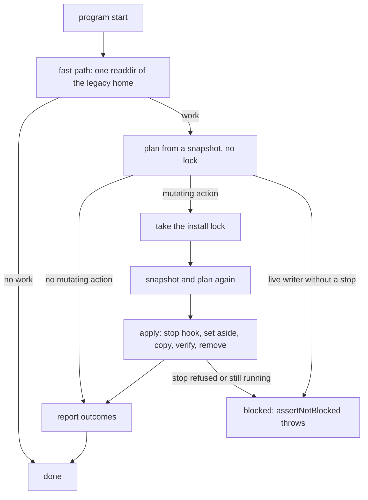

# 0036 — Move the legacy `~/.dg` through one layout module

Status: Proposed
Date: 2026-11-05

## Context

- [ADR 0025](0025-per-os-layout.md) moved dg files from `~/.dg` into the per-OS roots, but four places carry the move, each with its own trigger:
  `pkg/skills-cli/src/install/migrate-home.ts` on `dg-skills install`, `moveLegacyPhoneHome` in `pkg/dg-agent/src/phone/commands.ts`,
  `pkg/dg-agent/src/phone/migrate.ts` on `phone __refresh`, and `pkg/dg-daemon/src/crypto/keychain-backends.ts` on first daemon use.
- A user who ran any other command first never saw the move run. The state stayed split between `~/.dg` and the per-OS roots.
- v1.42.0 shipped two bugs from that split. The daemon, agent memory, inbox and channel review opened an empty per-OS store
  beside a full legacy one. The phone move failed on an existing target and lost the phone state.
- A moved folder can hold a live writer, and an unused target folder can block the move. Each migrator handled both its own way.
- The old rollback command (`dg-agent phone __rollback-home`) covered only the phone and left every other entry behind.

## Decision

One module, `pkg/common/src/node/layout.ts`, owns a declarative table of where each piece of dg state lives and how a legacy copy moves.
Every program (`dg-skills`, `dg-agent`, `dg-daemon`) runs `ensureLayout` at start, before any store opens, through the shared `installLayoutPreAction`.

- **One trigger (D1).** `ensureLayout` runs once per process. A lock-free fast path reads the legacy home with one `readdir`;
  only a home with work takes the install lock, plans again and applies.
- **Set-aside rule (D2).** An unused target moves aside as `<name>.empty-<ts>` and the legacy copy moves in. A used target stays, the legacy copy stays,
  and dg never merges or deletes either.
- **Stop-or-block rule (D3).** A live writer stops through an owner hook, or the entry is blocked. A `no-hook` block is silent.
  `live-writer`, `kept`, `failed`, `scheduled` and `setAside` log one stderr line per process,
  and a pending removal that completes on a later start logs one `removed` line.
- **Phone entry (D4).** Phone moves as a table entry with `verify` and `stop` hooks. `dg-agent` supplies `phone.stop` only under `phone` verbs (E2).
- **Owner post-steps (D5).** The phone-friend conversion and the keychain move run after `ensureLayout` on the target state (E1), under the install lock.
  The keychain step overwrites the current account only when this run set an empty daemon store aside (E4).
- **Contract specs (D6).** A layout contract spec in temp homes and an upgrade matrix start the real entrypoints on a legacy fixture home in every order.

Four further rules complete the design:

- `dg-skills doctor` runs the preAction like every command, and the `layout` check reports what the preAction left behind (E5).
- `resolveDgPaths` is memoized by its inputs, so the per-process result in a `WeakMap` hits at every store open (E6).
- The `ssms/config.yaml` entry moves only through the install-only `ssms.configDir` hook (E3).
- There is no rollback command. `dg-agent phone __rollback-home` is deleted, and the docs describe a manual rollback: stop the writers,
  copy the per-OS folders back to `~/.dg`, and install the older release.

A visible `dg-skills clean` removes the leftovers the move made: unused `<name>.empty-<ts>` copies, the `~/.dg/bin` notice launchers with one notice line,
and the empty `~/.dg`. It never removes a copy that holds data, leaves `dg-ai-*` folders to install, and refuses while any entry is blocked (A6').

## Consequences

- **Good:** every program moves the legacy home before it opens a store, so no store opens empty beside a full legacy copy.
  The move code lives in `pkg/common/src/node/layout.ts` and the lazy `layout-work.ts`.
- **Good:** an unused target never blocks the move and a used target never loses data.
- **Good:** `dg-skills doctor` reports split copies from the exported table.
- **Bad:** the keychain move is one-way. A manual rollback leaves the new account in place.
- **Bad:** Windows never stops a daemon. The user stops the service by hand, and the entry stays blocked until then.
- **Bad:** a manual rollback followed by an upgrade produces a split that the user resolves.
- **Bad:** set-asides stay on disk until the user runs `dg-skills clean`.
- **Neutral:** `~/.dg` may keep `bin`, `dg-ai-*` names and dotfiles after the move.

## Alternatives considered

- **Per-migrator triggers.** The status quo. Each migrator misses the starts it does not own, which caused both v1.42.0 bugs.
- **A marker file (A1).** A cross-process cache can go stale. The fast path costs one `readdir` and needs no file.
- **An import-time hook registry (S1).** The result depends on import order. Each `main` composes its hooks and passes them in.
- **A `needs` key on owner entries (E1 B).** It breaks the `daemon` entry. Owner post-steps run after `ensureLayout` instead.
- **A rollback command that copies every entry back (A6).** It restores a split that the next upgrade breaks again.
  A manual rollback and `dg-skills clean` replace it (A6').

## Diagrams

## References

- `pkg/common/src/node/layout.ts`
- `pkg/skills-cli/src/install/migrate-home.ts`
- `pkg/dg-agent/src/phone/commands.ts`
- `pkg/dg-agent/src/phone/migrate.ts`
- `pkg/dg-daemon/src/crypto/keychain-backends.ts`
- [ADR 0025](0025-per-os-layout.md)
