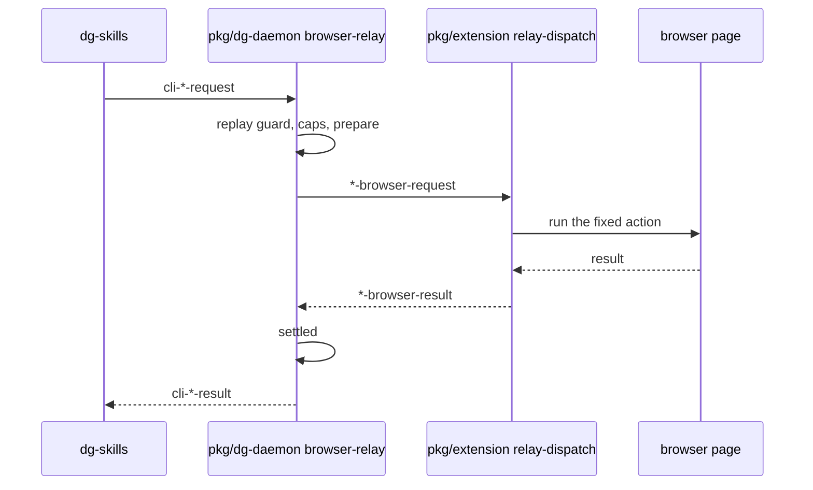

# 0037 — One browser relay for inbox, proto and pw-ext

Status: Proposed
Date: 2026-11-06

## Context

- `inbox`, `proto` and `pw-ext` each relay a CLI request through the daemon to the
  paired browser extension and back. Each feature rebuilds that relay by hand in
  `pkg/dg-daemon/src/server/inbox.ts`, `pkg/dg-daemon/src/server/proto.ts` and
  `pkg/dg-daemon/src/server/pw-ext.ts`.
- The copies drifted. Proto has no replay guard. Only pw-ext cancels a request.
  Only proto has progress frames and `failPendingProtoForExtension`.
- `pkg/common/src/chat-format.ts` lists each relay frame three times: the
  `ChatFrame` union, the frame-type sets and the validator `switch`.
  `pkg/dg-daemon/src/server/frame-handlers.ts` repeats the feature split in two
  `switch` blocks.
- A fix to one relay does not reach the other two. A new relay feature costs
  three packages of copied code.

## Decision

The daemon runs one generic relay and the extension runs one dispatcher. Both
read a per-feature table that lives in `pkg/common`.

- **D1.** `pkg/dg-daemon/src/server/browser-relay.ts` owns the relay lifecycle
  for every feature. `pkg/extension/lib/background/relay-dispatch.ts` owns the
  dispatch. A feature table in `pkg/common` drives both.
- **D2.** Frames, validator errors, refusal strings, check order and the point
  where a request id is burned stay byte-identical per feature. This record does
  not bump `CHAT_PROTOCOL_VERSION`.
- **D3.** Every feature gets a replay guard, proto included, with new copy. Cancel
  and progress opt in only where the frame exists.
- **D4.** Feature-only logic attaches through optional daemon hooks. `prepare`
  runs before forwarding. `settled` runs after any end. `salvage` repairs an
  unreadable result. The pw-ext staged-asset delete and the proto preview strip
  use them. The relay owns all lifecycle. It catches a hook throw, logs the
  error class and feature name, and goes on, so one bad hook cannot stop a CLI
  result or a session close.
- **D5.** The relay members of `ChatFrame`, `CHAT_FRAME_TYPES`,
  `INBOUND_FRAME_TYPES`, the relay validator cases and `CliFrame` come from the
  feature tables. Chat-only frames stay hand-written.
- **D6.** One relay contract spec at unit level replaces the lifecycle cases. The
  per-feature specs keep the validator and hook cases. Each old lifecycle case is
  deleted in the change that ports it.

## Consequences

- **Good:** `pkg/dg-daemon/src/server/browser-relay.ts` is the single lifecycle
  owner. A fix lands once, and a new relay feature is one table.
- **Bad:** Each feature keeps its own refusal strings, caps and version checks.
  Unifying them is deferred to a later record.
- **Bad:** Three oversized-result behaviors stay apart. Inbox does not settle, so
  the CLI waits for the timeout. Proto settles and returns with no error frame
  and no strike. Pw-ext settles, then sends the error frame and records a
  strike. Inbox also keeps no rejected-result settle. Both are deferred
  unification.
- **Neutral:** Extension handlers change signature. Each takes one object instead
  of the three separate handler options in `pkg/extension/lib/background/chat.ts`.

## Alternatives considered

- **Per-feature folders across packages.** Each package builds on its own, so
  one table cannot span them.
- **Unify refusal strings now.** This breaks D2 and the byte-identical frames.
- **Keep three relays and fix the drift by hand.** The copies drift again.

## Diagrams

## References

- `pkg/common/src/relay-format.ts`
- `pkg/common/src/relay-features.ts`
- `pkg/dg-daemon/src/server/browser-relay.ts`
- `pkg/extension/lib/background/relay-dispatch.ts`
- `pkg/common/src/inbox-format.ts`
- `pkg/common/src/proto-format.ts`
- `pkg/common/src/pw-ext-format.ts`
- `pkg/dg-daemon/src/server/inbox.ts`
- `pkg/dg-daemon/src/server/proto.ts`
- `pkg/dg-daemon/src/server/pw-ext.ts`
