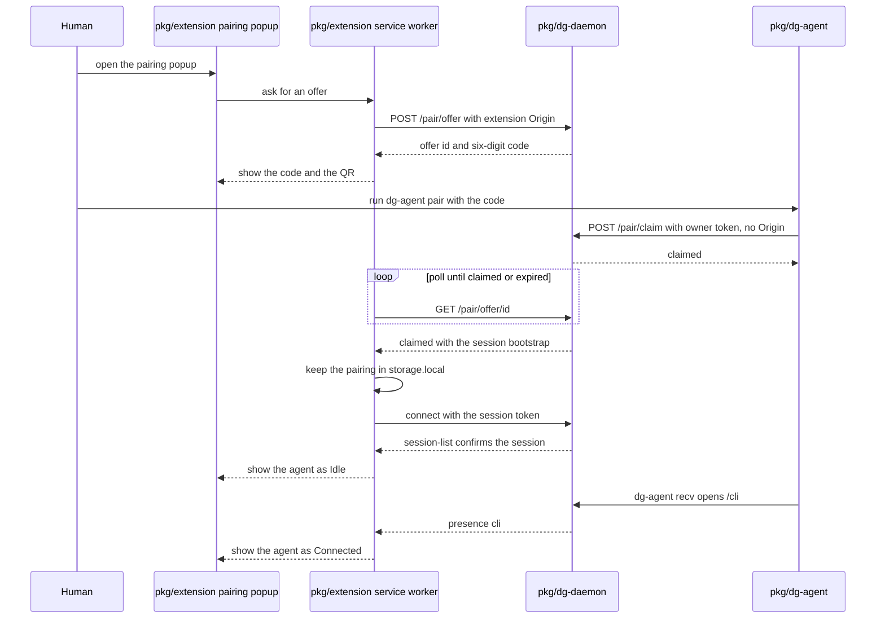

# 0038 — Reduce the extension to pairing and tab control

Status: Proposed
Date: 2026-11-07

## Context

- The extension held a chat in a browser panel that duplicated the page `dg-daemon` serves at `/chat`. Two chat surfaces drifted apart.
- The extension's paste form posted `POST /pair`. That route created active orphan sessions with `agentIdentity` `"extension"` that no agent owned. The idle TTL reaped them. Waiting sessions came from `POST /sessions` and `/attach { intent: "create" }`.
- `dg-skills pw --ext` acted on the active tab of the last focused window. An agent could read or drive a tab the human had not offered.
- A browser that held no pairing could not tell a human where to start. The only handoff was a URL with a fragment token that a shell printed.
- [ADR 0004](0004-loopback-pairing.md) fixed the origin pin, the owner token and the code rules. Those rules still hold. The flow that used them changed.

## Decision

The extension keeps one visible surface: the pairing popup. It shows a six-digit code, a QR code and the paired agents. The daemon `/chat` page replaces the extension chat. The `--ext` flag on `chat` and `overwatch` opens the daemon page, and the pairing popup pairs the browser.

- **Offer and claim.** The pairing popup asks the service worker for an offer with `POST /pair/offer`. The daemon keeps each offer in memory and holds only the hash of its code. The agent runs `dg-agent pair <code>`. The CLI posts `POST /pair/claim` with the owner token. A claim refuses any `Origin` header. The service worker polls `GET /pair/offer/<id>` and receives the session bootstrap once.
- **Limits.** The daemon allows 8 outstanding offers in the pending state. A rolling window of 5 failures expires every pending offer for good. Later claims return `locked` until the failures age out, and the pairing popup must ask for a new offer. The lockout guards against mistakes and cheap brute force. It does not stop a same-user adversary, who can already read the owner token. Expired offers leave tombstones. The daemon trims tombstones to 8 when it creates the next offer. Otherwise they expire with their TTL. A lockout can expire up to 8 pending offers at once, so the map can briefly hold more than 8 tombstones. The daemon also keeps claimed offers until the extension polls them or they expire.
- **Code handling.** The QR encodes the text `dg-agent pair <code>`, never a URL. `noteSecret` ignores values under 8 characters, so it cannot mask a six-digit code. The code stays out of logs only because no path prints it. The daemon logger records no request paths, and the CLI prints only the Paired line or daemon error text.
- **Persistence.** The extension keeps each pairing in `storage.local` under `pairing:<id>` and writes it on the first confirming `session-list`. Pairings survive a browser restart. The daemon-side session expiry is the bound. The residual risk is that every `<all_urls>` content script can read that area. The dg:security review accepted that risk in the slice that added the store.
- **Tab groups.** Each agent session owns one tab group titled `<agentIdentity> · <first four characters of sessionId>`. `pw --ext` acts on the group, and `--tab <id>` names one tab of it. `Add this tab` in the per-agent popup menu hands the current tab to an agent. The extension checks pairing, page rules and ownership first. It refuses a tab that another agent owns while that agent has pending runs.
- **Session registration.** `POST /start` refuses any `Origin` header with a 400. It also needs the owner token in the `OWNER_TOKEN_HEADER` header, or it answers 401. The `session-create` WebSocket frame still lets a socket that holds a session capability create further sessions. That frame is the second way to register a session.
- **Trust anchor.** The [ADR 0004](0004-loopback-pairing.md) origin pin stays the trust anchor for a paired extension. Offer and claim only bootstrap the first pairing.
- **Trust model for `POST /attach`.** Two paths reach the route. Each has its own rule.
  - **Extension with a code.** The request carries an extension-scheme `Origin`, pinned or not yet pinned, and a code from `dg-daemon pair`. The daemon counts the attempt against the shared lockout. A request with no accepted code gets a 401, even from the pinned `Origin`. An accepted code lets `all: true` return every active session. It lets `sessionId` return one. A different extension origin gets a 409 while one is pinned. This path works before the first pin. `MSG.sessionAttach` in `daemon-link.ts` reaches it.
  - **The `/chat` switcher.** The page sends `{ intent: "attach", sessionId }` with its bearer and a local page `Origin`. The `Origin` header is required. The route refuses `all` and `code` on this path. The bearer must belong to a live session. A limiter allows 30 requests per minute for each token.
- **Chat switcher.** The `/chat` page lists every connected agent. A page that holds one live token can obtain the bootstrap of one active agent-role session per request. A local process no longer gets every token through the pinned `Origin`. A bearer now needs the owner token, because `POST /start` requires it. That session must have presence `cli` and must not be the caller's own. Three limits bound this. The request must come from loopback with a live bearer. The same-origin check binds browsers only, because a non-browser client can set any `Origin` header. A closed session, or a session whose presence is non-`cli`, is never attachable.
- **Security review.** The dg:security review of slice 4 accepted the `storage.local` exposure to the two `<all_urls>` content scripts. The dg:security review of slice 8 accepted the switcher trust change. One live token of any role can obtain each active agent-role `cli` session token, one per request. It adds no new local-process exposure. A later change closed the pinned-origin path, so a live bearer is no longer free.

The word "pairing popup" names this surface throughout. [ADR 0035](0035-pw-ext-real-browser.md) discusses a per-call approval prompt that the project removed. The two are unrelated.

## Consequences

- **Good:** one chat surface. The extension no longer ships the chat, dashboard or overwatch pages. See `pkg/extension/lib/background/daemon-link.ts`.
- **Good:** an agent session exists only when an agent registers it. Pairing never creates a session. See `pkg/dg-daemon/src/server/pair-offers.ts`.
- **Good:** `pw --ext` acts only on tabs in the agent's own group or tabs the human handed over. See `pkg/extension/lib/background/agent-tabs.ts`.
- **Good:** one relay table serves inbox, proto and `pw --ext`. See `pkg/extension/lib/background/relay-dispatch.ts`.
- **Bad:** `POST /attach` now returns session tokens to a page that holds any one live token. Before, `session-list` exposed only ids, identities and roles. See `pkg/dg-daemon/src/server/http.ts`.
- **Good:** the pinned `Origin` header no longer replaces a code on `POST /attach`. Any loopback client can send `Origin: chrome-extension://<pinned id>`, and another OS user can compute an unpacked extension ID (CWE-346). That header now gains nothing. Getting a live bearer needs the owner token or an accepted code.
- **Bad:** the browser profile now holds session tokens at rest in `storage.local`. Any `<all_urls>` content script can read them until the session expires or the human clicks Unpair. One compromised extension page can obtain every active session token, not only the paired ones, through a code-accepted `POST /attach`. See `pkg/extension/lib/background/pairing-store.ts`.
- **Neutral:** Record demo moved to the pairing popup menu, and Alt+Shift+D still works. The live check of tab capture after the menu hop has not run, because no Chrome was available. The capture-failed hint is the fallback.
- **Neutral:** schema 13 drops the `awaiting_agent` column. The migration is forward-only. An older daemon stops on a newer database. The daemon writes a `pre-migration-v13-` snapshot first.
- **Neutral:** `storage.local` is per browser profile. Two profiles hold one session only if the agent pairs twice. The relay then refuses requests with the `Multiple extension peers` text.
- **Not done:** limit the `session-create` WebSocket frame. A socket that holds one session capability can still create sessions, and a later change can bound or gate it.
- **Not done:** the `/jobs` and `/feed` JSON routes lost their only client with the dashboard. They stay reachable. `refuseForeignOrigin` checks the extension origin and no credential when an `Origin` header is present. Before the first pairing any extension origin passes. After the pin, any loopback client that sends the pinned `Origin` passes. A later change gates them by owner token or live bearer. The `readSessionFiles` fallback stays in the CLI client. The overwatch wire frames stay. The `sidePanel` field stays in `pkg/common/src/connection-drop.ts`. Each is dead or near dead, and a later change removes it.

## Alternatives considered

- **A QR code that encodes a URL.** A phone camera would open that URL and leak the code to a page. The text `dg-agent pair <code>` is inert outside the agent.
- **Keep `POST /pair`.** It minted orphan sessions and let a code consumer create state. The offer and claim pair makes the agent create the session. It does not limit what a pinned extension origin can obtain.
- **Tab handles instead of groups.** A bare tab id is invisible to the human. A titled group shows which agent owns which tab.
- **Deliver the claim over the extension socket.** The socket exists only after the first pairing, so the first pairing would fail. The extension polls over HTTP instead.
- **Keep pairings in `storage.session`.** The browser clears it on restart, so every restart would force a new pairing.
- **Keep pairings in `storage.sync`.** It copies tokens to other devices. A token that works only on loopback has no use there.
- **Keep `awaiting_agent` as a dead column.** It would suggest a state that no code creates. Schema 13 drops it.
- **Keep the forward-pairing paths as a fallback.** Two ways to pair double the trust surface and the tests. One path is easier to review.
- **Extension-mediated chat.** The extension would relay every chat frame. The daemon page already holds the sessions and the board state.

## Diagrams

## References

- `pkg/dg-daemon/src/server/pair-offers.ts`
- `pkg/dg-agent/src/pair.ts`
- `pkg/extension/lib/background/relay-dispatch.ts`
- `pkg/extension/lib/background/agent-tabs.ts`
- `pkg/extension/lib/background/daemon-link.ts`
- `pkg/extension/lib/background/pairing-store.ts`
- [ADR 0004](0004-loopback-pairing.md), [ADR 0031](0031-loopback-pages.md), [ADR 0035](0035-pw-ext-real-browser.md), [ADR 0037](0037-one-browser-relay.md)
