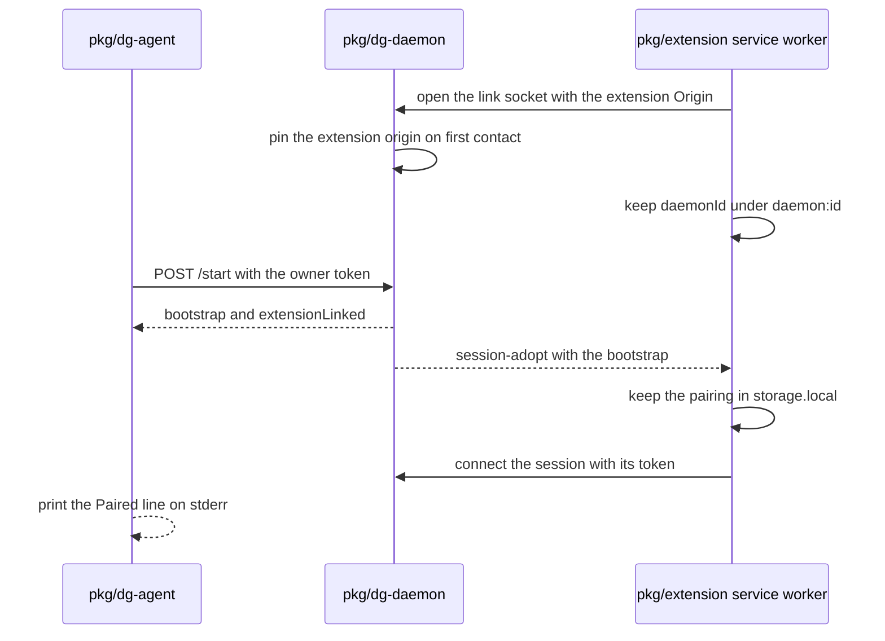

# 0039 — Pair the browser with no code and no human step

Status: Proposed
Date: 2026-11-07

## Context

- [ADR 0038](0038-extension-pairing-only.md) paired the browser with a six-digit code. The human read the code in the popup, and the agent ran `dg-agent pair <code>`. Every session needed that round trip.
- The code stopped no one who runs as the same user. That process can read the owner token and register its own session. The lockout guarded against mistakes, not against an adversary on the machine.
- An agent could not finish pairing alone. A human had to leave the work, open the popup, and read a code.
- `dg-agent start` printed a URL with the session token in its fragment. Browser history and shell logs could keep that token (CWE-598).
- The daemon already knows each session it creates. The extension already reaches the daemon on loopback.

## Decision

Pairing needs no code and no human step. The extension keeps one link socket to its daemon, and the daemon pushes every new session to it. The one routine human step is to load the extension once with **Load unpacked**.

- **Link socket.** The extension worker keeps one `/ws` socket open, even with zero pairings. It finds the daemon port through `findDaemonPort`.
- **First contact pins both sides.**
  - The daemon pins the extension origin on the first extension-scheme `Origin` it sees, through `pinOriginIfUnset`. It no longer waits for a capability handshake.
  - The extension stores the first `/healthz` `daemonId` under `daemon:id` in `storage.local`. It refuses a port that reports another id.
  - After a daemon home reset, the daemon id changes. The popup shows "The daemon changed" with **Trust this daemon**. One click pins the new id. This is the only rare human step besides loading the extension.
- **Push.** The `session-adopt` frame carries the session bootstrap. The daemon sends it to every admitted extension socket when it creates a session, and again for each active session when a link socket connects. The extension adopts it through the existing `pairing-store.ts` path.
- **Unpair is remembered.** **Unpair** sends `session-disconnect` and writes `dismissed:<sessionId>`. A reconnect push does not adopt that session again. The daemon sends `session-closed` to every extension socket, and the extension removes the key then.
- **CLI feedback.** The `/start` reply carries `extensionLinked`. `dg-agent start` prints `Paired <identity> (<id8>) with the browser extension.` or `No browser extension is connected. Install it with: dg-skills install` on stderr and prints nothing on stdout. `--json` prints `{sessionId, port, extensionLinked}`. `--print-session-id` prints the id.
- **No token URLs.** `POST /chat/code` accepts the owner token with `{ sessionId }` and no `Origin`. `dg-agent start --open`, `dg-agent overwatch open` and `dg-skills inbox bootstrap-url` mint a one-time code through `mintPageCode` and use `/chat#_chatcode=<code>`. A code works once, within 60 seconds. No command prints a URL that carries a session token. The page no longer reads the legacy `_chat` fragment.
- **Spawn.** `dg-agent spawn [opts] -- <command...>` creates a session, runs the command with `DG_SESSION_ID` set, and exits with its exit code. The CLI resolves its session from `--session`, then `DG_SESSION_ID`, then the one session for the current directory.
- **Removed.** `POST /pair/offer`, `POST /pair/offer/<id>` and `POST /pair/claim` return 404. `dg-daemon pair`, `dg-agent pair`, the popup code, QR and paste form, and the code and `all` branches of `POST /attach` are gone. The origin pin, the owner token and the one-time page code from [ADR 0004](0004-loopback-pairing.md) and [ADR 0038](0038-extension-pairing-only.md) still hold.

## Consequences

- **Good:** an agent pairs with one command, `dg-agent start`, and reads the result on stderr. See `pkg/dg-agent/src/start.ts`.
- **Good:** no secret travels through a human, a QR code or a URL. A one-time code replaces each token URL. See `pkg/common/src/node/page-code.ts`.
- **Good:** the daemon removed the offer store, the code hashing and the lockout. Less code guards a boundary that the code never held. See `pkg/dg-daemon/src/server/connection.ts`.
- **Good:** `dg-agent spawn -- <command>` gives a child process its own session with no copied token. See `pkg/dg-agent/src/commands.ts`.
- **Bad, the trust trade-off:** the daemon trusts any process that the same user runs on this machine, and it does so silently. A local program can set any `Origin` header, so the header proves nothing against a local process. The `daemon:id` pin stops a process that took a free port. It does not stop a proxy that copies the live daemon, because `/healthz` reports the id to any local caller. The old code gave the same protection against such a process, which is none.
- **Bad:** any local process can cause the extension to adopt a session of its own, because the extension adopts every session the daemon pushes. The session still lives on the user's daemon, and the process needs the owner token to register it.
- **Bad:** a daemon home reset needs one click on **Trust this daemon**. See `pkg/extension/lib/background/daemon-link.ts`.
- **Neutral:** an extension older than this change cannot pair with a new daemon, and a new extension adopts nothing from an old daemon. Update the binaries and the extension together.
- **Neutral:** `storage.local` still holds each pairing, so the risk that [ADR 0038](0038-extension-pairing-only.md) accepted for `<all_urls>` content scripts is unchanged. See `pkg/extension/lib/background/pairing-store.ts`.

## Alternatives considered

- **Keep the code and add a faster path.** Two ways to pair double the trust surface and the tests, and the code protects nothing against the same user.
- **Ask the human to approve each session in the popup.** The prompt interrupts every agent start, and a same-user process can already read the owner token, so it adds friction and no safety.
- **Pin the extension origin only.** A local program can fake the `Origin` header. The daemon id pin adds a check on the extension side for a process on a free port.
- **Keep the token URL and hide it.** A URL in shell output or history keeps the token. A one-time code that dies in 60 seconds does not.
- **Poll the daemon over HTTP for new sessions.** The link socket already exists, and a push reaches the extension at once.

## Diagrams

## References

- `pkg/dg-daemon/src/server/http.ts`
- `pkg/dg-daemon/src/server/origin.ts`
- `pkg/dg-daemon/src/server/connection.ts`
- `pkg/dg-daemon/src/server/bootstrap.ts`
- `pkg/dg-agent/src/start.ts`
- `pkg/dg-agent/src/commands.ts`
- `pkg/common/src/node/page-code.ts`
- `pkg/common/src/chat-format.ts`
- `pkg/extension/lib/background/daemon-link.ts`
- `pkg/extension/lib/background/pairing-store.ts`
- [ADR 0004](0004-loopback-pairing.md), [ADR 0031](0031-loopback-pages.md), [ADR 0038](0038-extension-pairing-only.md)
