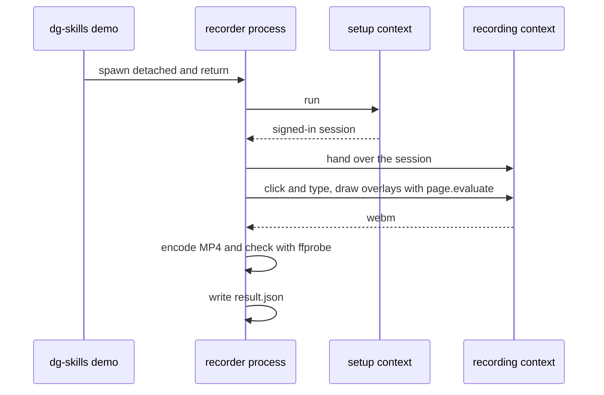

# 0040 — Record local demos with a Node recorder

Status: Accepted
Date: 2026-11-08

## Context

- [ADR 0030](0030-shared-tour-ui-and-local-player.md) played local demos with a player script that ran inside the page. The player drew the tour UI and ran the narration in the page.
- A strict site Content Security Policy blocked the in-page voice. The run then recorded without voice.
- The recorded video showed a REC badge, and the first seconds showed the start screen.
- Local mode opened a start screen where the human chose review, walkthrough, or video. An agent could not finish a demo alone, because it had to wait for that choice.
- A fill action put a literal secret in the plan. The plan and its URL marker then held the credential.
- Browser lookup was split between the demo player and `pw`. Each checked a different list, and a missing Chrome sent the user to a download.

## Decision

Local `dg-skills demo` always records. A Node recorder in `pkg/skills-cli/src/demo/recorder/` drives the real UI with Playwright, with real clicks and key-by-key typing. `--ext` keeps the interactive extension tour unchanged.

- **Overlays.** The recorder draws full-screen chapter cards, a caption bar in the extension tour-card style, and an outline with an arrow on the target. It does this with plain DOM through `page.evaluate`, so a strict site Content Security Policy does not block it. The recording has no REC badge.
- **Chapters.** Plan frontmatter takes `intro: "Eyebrow | Title | Detail"` and `outro: "..."`. The intro defaults to the eyebrow `Demo` with the plan `title`. No outro plays unless the plan sets one. The parser lives in `pkg/common/src/plan-format.ts`.
- **MP4 output.** The recorder encodes H.264 at 1440x810 and 30 fps, then checks the file with `ffprobe`. The default path is `<cacheDir>/demos/<slug>/<slug>-<stamp>.mp4`. `--out` must end in `.mp4` and must sit outside a git work tree. Without `ffmpeg`, the raw webm stays, with a sidecar `.wav` when narrated, and the CLI warns. `dg-skills demo doctor` checks `ffmpeg` and `ffprobe`.
- **Credentials.** `@type="$DG_DEMO_VELORA_PW"` types the value of that env var. Only `$DG_DEMO_*` variables resolve (`^\$DG_DEMO_[A-Z0-9_]+$`), so a plan cannot read an unrelated secret such as `$AWS_SECRET_ACCESS_KEY`. `validate()` rejects a variable-looking value without the prefix with `only $DG_DEMO_* variables can be typed`. The recorder types an env reference only into `input[type=password]`. The plan never holds the value, and logs and results never print it. An unset variable in a recorded step refuses with exit 2: `demo: set $DG_DEMO_VELORA_PW or move the login to ## Setup`.
- **Setup handoff.** `## Setup` with `includeSetup: false` runs in an unrecorded context first. It hands its login to the recording.
- **Human fallback.** When a setup fill names an unset variable, a headed window opens, shows "Type it here, then continue.", and waits for a navigation, for Enter or a blur in the filled field, or for the next setup step's selector to appear. After a navigation, later setup steps whose selector does not show within 2 s are skipped with one log line. A headless-only plan, such as WSL without `--windows` or `--wsl-headed`, refuses this case with exit 2.
- **Narration switch.** `-n` / `--narration` is a plain switch, off by default. With no flag, the video has captions and no sound. With `-n`, the recorder makes a Kokoro voice (default `af_heart`) before the recording, on a page it controls, and muxes it as AAC. Because the voice does not run in the target page, the site policy cannot block it.
- **Verify.** `--verify <plan>` drives the same recorder in a dry run, with no overlays and no holds. Findings are `selector-unresolved`, `env-unset` (it names the variable), `plan-unreadable`, and `harness-error`. A click that submits a form and navigates is fine. `unrecorded-navigation` and `page-mismatch` no longer apply to local verify.
- **One browser finder.** One finder checks `DG_BROWSER` (alias `DG_VERIFY_BROWSER`), Chrome, Edge, Brave, Chromium, Vivaldi, Chrome for Testing on PATH, the usual macOS and Windows app folders, then the downloaded Chromium. Only then does it suggest `dg-skills pw install-browser`.

This replaces the in-page player and start screen of [ADR 0030](0030-shared-tour-ui-and-local-player.md) for local mode. The shared `pkg/tour-ui` stays the base of the `--ext` tour. The WSL debug-port risk of [ADR 0029](0029-local-demo-player-wsl-debug-port.md) still applies when the recorder drives a Windows browser.

## Consequences

- **Good:** an agent runs verify, then record, then reads the MP4 path. No human step stands between them. See `plugins/dg/skills/demo/SKILL.md`.
- **Good:** a strict Content Security Policy blocks neither the overlays nor the voice. See `pkg/skills-cli/src/demo/recorder/overlays.ts`.
- **Good:** no secret enters a plan, a log, or a result. See `pkg/skills-cli/src/demo/recorder/drive.ts`.
- **Good:** one browser finder serves `demo` and `pw`. See `pkg/skills-cli/src/pw/`.
- **Bad:** MP4 output needs `ffmpeg`. Without it, the user gets a raw webm.
- **Bad:** the first voiced run still downloads about 86 MB of model assets.
- **Bad, breaking:** local mode has no start screen, review, or walkthrough. Use `--ext` for the interactive tour.
- **Bad, breaking:** `--narration` takes no value. `both`, `voice`, and `captions` are gone. Use `-n` for voice.
- **Bad, breaking:** local output is an MP4, not a webm, and the default folder is `<cacheDir>/demos/`.
- **Neutral:** `--video` stays accepted and has no effect in local mode.

## Alternatives considered

- **Keep the in-page player and patch the policy block.** A page script cannot beat a strict policy, and the REC badge and start screen stay.
- **Record through the extension for every demo.** It needs the extension and a human gesture to start tab capture.
- **Read secrets from a flag or a prompt in chat.** A flag lands in shell history, and a chat prompt puts the secret in the agent context.
- **Keep a literal fill for setup logins.** The plan and its marker then hold the credential.

## Diagrams

## References

- `pkg/skills-cli/src/demo/recorder/drive.ts`
- `pkg/skills-cli/src/demo/recorder/overlays.ts`
- `pkg/skills-cli/src/demo/recorder/encode.ts`
- `pkg/skills-cli/src/demo/recorder/narrate.ts`
- `pkg/skills-cli/src/demo/verify-local.ts`
- `pkg/common/src/plan-format.ts`
- `plugins/dg/skills/demo/SKILL.md`
