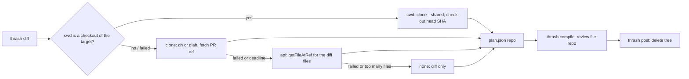

# 0042 — thrash: review from a scratch checkout of the PR head

Status: Accepted (implemented)
Date: 2026-11-12

## Context

- `thrash` reviews a diff. A reviewer that sees only the diff cannot check a caller, a type or a test that the diff does not show.
- A reviewer needs the code of the PR head. The working directory of the agent can hold another branch, uncommitted work, or another repository.
- The PR content is not trusted. A clone or a checkout can run a hook, a filter, a submodule update or an fsmonitor command from the PR.
- A review of a stack covers many PRs of one repository. One network clone for each PR is slow and costs bandwidth.
- A clone can fail, stall or be refused. The review must still finish.

## Decision

`thrash diff` builds a tree of the PR head in thrash scratch and records it as `repo: { root, headSha, source }` in plan.json. The code is
`pkg/skills-cli/src/thrash/checkout.ts`. `resolveCheckout` never throws. It tries four steps in this order and stops at the first that gives a tree:

1. **cwd.** When the working directory is in a git repository whose `origin` is the target repository, run `git clone --shared --no-checkout` of that
   repository into scratch and check out the PR head SHA. When the SHA is not in the objects, fetch it by the provider PR ref from the `origin` URL. The
   origin match reads `git config --get remote.origin.url`, not `git remote get-url`, because `get-url` expands `insteadOf` rules. The match compares
   host, owner and repo without case. Source is `cwd`.
2. **clone.** Clone the target through the provider CLI (`gh repo clone` or `glab repo clone`) at depth 1, then fetch the PR head by
   `refs/pull/<n>/head` or `refs/merge-requests/<n>/head`, so that a fork PR resolves. Source is `clone`.
3. **api.** When the diff has 50 or fewer text files that are not deleted, write each at the head SHA with `Provider.getFileAtRef`. Source is `api`.
4. **none.** Return `source: "none"` and an empty `root`. `thrash compile` then adds the note "Reviewed from the diff only" under `Review limits`.

A local target (`thrash diff .`) is the one case that reads a working tree in place. `root` is the git root and `source` is `cwd`. It runs no clone and
no git write command.

The PR head SHA comes from one `viewPullRequest` call in `writeDiff`. That call also feeds the context file. A call that fails, or gives no `headSha`,
gives `source: "none"` and does not change the exit code. `--no-repo` skips the checkout for `diff` and for `stack --diff`. Thrashley passes it.

`thrash stack --diff` makes one scratch clone for each repository before the per-PR work. Each open PR then gets a detached `git worktree` of that
clone at its own head SHA, added one at a time. When that clone fails, no PR runs its own network clone. The cwd step and the api step still run.

### Hardening and threat model

The config of the cwd repository is trusted: the user owns it. The PR content is not trusted. Every clone, fetch and checkout runs with `--no-tags`,
`--no-recurse-submodules`, `-c core.hooksPath=/dev/null`, `-c core.fsmonitor=false` and `-c core.symlinks=false`. The child environment is an allowlist
and sets `GIT_LFS_SKIP_SMUDGE=1` and `GIT_TERMINAL_PROMPT=0`. The code starts each process with `detached: true`. On a timeout it stops the process
group with `killProcessTree`.

Every git command that writes a work tree (`checkout`, `worktree add`) also runs with the top-level option
`--attr-source=4b825dc642cb6eb9a060e54bf8d69288fbee4904`, the empty tree. Git then ignores the `.gitattributes` of the PR, so a `* filter=x` line
cannot start a `filter.x.smudge` command from the user config. The code checks the head SHA against `^[0-9a-f]{40}([0-9a-f]{24})?$` before any
step and returns `source: "none"` for any other value. It puts `--end-of-options` before the SHA in `checkout` and `worktree add`.

`credential.helper` stays as the user set it. Clearing it makes the fetch of a PR head fail for a private repository over https. The prompt guard
stops a password prompt.

One deadline of `CLONE_TIMEOUT_MS` (120 s) covers the cwd step and the clone step together. When it ends, the code removes the partial tree and goes to
the api step. The api step skips an unsafe path (absolute, empty segment, NUL byte, `.git` segment, or a path outside the tree), a file above 1 MiB,
and runs at most 8 fetches at one time.

### Cleanup

`thrash compile` copies `repo` (with an absolute `root`) into the stored review file. `thrash post` reads `repo` only from that file. It deletes the
tree after a successful publish and in the dry-run branch. It deletes nothing after a failed publish or a refusal for a missing `--confirm`. It deletes
only a path whose `realpath` is inside `scratchDir("thrash")` and is not that directory, and it deletes that resolved path, not the input string. For a stack tree it runs `git worktree remove --force` and
`git worktree prune`, and it deletes the shared clone when only the main entry is left. The scratch TTL removes a tree that no `post` removed.

Scratch is scoped to the working directory. A `post` that runs in another directory than `diff` finds another scratch root, deletes nothing, and
leaves the tree to the TTL.

## Consequences

- **Accepted risk:** a second `stack --diff` on the same repository before the first `post` replaces the shared clone and breaks the worktrees of the
  first run. `post` still removes them.

- **Good:** the reviewer reads the real code at the head SHA, also for a fork PR and for a stack. `checkout.ts` returns a usable result for every
  failure, so `thrash diff` has the same exit code as before.
- **Good:** no step writes to the cwd repository. A user can review a PR while the working tree holds other work.
- **Good:** a stack costs one network clone for each repository.
- **Bad:** `git clone --shared` borrows the objects of the cwd repository. A `git gc --prune` in that repository can remove objects that the scratch
  tree needs. The checked-out files stay. A later git command in the tree can fail. The project accepts this risk, and the TTL bounds it.
- **Bad:** a local target tree is the working tree, so it can differ from `HEAD`. `headSha` is `git rev-parse HEAD` and does not describe uncommitted
  or untracked files.
- **Neutral:** the clone helpers in `pkg/channel-review` (`address.ts`, `automation/repo-job.ts`) are not hoisted. They clone a branch. This code
  fetches a head SHA into a detached tree and needs a deadline and a worktree mode. Hoist a shared helper when a third caller appears.

## Alternatives considered

- **Review from the diff only.** The reviewer cannot check what the diff does not show.
- **Read the working tree of the cwd.** It can hold another branch or uncommitted work.
- **`git worktree add` in the cwd repository.** It writes to the worktree list and the refs of the cwd repository.
- **Clone with `runShell`.** It has no process-group kill and no explicit environment, so a stalled clone or a hostile hook can outlive the review.
- **One clone for each PR in a stack.** It repeats the network cost for one repository.

## Diagrams

## References

- `pkg/skills-cli/src/thrash/checkout.ts`
- `pkg/skills-cli/src/thrash/index.ts`
- `pkg/skills-cli/src/provider/types.ts` (`Provider.getFileAtRef`)
- `pkg/channel-review/src/address.ts`
