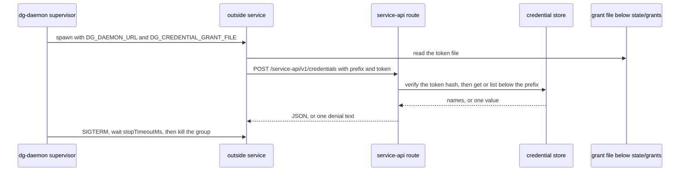

# 0043 — Run outside services under the daemon with a provisional service API

Status: Accepted
Date: 2026-11-12

## Context

- An outside service is a long-running program that dg does not ship, such as a bot or a watcher. The daemon already supervises such a program, but it gave the program no way to read its own credentials and no way to pass environment values on.
- A service has no dg session, so it cannot use the `/cli` socket. It must not need dg code either: a service in any language needs `fetch`, environment variables and one file read.
- The config path of a service lived in docs as `~/.dg`, which the per-OS layout of [ADR 0025](0025-per-os-layout.md) no longer uses.
- The daemon had no stop command. A user stopped it by reading `daemon.pid` and signaling the process, which skips the grace period of each service.
- `service add` had no command. A user edited `<state>/daemon/config.json` by hand, and a typo surfaced only at the next daemon start.

## Decision

The consumer is an outside service. This record accepts the design below. Service API v1 is provisional: a breaking change arrives as a new environment key or a v2 route, and the keys and route of v1 are not changed in place.

The daemon runs each declared service with the allowlist (`PATH`, `HOME`, `LANG`, `TZ`), then the `passEnv` names, then the `envFile` lines, then the injected keys `DG_SERVICE_API`, `DG_SERVICE_LABEL`, `DG_DAEMON_URL`, `DG_CREDENTIAL_GRANT_PREFIX` and `DG_CREDENTIAL_GRANT_FILE`. The injected keys win. `passEnv` values come from the environment of the process that started the daemon. A name that is absent logs a warning at each launch.

A service reads its credentials with `POST /service-api/v1/credentials` on the loopback daemon. The caller sends the grant prefix in `X-Dg-Grant-Prefix` and the token in `X-Dg-Grant-Token`. It reads the token from the file that `DG_CREDENTIAL_GRANT_FILE` names. The environment never holds a token. The route allows `get` and `list` below the prefix of the `grant` key. It refuses a browser `Origin`, keeps the `isBrowserOrigin` gate of `/cli` (so `Origin: null` passes, and a grant token is still required), and answers each denial with one text. No response and no log line echoes request body text or headers.

A service declares `grant`, `passEnv` and `stopTimeoutMs` (default 5000, maximum 240000) in the `services` table. `dg-daemon service add <label> --cwd <path> -- <command>` and `dg-daemon service rm <label>` write that table through `readConfigStrict` and `writeServiceEntry`. Both work with no daemon running.

`dg-daemon start` is idempotent. It shares `ensureDaemonRunning` with `dg-agent start`. `dg-daemon stop` sends SIGTERM and waits for the daemon. A regular shutdown waits for the `stopTimeoutMs` of each service, 240 s at most, so the command waits up to 255 s. `dg-daemon stop --force` gives no grace period: it kills the daemon and each service process tree at once. It does not kill a running job command or dispatch command. On Windows each stop is forced. `dg-daemon restart` stops the daemon, ends each session, and starts only the `autostart` services. It prints the real state, `started on` or `already running on`, and its new daemon has the environment of the caller.

## Consequences

- **Good:** a service in any language reads its credentials with `fetch` and one file read (`pkg/dg-daemon/src/server/service-api.ts`).
- **Good:** `service add` validates the entry with the same parser the daemon uses, so a bad entry fails at add time (`pkg/dg-daemon/src/services/config.ts`).
- **Good:** `dg-daemon stop` and `restart` replace the pid-file steps in the install guide (`pkg/dg-daemon/src/commands/stop.ts`).
- **Bad:** a grant limits the route to one prefix and is not a sandbox. A process of the same OS user can read each token file.
- **Bad:** a daemon that ran before the upgrade reports the new keys as `unknown key(s)` until `dg-daemon restart` runs.
- **Bad:** `--force` does not stop a job command or a dispatch command that runs at that time.
- **Neutral:** `Origin: null` passes the browser gate, as on `/cli`. The grant token is the control.
- **Neutral:** [ADR 0020](0020-one-dg-command.md) stays as it is, and ADRs 0008 to 0019 keep their status.

## Alternatives considered

- **A socket transport now.** The route needs only `fetch`. A later transport arrives as a new environment key.
- **A client library.** It forces a dg dependency on a service in any language.
- **A grant mint at spawn.** It gives each launch a new token and hides a missing grant until the service runs. The user mints the grant once instead.
- **A token value in the environment.** A child process and a crash report can leak it. The environment holds a file path.
- **An owner-gated shutdown route.** It adds a network route that stops the daemon. A signal needs no route.
- **A force signal that the daemon handles.** A hung daemon cannot handle it. The CLI kills the process trees itself.

## Diagrams

## References

- [ADR 0002](0002-daemon-hub.md) and [ADR 0006](0006-credential-store.md)
- `pkg/dg-daemon/src/services/config.ts`
- `pkg/dg-daemon/src/services/supervisor.ts`
- `pkg/dg-daemon/src/dispatch/exec.ts`
- `pkg/dg-daemon/src/server/service-api.ts`
- `pkg/dg-daemon/src/server/credentials.ts`
- `pkg/dg-daemon/src/commands/stop.ts`
- `pkg/common/src/node/daemon-start.ts`
- `pkg/common/src/chat-format.ts`
- [`docs/service-api.md`](../service-api.md)
