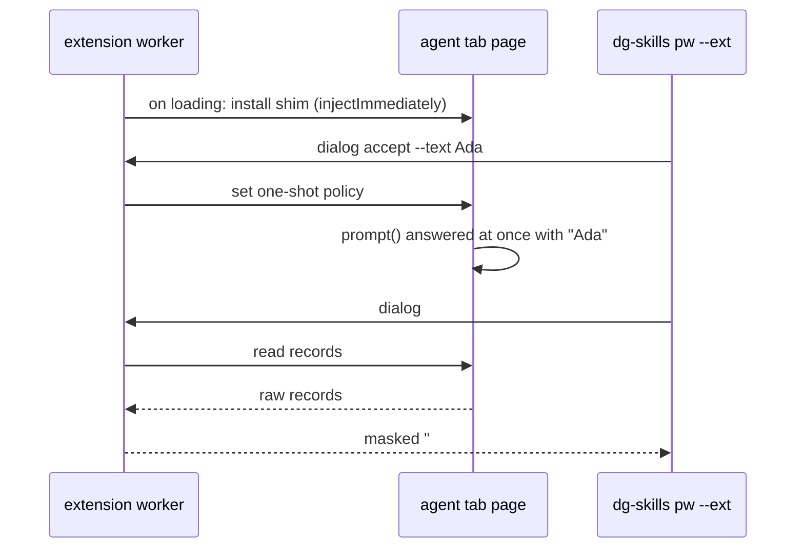

# 0044 — pw --ext: answer page dialogs with a shim in agent tabs

Status: Accepted (implemented)
Date: 2026-11-12

## Context

- `alert`, `confirm` and `prompt` stop the page's script until a person answers.
  In an agent tab, `scripting.executeScript` then waits too, so a `pw --ext`
  verb hangs until its relay deadline.
- Agents need to read the dialog text, and to accept or dismiss it. A `prompt`
  needs a text answer.
- The manifest has no `debugger` or `webNavigation` permission. A new
  permission makes Chrome ask each user again, and `debugger` also shows a
  "started debugging this browser" bar on each attach.
- `userScripts` is in the manifest, but it is not per tab and needs a user
  toggle. It cannot keep a shim out of the human's own tabs.
- [ADR 0035](0035-pw-ext-real-browser.md) keeps `pw --ext` in the agent's own
  tab group and away from a mailbox and browser pages.

## Decision

The worker puts a MAIN-world shim (`pwExtDialogs` in
`pkg/extension/lib/features/pw-ext-dialog-main.ts`) over `alert`, `confirm` and
`prompt` in an agent tab. It injects the shim with `injectImmediately` when a
tab of any agent group reports `loading` or `complete`, and again from the
`dialog` and `snapshot` verbs, which install it when it is missing. Each
injection checks the document URL, so a page that changed in between gets
nothing. When a tab leaves its agent group, the worker removes the shim and the
native dialogs come back. It never injects into a user tab, a private tab, a
mailbox origin or a browser page. The
shim answers each dialog at once from a one-shot policy: dismiss by default, or
the answer that `pw --ext dialog accept [--text <answer>]` or
`pw --ext dialog dismiss` set. Each new document starts again at dismiss. The
shim keeps the last 10 dialogs as raw, size-capped records. The worker
validates them, masks them like other page text, and shows them in `dialog` and
under `### Dialog` in `snapshot`. Page verbs that wait on the page stop after
15 seconds with an error that names a dialog the shim could not catch. An
extension that does not list `dialog` in its `pwExtVerbs` handshake refuses the
verb at once.

## Consequences

- **Good:** a dialog in an agent tab never hangs a verb, and no new permission
  is needed (`pkg/extension/lib/background/pw-ext.ts`).
- **Good:** the human's own tabs keep native dialogs.
- **Bad:** the agent cannot answer a dialog after it reads it. It sets the
  answer first and repeats the action that opens the dialog.
- **Bad:** a dialog that opens while a page loads, before the shim is in
  place, is native. The verb then stops at the 15 second page deadline and the
  human closes the dialog. Dialogs in a child frame are not caught.
- **Bad:** the shim runs in the page's own context. The page can read the
  policy, including `--text`, and can forge dialog records. `dialog accept
  --text` therefore refuses a value the session filled as a secret, and the
  worker treats the records as untrusted page text.
- **Neutral:** `onbeforeunload` prompts are not handled.

## Alternatives considered

- **`chrome.debugger` with `Page.javascriptDialogOpening`.** It holds the real
  dialog open until the agent answers. It needs the `debugger` permission, a
  new install prompt, and the debugging bar on every attach.
- **A static MAIN content script on all pages.** It would change `alert` in the
  human's own tabs, and it cannot know at once which tab is an agent tab.
- **`userScripts`.** Not per tab, and it needs a user toggle.

## Diagrams

## References

- `pkg/extension/lib/features/pw-ext-dialog-main.ts`
- `pkg/extension/lib/background/pw-ext.ts`
- `pkg/common/src/pw-ext-format.ts`
- `pkg/common/src/relay-features.ts`
- `pkg/skills-cli/src/pw/ext.ts`
- [ADR 0035](0035-pw-ext-real-browser.md), [ADR 0041](0041-pw-ext-unmask.md)
