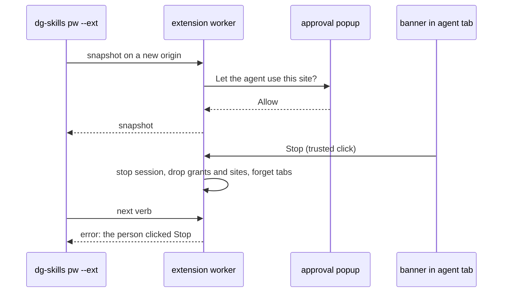

# 0045 — pw --ext: an "Agent is driving" banner with Stop, and a site allowlist per session

Status: Accepted (implemented)
Date: 2026-11-13

## Context

- Since the 2026-11-05 amendment of [ADR 0035](0035-pw-ext-real-browser.md),
  passing `--ext` is the grant. The browser asks for no approval per call.
- The person at the browser cannot see which tabs an agent drives, and has no
  way to take control back other than closing the tab group.
- An agent can open and act on any site. The person has no say per site.
- The person must be able to end a session's control at once, and a page
  script must not be able to do that for them or read the control.

## Decision

The worker shows an "Agent is driving this tab" banner with a Stop button in
each agent tab (`pwExtBanner` in `pkg/extension/lib/features/pw-ext-banner.ts`).
It runs in the extension's isolated world and puts its text in a closed shadow
root. The banner follows the same lifecycle as the dialog shim of
[ADR 0044](0044-pw-ext-dialogs.md) in `pkg/extension/lib/background/dialog-shim.ts`.
Only a trusted click on Stop sends a message to the worker. The worker accepts
it only from this extension and from a tab. It then stops the session that owns
the tab's group (`stop` in `pkg/extension/lib/background/pw-ext.ts`). Stop marks
the session stopped in `storage.session`, ends its verbs in flight, drops its
unmask and `dg_` grants and allowed sites, and forgets its agent tab record,
which removes the shim and the banner. Each later verb of that session fails
with an error that names Stop, until a new dg session starts.

The first verb on a new http or https origin in a session asks the person in
the approval popup of `pkg/extension/lib/background/approval.ts` to allow that
origin for the session. `open` and `new` ask for their target origin. Reads and
writes both need an allowed origin; `tabs`, `select` and `close` do not. Allowed
origins live per session in `storage.session`
(`pkg/extension/lib/background/session-control.ts`) and end with the session.
The mailbox guard runs first and does not change.

## Consequences

- **Good:** the person sees each agent tab and can end the session's control
  with one click.
- **Good:** the person decides, per site and per session, where an agent may
  read or write.
- **Bad:** the agent waits for a popup on each new site. A long task across
  many sites asks many times.
- **Bad:** a page can remove the banner element from its DOM. The worker shows
  it again on the next load or verb sync. A page cannot press Stop or read the
  banner text through the closed shadow root.
- **Bad:** work that a stopped verb already started in the page, such as a
  click, can still finish; only its result is dropped.
- **Bad:** while a page shows its own modal `<dialog>`, the rest of the page,
  the banner too, is inert, so Stop cannot be clicked until the modal closes.
  Closing the tab or its group still takes the tab back.
- **Bad:** a mailbox tab gets no banner, because the worker never injects into
  a mailbox origin. Only the WebMCP verbs that the mailbox guard lets through
  run there.
- **Neutral:** a Stop holds until the browser ends, so a session id that
  reconnects stays stopped. A new dg session has a new id.
- **Neutral:** no settings page; the allowlist lives only for the session.

## Alternatives considered

- **A settings page with a standing allowlist.** More UI, and a standing list
  outlives the task that needed it.
- **A banner in the page MAIN world.** Page scripts could read and press it.
- **Stop that only cancels the current verb.** The agent would retry at once;
  the person asked for the session to end.

## Diagrams

## References

- `pkg/extension/lib/features/pw-ext-banner.ts`
- `pkg/extension/lib/background/session-control.ts`
- `pkg/extension/lib/background/pw-ext.ts`
- `pkg/extension/lib/background/dialog-shim.ts`
- `pkg/extension/lib/background/daemon-link.ts`
- [ADR 0035](0035-pw-ext-real-browser.md), [ADR 0044](0044-pw-ext-dialogs.md)

## Amended 2026-11-13: Stop in the toolbar popup

A page's own modal `<dialog>` makes the banner inert, so Stop on the page cannot
be clicked. The toolbar popup now lists each session that drives agent tabs,
with its tab count and a Stop button. The popup sends a typed message
(`MSG.pwExtStop`). The worker accepts it only from this extension's own
`popup.html`, by sender id and URL, and only for a session that holds an agent
tab group. It then runs the same `stop` as the banner. The popup shows the
session as stopped after.

- `pkg/extension/lib/features/popup.ts`
- `pkg/extension/lib/background/popup-sender.ts`

## Amended 2026-11-13: one Allow per registrable domain

A sign-in moves between hosts of one company, for example `login.live.com`,
`account.live.com` and `outlook.live.com`. With one entry per origin, the person
clicked Allow for each host. Now the allowlist keys each site by scheme and
registrable domain (eTLD+1) from the Public Suffix List, with its private
section (`siteOf` in `pkg/extension/lib/background/site-key.ts`).

- One Allow covers every host of that domain for the session. A redirect to
  another host of an allowed domain does not ask again. A redirect to a new
  domain asks once on the next verb.
- Private suffixes stay apart: `a.github.io`, `b.github.io`, `*.vercel.app` and
  `*.azurewebsites.net` tenants are separate sites. `outlook.cloud.microsoft`
  and `microsoft.com` are separate sites.
- The scheme stays in the key, so `http` and `https` are separate sites. A
  grouped key has no port, so it covers every port of the domain. An IP
  address, `localhost`, a single-label host or a bare public suffix has no
  registrable domain; it keys by its exact origin, port included. A host with
  a trailing dot (`example.com.`) also keys by its exact origin, because the
  list lookup would read it as a bare top-level domain.
- Verbs that ask for one site of one session at the same time share one popup.
  After a Deny, the verbs that were sent before the answer fail without a new
  popup. A verb sent after the answer can ask again.
- The popup title names the domain ("Allow the agent on live.com and its
  subdomains for this session?") and lists the host that asked.
- The worker bundles `tldts` (pinned, with its `tldts-core` pinned through the
  root `overrides`). Only the background worker imports it. The options page
  no longer imports `pw-ext.ts`, so the list stays out of the extension pages
  and out of `pkg/pages`. The worker grows by about 270 KB.
- The mailbox guard, Stop and unmask grants do not change. Stop still drops the
  allowed sites. The "page changed while the site question was open" refusal
  stays, because the mailbox guard ran on the old page.
- Concurrent `dg_` tool calls that ask for one session grant now share one
  popup (`once` in `pkg/extension/lib/background/webmcp-approval.ts`). The grant
  scope stays session, origin, tool and tab group.

**Bad:** an Allow is wider than before. It covers hosts of the domain that the
person did not see, such as other subdomains of a large provider. The private
section of the list limits this for hosting platforms that give each customer a
subdomain.

- `pkg/extension/lib/background/site-key.ts`
- `pkg/extension/lib/background/pw-ext.ts`
- `pkg/extension/lib/background/webmcp-approval.ts`
