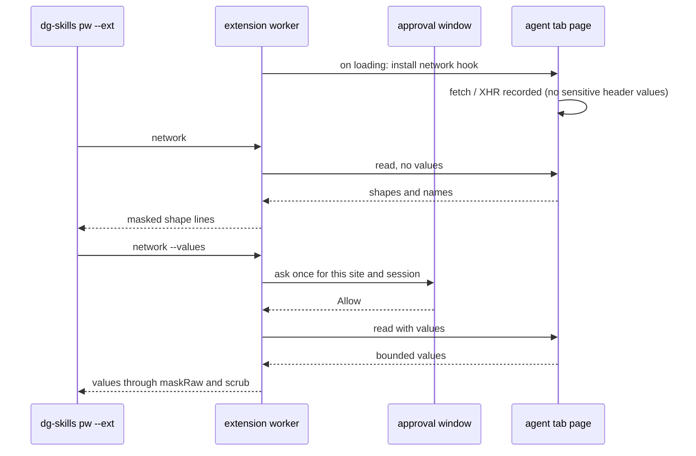

# 0046 — pw --ext: read the network calls of an agent tab, shape first

Status: Accepted (implemented)
Date: 2026-11-13

## Context

- The Outlook spike of spec 018 (PR #193,
  `.agents/references/webmcp-outlook-spike.md` on `spike/webmcp-outlook`) could
  not see Outlook's service calls. `pw --ext` had no network view, so every
  action name, header name and body key in that file is a guess.
- A network view shows data that can hold personal or health data: mail
  subjects, addresses, ids and tokens. Dante's rule: mask possible PII and PHI
  by default, and ask the user before a value is shown.
- Chrome's `webRequest` API gives header values but no response body, needs
  host permissions, and sees every tab, not one tab group. `chrome.debugger`
  with `Network.*` sees everything, but needs the `debugger` permission, a new
  install prompt, and a debugging bar on every attach. A body can be read only
  in the page or through the debugger.
- [ADR 0044](0044-pw-ext-dialogs.md) already puts a MAIN-world shim in each
  agent tab with fixed ownership and lifecycle rules.
  [ADR 0041](0041-pw-ext-unmask.md) asks the user in the extension's own
  approval window before email addresses are shown.
  [ADR 0045](0045-pw-ext-driving-banner-and-sites.md) keeps a per-session site
  allowlist and Stop.

## Decision

Add the read verb `pw --ext network [--filter <text>] [--limit N]
[--since <ms>|clear] [--values]`.

**Capture.** A MAIN-world hook (`pwExtNetwork` in
`pkg/extension/lib/features/pw-ext-network-main.ts`) wraps `window.fetch` and
`XMLHttpRequest.prototype.open`, `setRequestHeader` and `send`. The worker
injects it next to the dialog shim, through the same `syncDialogShim` path in
`pkg/extension/lib/background/dialog-shim.ts`. It thus has the same ownership
and lifecycle: agent tabs only; never a user tab, a private tab, a mailbox
origin or a browser page; removed when the tab leaves its group or the session
ends; removal is final for that document; the buffer clears when the tab goes
to another session. The fetch wrapper returns the page's own promise, reads a
`clone()` of a readable response up to 1 MiB, and then cancels the clone. Each
page keeps a ring of the newest 100 calls. Each entry holds the method, the
full address, the status, header names, header values up to 512 characters,
body text up to 8000 characters, and the JSON key structure of the body. The
hook never stores the value of a header whose name holds auth, cookie, token,
secret, api-key, session, canary, csrf, xsrf, credential, password or
signature, so `Authorization`, `Cookie`, `Set-Cookie` and `X-OWA-CANARY` values
are never captured.

**Default output: shape only.** The worker asks the hook for a read without
values, so no value leaves the page. `formatNetwork` in
`pkg/common/src/pw-ext-network.ts` prints, per call: time, `fetch` or `xhr`,
method, the shape address, status, header names, and per body the content
type, size and JSON key structure with value types (`[n x <shape>]` for an
array). The shape address drops user info, the fragment and every query value
(`name=*`). It masks a path part or a key that looks like a generated id
(`looksLikeOpaqueId`) as `*`. A conservative allowlist keeps the value of only
`action` and `app`, and only when it is a plain API name
(`^[A-Za-z][A-Za-z0-9_]{0,63}$` and not id-like), such as `FindConversation`.
`--filter` matches the shape address, never the raw address, so a filter
cannot test for a hidden value.

**Values: one Allow per site and session.** `--values` first checks a values
grant in `storage.session` (`pkg/extension/lib/background/session-control.ts`).
With no grant, the worker asks once in the approval window of
`pkg/extension/lib/background/approval.ts`. The popup says that request and
response values, which can hold personal or health data, will be shown to the
agent, and that it lasts until the session ends or Stop. Concurrent asks share
one popup. An Allow lasts for the rest of that dg session on that site. It has
no time limit and never asks again in the session. It ends on Stop (banner or
toolbar) and at the session end, next to the site allowlist. Deny, a closed
window, no answer in 60 seconds, or a window that does not open refuses the
verb with a message that names the approval window, and the page is not read.
The grant key is the origin today (`valuesSiteOf` in `pw-ext.ts`); it moves to
the registrable-domain site key when PR #191 lands. There is no UI to remove
one grant yet; Stop removes all of them.

**Masking.** Every shown value goes through `maskRaw`, the same span-union
redaction as other `pw --ext` output (held secrets, token patterns, and email
addresses unless an unmask grant covers the site). A value the page cut ends in
an ellipsis, so the worker also masks the word at the cut. A sensitive header
shows as `name (hidden)`. The whole text then goes through `shown()` and
`scrub()` like every other verb. MAIN never gets held secrets.

**Guards.** `network` is a page verb: it is refused on browser pages, private
tabs and mailbox origins (Proton today), on a discarded tab, and on a site the
session has not allowed. It joins `PW_EXT_LISTED_VERBS`, so an older extension
refuses it at once.

**`count` ids.** `count` printed opaque ids such as OWA element ids. It now
prints `[redacted]` for an `id` or `name` value that passes
`looksLikeOpaqueId`, and keeps readable ones so it stays useful to test a
selector. `snapshot` never prints these attributes.

## Consequences

- **Good:** the agent learns endpoint names, header names and body keys with no
  value shown and no new permission.
- **Good:** values need one click by the person, once per site and session.
- **Good:** sign-in header values never enter the buffer, so neither a page
  script nor a values read can get them through the hook.
- **Bad:** the hook installs when the tab reports `loading`, with
  `injectImmediately`. Calls that a page makes before that, and calls through a
  `fetch` reference the page saved before that, are missed. `open` the same
  address to load the page again with the hook in place.
- **Bad:** only the top frame is hooked. Calls from frames, workers and service
  workers are not seen. WebSocket and `sendBeacon` are not seen.
- **Bad:** the buffer is per document, in the page's own context, under a
  `Symbol.for` key. A same-origin page script can read it, but it holds only
  what the page already had, minus sensitive header values. A page script can
  also forge entries; the worker validates them as untrusted page data.
- **Bad:** a long response body is read up to 1 MiB through a clone. A stream
  that never ends holds that clone open until the page closes.
- **Neutral:** a values grant has no time box, by Dante's decision. The first
  draft asked for a time-boxed grant like unmask; the clarification replaced
  it with one ask per session.
- **Neutral (Outlook):** Outlook is not in `mailbox()` today, so `network`
  works on Outlook now. When slice 4 of spec 018 adds Outlook to `mailbox()`,
  `network` there needs the new `area` approval (R-10), or it stays blocked.
  This ADR does not build `area`.

## Alternatives considered

- **`webRequest` / `declarativeNetRequest`.** No response body, not per tab
  group, and host permissions for every site.
- **`chrome.debugger` `Network` domain.** Complete, but a new install prompt
  and a debugging bar on each attach.
- **A static MAIN content script on all pages at `document_start`.** It sees
  boot calls, but it would wrap `fetch` in the person's own tabs and cannot
  know at once which tab is an agent tab.
- **Shape computed in the worker from stored raw bodies.** The page would have
  to send whole bodies to the worker on every read. The hook computes the key
  structure at capture time and keeps only bounded text.
- **A time-boxed values grant.** Rejected by Dante: ask once per session.

## Diagrams

## References

- `pkg/extension/lib/features/pw-ext-network-main.ts`
- `pkg/extension/lib/background/dialog-shim.ts`
- `pkg/extension/lib/background/pw-ext.ts`
- `pkg/extension/lib/background/session-control.ts`
- `pkg/extension/lib/features/pw-ext-page.ts`
- `pkg/common/src/pw-ext-network.ts`
- `pkg/common/src/pw-ext-format.ts`
- `pkg/common/src/relay-features.ts`
- `pkg/skills-cli/src/pw/ext.ts`
- [ADR 0041](0041-pw-ext-unmask.md), [ADR 0044](0044-pw-ext-dialogs.md),
  [ADR 0045](0045-pw-ext-driving-banner-and-sites.md)
