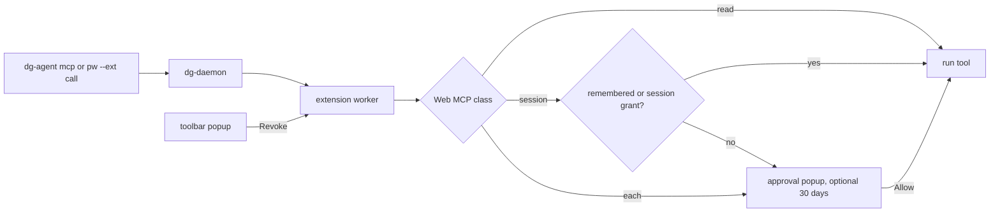

# 0046 — Web MCP approvals apart from pw --ext browser control

Status: Proposed
Date: 2026-11-13

## Context

- Web MCP `dg_` tool calls run through the pw --ext `call` verb
  ([ADR 0035](0035-pw-ext-real-browser.md)). They inherited the pw --ext
  controls of [ADR 0045](0045-pw-ext-driving-banner-and-sites.md): the site
  allowlist gated them, and Stop dropped their grants.
- Web MCP session grants were keyed by session, origin, tool and tab group. A
  grant given in one tab group did not hold in another tab of the same site.
- The person could not see or revoke a Web MCP grant apart from a pw --ext Stop.
- Spec 018 R-13 (2026-11-13): Web MCP and browser control with pw --ext are
  two separate things. R-14 (2026-11-13): Web MCP approvals offer an optional
  30-day grant that the person can revoke.
- A site tool without a `dg_` name had no Web MCP approval at all. The site
  allowlist was its only gate.

## Decision

Web MCP has its own approvals only. `tools` and `call` skip the pw --ext site
question (`NO_SITE_ASK` in `pkg/extension/lib/background/pw-ext.ts`). Before a
call, `requestWebMcpApproval` in
`pkg/extension/lib/background/webmcp-approval.ts` applies the tool's class:
`read` runs, `session` asks once per MCP session, site and tool, and `each`
asks every time. A tool with no `dg_` name is now `each`. The site is the
registrable-domain key of `siteOf` in
`pkg/extension/lib/background/site-key.ts`; no tab group is part of the key. A
`session` approval popup offers an unticked "Remember for 30 days" checkbox.
When the person ticks it, the worker stores the site and tool, the approval
time and the expiry time in `storage.local`, with an HMAC from the
non-extractable key of `pkg/extension/lib/background/webmcp-signing.ts` over a
`webmcp-grant:v1` payload. A remembered grant holds for every session until it
expires; use does not extend it. pw --ext Stop no longer drops Web MCP grants.
Session grants still end with the dg session (`forgetAgentTabs` in
`pkg/extension/lib/background/daemon-link.ts`). The toolbar popup
(`pkg/extension/lib/features/popup.ts`) lists session and remembered grants
with Revoke and Revoke all. The worker answers those messages only from the
extension's own `popup.html` (`isOwnPageSender`).

## Consequences

- **Good:** one Allow for a `session` tool covers every agent tab of that site
  in the session, and the person can keep it for 30 days.
- **Good:** the person sees each Web MCP grant and can revoke it without
  stopping browser control.
- **Good:** a site's own WebMCP tool now asks every time; before, one site
  Allow let it run with no further question.
- **Bad:** a `read` `dg_` tool, such as `dg_outlook_read`, now runs with no
  question at all. The person's consent is enabling the built-in script. The
  `area` class of R-10 is the planned seam for a per-area ask.
- **Bad:** a remembered grant covers every agent session for 30 days. A content
  script can read or delete the record in `storage.local`, but it cannot forge
  or extend one without the key.
- **Neutral:** after Stop the session's tabs return to the person and every
  verb fails, so its Web MCP grants stay but have no tab to run in until the
  session ends.
- **Neutral:** the HMAC key is shared with script approvals. The
  `webmcp-grant:v1` prefix keeps a grant MAC apart from a script MAC, which
  signs a JSON array.

## Alternatives considered

- **Keep the site allowlist as a second gate for Web MCP.** R-13 rejects it:
  the two features must not depend on each other.
- **Remember `each` tools too.** R-14 rejects it: send, delete and other
  high-risk tools always ask.
- **Store remembered grants unsigned.** Content scripts can write
  `storage.local`, so an unsigned record could be forged.

## Diagrams

## References

- `pkg/extension/lib/background/webmcp-approval.ts`
- `pkg/extension/lib/background/pw-ext.ts`
- `pkg/extension/lib/background/approval.ts`
- `pkg/extension/lib/background/daemon-link.ts`
- `pkg/extension/lib/features/popup.ts`
- `pkg/extension/entrypoints/approve/main.ts`
